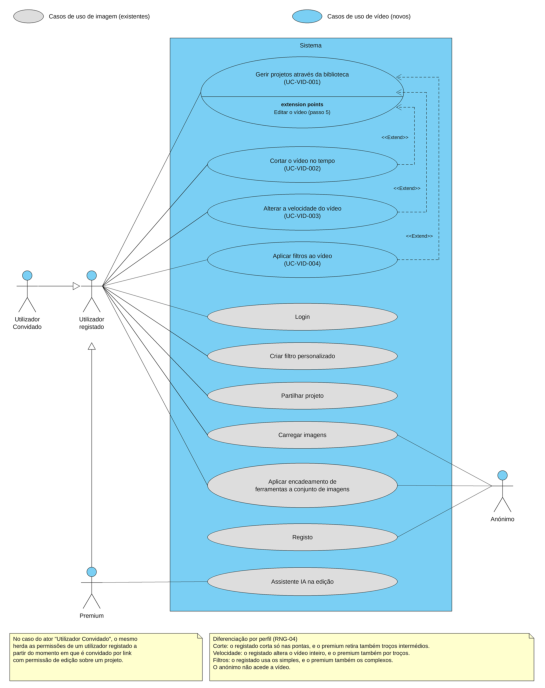
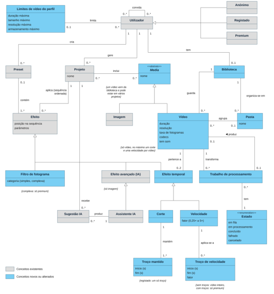
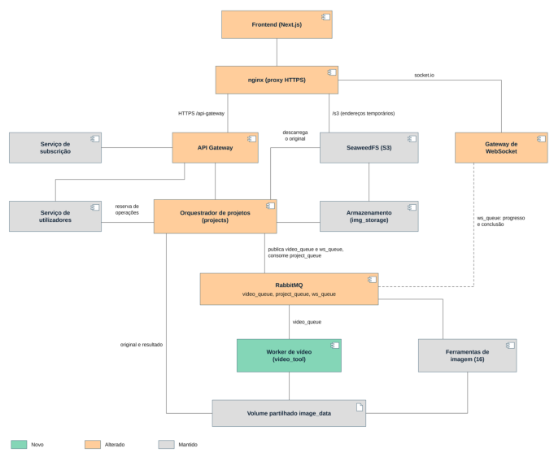
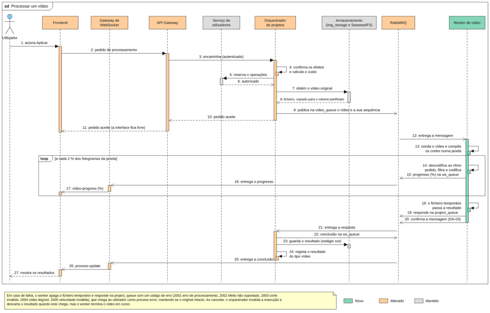

<!-- Conversão de doc-ext-requisitos-2627.pdf para Markdown; numeração de página e conteúdo original preservados na medida do possível. -->

<!-- Página 1 do PDF -->

Universidade do Minho Escola de Engenharia Mestrado em Engenharia Informática

Unidade Curricular de Requisitos e Arquiteturas de Software 2026/2027

## Fase 1: Suporte a Vídeo Requisitos, Arquitetura, Implementação e Validação do MVP

## Grupo 4

## Gonçalo Castro pg63966

## Martim Ribeiro pg62409

## Nuno Campelo pg61468

## Pedro Ribeiro pg64019

## Outubro, 2026

## RAS

<!-- Página 2 do PDF -->

| Data da Receção |  |
| --- | --- |
| Responsável |  |
| Avaliação |  |
| Observações |  |

## Fase 1: Suporte a Vídeo Requisitos, Arquitetura, Implementação e Validação do MVP

## Gonçalo Castro pg63966

## Martim Ribeiro pg62409

## Nuno Campelo pg61468

## Pedro Ribeiro pg64019

## Outubro, 2026

<!-- Página 3 do PDF -->

Histórico de versões

Regista-se abaixo a evolução do documento ao longo das aulas, desde a primeira versão dos casos de uso até à versão entregue da Fase 1.

| Versão | Data | Alterações | Autores |
| --- | --- | --- | --- |
| v1.0 | 2026-09-30 | Primeira versão dos casos de uso de vídeo | Grupo 4 |
| v1.1 | 2026-10-07 | Especificação dos casos de uso e dos requisitos | Grupo 4 |
| v1.2 | 2026-10-18 | Implementação do MVP e atualização da arquitetura | Grupo 4 |
| v1.3 | 2026-10-19 | Testes, validação e estado de realização dos requisitos | Grupo 4 |
| v1.4 | 2026-10-19 | Aprofundamento dos casos de uso e diagramas atualizados | Grupo 4 |
| v1.5 | 2026-10-20 | Velocidade do vídeo na edição | Grupo 4 |
| v1.6 | 2026-10-20 | Revisão geral, rastreabilidade e impacto na solução de base | Grupo 4 |
| v1.7 | 2026-10-21 | Casos de uso reestruturados segundo a orientação docente, com um caso de uso geral de gestão de projetos através da biblioteca e as ferramentas de corte, velocidade e filtros como extensões diferenciadas por perfil, requisitos reorganizados e renumerados sem lacunas e estado de realização revisto contra o código | Grupo 4 |
| v2.0 | 2026-10-23 | Revisão fni al e versão entregue | Grupo 4 |

<!-- Página 4 do PDF -->

Índice

1. Introdução . . . . . . . . . . . . . . . . . . . . . . . . . . . . . . . . . . . . . . . . . . . . . . . . . . . . . . . . . . . . . . . . . . . . . . . . . . . . . . . . . . . . . . . . . ⁠1 1.1. Propósito do incremento . . . . . . . . . . . . . . . . . . . . . . . . . . . . . . . . . . . . . . . . . . . . . . . . . . . . . . . . . . . . . . . . . . . . . ⁠1 1.2. Baseline e repositório . . . . . . . . . . . . . . . . . . . . . . . . . . . . . . . . . . . . . . . . . . . . . . . . . . . . . . . . . . . . . . . . . . . . . . . . ⁠1 1.3. Resumo do trabalho realizado . . . . . . . . . . . . . . . . . . . . . . . . . . . . . . . . . . . . . . . . . . . . . . . . . . . . . . . . . . . . . . . . ⁠1 1.4. Organização do documento . . . . . . . . . . . . . . . . . . . . . . . . . . . . . . . . . . . . . . . . . . . . . . . . . . . . . . . . . . . . . . . . . . ⁠2 2. Contexto, Perfis e Stakeholders (revisão) . . . . . . . . . . . . . . . . . . . . . . . . . . . . . . . . . . . . . . . . . . . . . . . . . . . . . . . . . . . . ⁠3 2.1. Perfis de utilização e vídeo . . . . . . . . . . . . . . . . . . . . . . . . . . . . . . . . . . . . . . . . . . . . . . . . . . . . . . . . . . . . . . . . . . . ⁠3 2.2. Stakeholders e interesses . . . . . . . . . . . . . . . . . . . . . . . . . . . . . . . . . . . . . . . . . . . . . . . . . . . . . . . . . . . . . . . . . . . . . ⁠3 2.3. Elicitação de requisitos . . . . . . . . . . . . . . . . . . . . . . . . . . . . . . . . . . . . . . . . . . . . . . . . . . . . . . . . . . . . . . . . . . . . . . . ⁠4 3. Visão Geral da Extensão de Vídeo . . . . . . . . . . . . . . . . . . . . . . . . . . . . . . . . . . . . . . . . . . . . . . . . . . . . . . . . . . . . . . . . . . . ⁠5 3.1. Funcionalidades de vídeo do MVP . . . . . . . . . . . . . . . . . . . . . . . . . . . . . . . . . . . . . . . . . . . . . . . . . . . . . . . . . . . . ⁠5 3.2. Diagrama de casos de uso . . . . . . . . . . . . . . . . . . . . . . . . . . . . . . . . . . . . . . . . . . . . . . . . . . . . . . . . . . . . . . . . . . . . ⁠6 3.3. Modelo de domínio . . . . . . . . . . . . . . . . . . . . . . . . . . . . . . . . . . . . . . . . . . . . . . . . . . . . . . . . . . . . . . . . . . . . . . . . . . ⁠8 3.4. Regras de negócio transversais . . . . . . . . . . . . . . . . . . . . . . . . . . . . . . . . . . . . . . . . . . . . . . . . . . . . . . . . . . . . . . . ⁠9 3.5. Convenções de identificação . . . . . . . . . . . . . . . . . . . . . . . . . . . . . . . . . . . . . . . . . . . . . . . . . . . . . . . . . . . . . . . . . . ⁠9 4. Casos de Uso . . . . . . . . . . . . . . . . . . . . . . . . . . . . . . . . . . . . . . . . . . . . . . . . . . . . . . . . . . . . . . . . . . . . . . . . . . . . . . . . . . . . . . ⁠11 4.1. UC-VID-001: Gerir projetos através da biblioteca . . . . . . . . . . . . . . . . . . . . . . . . . . . . . . . . . . . . . . . . . . . . . ⁠11 4.1.1. Cabeçalho . . . . . . . . . . . . . . . . . . . . . . . . . . . . . . . . . . . . . . . . . . . . . . . . . . . . . . . . . . . . . . . . . . . . . . . . . . ⁠11 4.1.2. Fluxo Principal . . . . . . . . . . . . . . . . . . . . . . . . . . . . . . . . . . . . . . . . . . . . . . . . . . . . . . . . . . . . . . . . . . . . . . ⁠12 4.1.3. Fluxos Alternativos . . . . . . . . . . . . . . . . . . . . . . . . . . . . . . . . . . . . . . . . . . . . . . . . . . . . . . . . . . . . . . . . . . ⁠13 4.1.4. Exceções . . . . . . . . . . . . . . . . . . . . . . . . . . . . . . . . . . . . . . . . . . . . . . . . . . . . . . . . . . . . . . . . . . . . . . . . . . . . ⁠14 4.1.5. Pós-condições . . . . . . . . . . . . . . . . . . . . . . . . . . . . . . . . . . . . . . . . . . . . . . . . . . . . . . . . . . . . . . . . . . . . . . ⁠15 4.1.6. Regras de Negócio e Restrições . . . . . . . . . . . . . . . . . . . . . . . . . . . . . . . . . . . . . . . . . . . . . . . . . . . . . ⁠15 4.1.7. Assunções . . . . . . . . . . . . . . . . . . . . . . . . . . . . . . . . . . . . . . . . . . . . . . . . . . . . . . . . . . . . . . . . . . . . . . . . . . ⁠16 4.1.8. Questões em Aberto . . . . . . . . . . . . . . . . . . . . . . . . . . . . . . . . . . . . . . . . . . . . . . . . . . . . . . . . . . . . . . . . ⁠16 4.1.9. Cenário Concreto . . . . . . . . . . . . . . . . . . . . . . . . . . . . . . . . . . . . . . . . . . . . . . . . . . . . . . . . . . . . . . . . . . . ⁠17 4.1.10. Requisitos Relacionados e Estado de Realização . . . . . . . . . . . . . . . . . . . . . . . . . . . . . . . . . . . . . ⁠17 4.2. UC-VID-002: Cortar o vídeo no tempo . . . . . . . . . . . . . . . . . . . . . . . . . . . . . . . . . . . . . . . . . . . . . . . . . . . . . . . ⁠19 4.2.1. Cabeçalho . . . . . . . . . . . . . . . . . . . . . . . . . . . . . . . . . . . . . . . . . . . . . . . . . . . . . . . . . . . . . . . . . . . . . . . . . . ⁠19 4.2.2. Fluxo Principal . . . . . . . . . . . . . . . . . . . . . . . . . . . . . . . . . . . . . . . . . . . . . . . . . . . . . . . . . . . . . . . . . . . . . . ⁠19 4.2.3. Fluxos Alternativos . . . . . . . . . . . . . . . . . . . . . . . . . . . . . . . . . . . . . . . . . . . . . . . . . . . . . . . . . . . . . . . . . . ⁠20 4.2.4. Exceções . . . . . . . . . . . . . . . . . . . . . . . . . . . . . . . . . . . . . . . . . . . . . . . . . . . . . . . . . . . . . . . . . . . . . . . . . . . . ⁠20 4.2.5. Pós-condições . . . . . . . . . . . . . . . . . . . . . . . . . . . . . . . . . . . . . . . . . . . . . . . . . . . . . . . . . . . . . . . . . . . . . . ⁠21 4.2.6. Regras de Negócio e Restrições . . . . . . . . . . . . . . . . . . . . . . . . . . . . . . . . . . . . . . . . . . . . . . . . . . . . . ⁠21 4.2.7. Diferenciação por perfil . . . . . . . . . . . . . . . . . . . . . . . . . . . . . . . . . . . . . . . . . . . . . . . . . . . . . . . . . . . . . ⁠21 4.2.8. Validação do corte . . . . . . . . . . . . . . . . . . . . . . . . . . . . . . . . . . . . . . . . . . . . . . . . . . . . . . . . . . . . . . . . . . ⁠22 4.2.9. Assunções . . . . . . . . . . . . . . . . . . . . . . . . . . . . . . . . . . . . . . . . . . . . . . . . . . . . . . . . . . . . . . . . . . . . . . . . . . ⁠22 4.2.10. Questões em Aberto . . . . . . . . . . . . . . . . . . . . . . . . . . . . . . . . . . . . . . . . . . . . . . . . . . . . . . . . . . . . . . . . ⁠22 4.2.11. Cenário Concreto . . . . . . . . . . . . . . . . . . . . . . . . . . . . . . . . . . . . . . . . . . . . . . . . . . . . . . . . . . . . . . . . . . . ⁠23 4.2.12. Requisitos Relacionados e Estado de Realização . . . . . . . . . . . . . . . . . . . . . . . . . . . . . . . . . . . . . ⁠23 4.3. UC-VID-003: Alterar a velocidade do vídeo . . . . . . . . . . . . . . . . . . . . . . . . . . . . . . . . . . . . . . . . . . . . . . . . . . ⁠24 4.3.1. Cabeçalho . . . . . . . . . . . . . . . . . . . . . . . . . . . . . . . . . . . . . . . . . . . . . . . . . . . . . . . . . . . . . . . . . . . . . . . . . . ⁠24 4.3.2. Fluxo Principal . . . . . . . . . . . . . . . . . . . . . . . . . . . . . . . . . . . . . . . . . . . . . . . . . . . . . . . . . . . . . . . . . . . . . . ⁠25 4.3.3. Fluxos Alternativos . . . . . . . . . . . . . . . . . . . . . . . . . . . . . . . . . . . . . . . . . . . . . . . . . . . . . . . . . . . . . . . . . . ⁠25 4.3.4. Exceções . . . . . . . . . . . . . . . . . . . . . . . . . . . . . . . . . . . . . . . . . . . . . . . . . . . . . . . . . . . . . . . . . . . . . . . . . . . . ⁠25 4.3.5. Pós-condições . . . . . . . . . . . . . . . . . . . . . . . . . . . . . . . . . . . . . . . . . . . . . . . . . . . . . . . . . . . . . . . . . . . . . . ⁠26 4.3.6. Regras de Negócio e Restrições . . . . . . . . . . . . . . . . . . . . . . . . . . . . . . . . . . . . . . . . . . . . . . . . . . . . . ⁠26 4.3.7. Diferenciação por perfil . . . . . . . . . . . . . . . . . . . . . . . . . . . . . . . . . . . . . . . . . . . . . . . . . . . . . . . . . . . . . ⁠26 4.3.8. Assunções . . . . . . . . . . . . . . . . . . . . . . . . . . . . . . . . . . . . . . . . . . . . . . . . . . . . . . . . . . . . . . . . . . . . . . . . . . ⁠27

<!-- Página 5 do PDF -->

4.3.9. Questões em Aberto . . . . . . . . . . . . . . . . . . . . . . . . . . . . . . . . . . . . . . . . . . . . . . . . . . . . . . . . . . . . . . . . ⁠27 4.3.10. Cenário Concreto . . . . . . . . . . . . . . . . . . . . . . . . . . . . . . . . . . . . . . . . . . . . . . . . . . . . . . . . . . . . . . . . . . . ⁠27 4.3.11. Requisitos Relacionados e Estado de Realização . . . . . . . . . . . . . . . . . . . . . . . . . . . . . . . . . . . . . ⁠28 4.4. UC-VID-004: Aplicar filtros ao vídeo . . . . . . . . . . . . . . . . . . . . . . . . . . . . . . . . . . . . . . . . . . . . . . . . . . . . . . . . . ⁠28 4.4.1. Cabeçalho . . . . . . . . . . . . . . . . . . . . . . . . . . . . . . . . . . . . . . . . . . . . . . . . . . . . . . . . . . . . . . . . . . . . . . . . . . ⁠28 4.4.2. Fluxo Principal . . . . . . . . . . . . . . . . . . . . . . . . . . . . . . . . . . . . . . . . . . . . . . . . . . . . . . . . . . . . . . . . . . . . . . ⁠29 4.4.3. Fluxos Alternativos . . . . . . . . . . . . . . . . . . . . . . . . . . . . . . . . . . . . . . . . . . . . . . . . . . . . . . . . . . . . . . . . . . ⁠29 4.4.4. Exceções . . . . . . . . . . . . . . . . . . . . . . . . . . . . . . . . . . . . . . . . . . . . . . . . . . . . . . . . . . . . . . . . . . . . . . . . . . . . ⁠30 4.4.5. Pós-condições . . . . . . . . . . . . . . . . . . . . . . . . . . . . . . . . . . . . . . . . . . . . . . . . . . . . . . . . . . . . . . . . . . . . . . ⁠30 4.4.6. Regras de Negócio e Restrições . . . . . . . . . . . . . . . . . . . . . . . . . . . . . . . . . . . . . . . . . . . . . . . . . . . . . ⁠30 4.4.7. Diferenciação por perfil e catálogo de filtros . . . . . . . . . . . . . . . . . . . . . . . . . . . . . . . . . . . . . . . . . ⁠31 4.4.8. Assunções . . . . . . . . . . . . . . . . . . . . . . . . . . . . . . . . . . . . . . . . . . . . . . . . . . . . . . . . . . . . . . . . . . . . . . . . . . ⁠32 4.4.9. Questões em Aberto . . . . . . . . . . . . . . . . . . . . . . . . . . . . . . . . . . . . . . . . . . . . . . . . . . . . . . . . . . . . . . . . ⁠32 4.4.10. Cenário Concreto . . . . . . . . . . . . . . . . . . . . . . . . . . . . . . . . . . . . . . . . . . . . . . . . . . . . . . . . . . . . . . . . . . . ⁠32 4.4.11. Requisitos Relacionados e Estado de Realização . . . . . . . . . . . . . . . . . . . . . . . . . . . . . . . . . . . . . ⁠32 5. Especificação de Requisitos do Sistema (ERS) . . . . . . . . . . . . . . . . . . . . . . . . . . . . . . . . . . . . . . . . . . . . . . . . . . . . . . ⁠34 5.1. Requisitos Funcionais . . . . . . . . . . . . . . . . . . . . . . . . . . . . . . . . . . . . . . . . . . . . . . . . . . . . . . . . . . . . . . . . . . . . . . . ⁠34 5.1.1. Biblioteca e projetos (UC-VID-001) . . . . . . . . . . . . . . . . . . . . . . . . . . . . . . . . . . . . . . . . . . . . . . . . . . ⁠34 5.1.2. Ferramenta de corte (UC-VID-002) . . . . . . . . . . . . . . . . . . . . . . . . . . . . . . . . . . . . . . . . . . . . . . . . . . ⁠36 5.1.3. Ferramenta de velocidade (UC-VID-003) . . . . . . . . . . . . . . . . . . . . . . . . . . . . . . . . . . . . . . . . . . . . . ⁠37 5.1.4. Ferramenta de filtros (UC-VID-004) . . . . . . . . . . . . . . . . . . . . . . . . . . . . . . . . . . . . . . . . . . . . . . . . . . ⁠39 5.1.5. Áreas de serviço partilhadas . . . . . . . . . . . . . . . . . . . . . . . . . . . . . . . . . . . . . . . . . . . . . . . . . . . . . . . . ⁠40 5.2. Requisitos Não Funcionais e de Qualidade . . . . . . . . . . . . . . . . . . . . . . . . . . . . . . . . . . . . . . . . . . . . . . . . . . . ⁠45 5.3. Verificação da completude e dos limites do âmbito . . . . . . . . . . . . . . . . . . . . . . . . . . . . . . . . . . . . . . . . . . ⁠47 6. Impacto no Sistema Existente . . . . . . . . . . . . . . . . . . . . . . . . . . . . . . . . . . . . . . . . . . . . . . . . . . . . . . . . . . . . . . . . . . . . . . ⁠49 6.1. Conflitos entre funcionalidades . . . . . . . . . . . . . . . . . . . . . . . . . . . . . . . . . . . . . . . . . . . . . . . . . . . . . . . . . . . . . . ⁠51 7. Rastreabilidade . . . . . . . . . . . . . . . . . . . . . . . . . . . . . . . . . . . . . . . . . . . . . . . . . . . . . . . . . . . . . . . . . . . . . . . . . . . . . . . . . . . . ⁠52 7.1. Casos de uso → requisitos . . . . . . . . . . . . . . . . . . . . . . . . . . . . . . . . . . . . . . . . . . . . . . . . . . . . . . . . . . . . . . . . . . . ⁠52 7.2. Decisões de qualidade . . . . . . . . . . . . . . . . . . . . . . . . . . . . . . . . . . . . . . . . . . . . . . . . . . . . . . . . . . . . . . . . . . . . . . ⁠56 7.3. Realização e verificação dos requisitos . . . . . . . . . . . . . . . . . . . . . . . . . . . . . . . . . . . . . . . . . . . . . . . . . . . . . . . ⁠56 8. Alterações Arquiteturais . . . . . . . . . . . . . . . . . . . . . . . . . . . . . . . . . . . . . . . . . . . . . . . . . . . . . . . . . . . . . . . . . . . . . . . . . . . ⁠62 8.1. Visão geral das alterações . . . . . . . . . . . . . . . . . . . . . . . . . . . . . . . . . . . . . . . . . . . . . . . . . . . . . . . . . . . . . . . . . . . ⁠62 8.2. Decisões arquiteturais . . . . . . . . . . . . . . . . . . . . . . . . . . . . . . . . . . . . . . . . . . . . . . . . . . . . . . . . . . . . . . . . . . . . . . . ⁠63 8.3. Fluxo de processamento de vídeo . . . . . . . . . . . . . . . . . . . . . . . . . . . . . . . . . . . . . . . . . . . . . . . . . . . . . . . . . . . ⁠65 8.4. Impacto previsto das funcionalidades por implementar . . . . . . . . . . . . . . . . . . . . . . . . . . . . . . . . . . . . . . ⁠67 8.5. Impacto na instalação e execução . . . . . . . . . . . . . . . . . . . . . . . . . . . . . . . . . . . . . . . . . . . . . . . . . . . . . . . . . . . ⁠67 9. Implementação Assistida por Agentes de IA . . . . . . . . . . . . . . . . . . . . . . . . . . . . . . . . . . . . . . . . . . . . . . . . . . . . . . . . ⁠68 9.1. Ferramentas, modelos e configuração . . . . . . . . . . . . . . . . . . . . . . . . . . . . . . . . . . . . . . . . . . . . . . . . . . . . . . . ⁠68 9.2. Tarefas apoiadas e validação . . . . . . . . . . . . . . . . . . . . . . . . . . . . . . . . . . . . . . . . . . . . . . . . . . . . . . . . . . . . . . . . ⁠68 9.3. Análise crítica . . . . . . . . . . . . . . . . . . . . . . . . . . . . . . . . . . . . . . . . . . . . . . . . . . . . . . . . . . . . . . . . . . . . . . . . . . . . . . . ⁠69 10. Testes e Validação do MVP . . . . . . . . . . . . . . . . . . . . . . . . . . . . . . . . . . . . . . . . . . . . . . . . . . . . . . . . . . . . . . . . . . . . . . . . ⁠70

10.1. Estratégia e ambiente de testes . . . . . . . . . . . . . . . . . . . . . . . . . . . . . . . . . . . . . . . . . . . . . . . . . . . . . . . . . . . . . ⁠70 10.2. Testes realizados . . . . . . . . . . . . . . . . . . . . . . . . . . . . . . . . . . . . . . . . . . . . . . . . . . . . . . . . . . . . . . . . . . . . . . . . . . . . ⁠70 10.3. Limitações e defeitos conhecidos . . . . . . . . . . . . . . . . . . . . . . . . . . . . . . . . . . . . . . . . . . . . . . . . . . . . . . . . . . . . ⁠72 11. Manutenção Corretiva da Solução de Base . . . . . . . . . . . . . . . . . . . . . . . . . . . . . . . . . . . . . . . . . . . . . . . . . . . . . . . . . ⁠74 12. Conclusão . . . . . . . . . . . . . . . . . . . . . . . . . . . . . . . . . . . . . . . . . . . . . . . . . . . . . . . . . . . . . . . . . . . . . . . . . . . . . . . . . . . . . . . . . ⁠76 A. Instruções de execução . . . . . . . . . . . . . . . . . . . . . . . . . . . . . . . . . . . . . . . . . . . . . . . . . . . . . . . . . . . . . . . . . . . . . . . . . . . . ⁠77 B. Glossário . . . . . . . . . . . . . . . . . . . . . . . . . . . . . . . . . . . . . . . . . . . . . . . . . . . . . . . . . . . . . . . . . . . . . . . . . . . . . . . . . . . . . . . . . . ⁠78

<!-- Página 6 do PDF -->

Lista de Figuras

Figura 1 Diagrama de casos de uso atualizado (Fase 1, vídeo) . . . . . . . . . . . . . . . . . . . . . . . . . . . . . . . . . . . . . . . . . . . ⁠7 Figura 2 Modelo de domínio atualizado (Fase 1, vídeo) . . . . . . . . . . . . . . . . . . . . . . . . . . . . . . . . . . . . . . . . . . . . . . . . . . ⁠8 Figura 3 Vista de componentes da solução com suporte a vídeo . . . . . . . . . . . . . . . . . . . . . . . . . . . . . . . . . . . . . . . . ⁠62 Figura 4 Sequência de processamento de um vídeo entre componentes . . . . . . . . . . . . . . . . . . . . . . . . . . . . . . . ⁠66

<!-- Página 7 do PDF -->

Lista de Tabelas

Tabela 1 Perfis de utilização e respetivo acesso a vídeo . . . . . . . . . . . . . . . . . . . . . . . . . . . . . . . . . . . . . . . . . . . . . . . . ⁠3 Tabela 2 Stakeholders e interesses (novos ou revistos) . . . . . . . . . . . . . . . . . . . . . . . . . . . . . . . . . . . . . . . . . . . . . . . . . ⁠3 Tabela 3 Funcionalidades de vídeo do MVP . . . . . . . . . . . . . . . . . . . . . . . . . . . . . . . . . . . . . . . . . . . . . . . . . . . . . . . . . . . . ⁠5 Tabela 4 Regras de negócio transversais . . . . . . . . . . . . . . . . . . . . . . . . . . . . . . . . . . . . . . . . . . . . . . . . . . . . . . . . . . . . . . . ⁠9 Tabela 5 Caso de uso UC-VID-001: Gerir projetos através da biblioteca . . . . . . . . . . . . . . . . . . . . . . . . . . . . . . . . ⁠11 Tabela 6 UC-VID-001: Fluxo principal . . . . . . . . . . . . . . . . . . . . . . . . . . . . . . . . . . . . . . . . . . . . . . . . . . . . . . . . . . . . . . . . . ⁠12 Tabela 7 UC-VID-001: Fluxos alternativos . . . . . . . . . . . . . . . . . . . . . . . . . . . . . . . . . . . . . . . . . . . . . . . . . . . . . . . . . . . . . ⁠13 Tabela 8 UC-VID-001: Exceções . . . . . . . . . . . . . . . . . . . . . . . . . . . . . . . . . . . . . . . . . . . . . . . . . . . . . . . . . . . . . . . . . . . . . . . ⁠14 Tabela 9 Caso de uso UC-VID-002: Cortar o vídeo no tempo . . . . . . . . . . . . . . . . . . . . . . . . . . . . . . . . . . . . . . . . . . ⁠19 Tabela 10 UC-VID-002: Fluxo principal . . . . . . . . . . . . . . . . . . . . . . . . . . . . . . . . . . . . . . . . . . . . . . . . . . . . . . . . . . . . . . . . . ⁠20 Tabela 11 UC-VID-002: Fluxos alternativos . . . . . . . . . . . . . . . . . . . . . . . . . . . . . . . . . . . . . . . . . . . . . . . . . . . . . . . . . . . . . ⁠20 Tabela 12 UC-VID-002: Exceções . . . . . . . . . . . . . . . . . . . . . . . . . . . . . . . . . . . . . . . . . . . . . . . . . . . . . . . . . . . . . . . . . . . . . . . ⁠20 Tabela 13 UC-VID-002: Corte por perfil . . . . . . . . . . . . . . . . . . . . . . . . . . . . . . . . . . . . . . . . . . . . . . . . . . . . . . . . . . . . . . . . ⁠21 Tabela 14 UC-VID-002: Validação do corte . . . . . . . . . . . . . . . . . . . . . . . . . . . . . . . . . . . . . . . . . . . . . . . . . . . . . . . . . . . . . ⁠22 Tabela 15 Caso de uso UC-VID-003: Alterar a velocidade do vídeo . . . . . . . . . . . . . . . . . . . . . . . . . . . . . . . . . . . . . . ⁠24 Tabela 16 UC-VID-003: Fluxo principal . . . . . . . . . . . . . . . . . . . . . . . . . . . . . . . . . . . . . . . . . . . . . . . . . . . . . . . . . . . . . . . . . ⁠25 Tabela 17 UC-VID-003: Fluxos alternativos . . . . . . . . . . . . . . . . . . . . . . . . . . . . . . . . . . . . . . . . . . . . . . . . . . . . . . . . . . . . . ⁠25 Tabela 18 UC-VID-003: Exceções . . . . . . . . . . . . . . . . . . . . . . . . . . . . . . . . . . . . . . . . . . . . . . . . . . . . . . . . . . . . . . . . . . . . . . . ⁠25 Tabela 19 UC-VID-003: Velocidade por perfil . . . . . . . . . . . . . . . . . . . . . . . . . . . . . . . . . . . . . . . . . . . . . . . . . . . . . . . . . . . ⁠26 Tabela 20 Caso de uso UC-VID-004: Aplicar filtros ao vídeo . . . . . . . . . . . . . . . . . . . . . . . . . . . . . . . . . . . . . . . . . . . . . ⁠28 Tabela 21 UC-VID-004: Fluxo principal . . . . . . . . . . . . . . . . . . . . . . . . . . . . . . . . . . . . . . . . . . . . . . . . . . . . . . . . . . . . . . . . . ⁠29 Tabela 22 UC-VID-004: Fluxos alternativos . . . . . . . . . . . . . . . . . . . . . . . . . . . . . . . . . . . . . . . . . . . . . . . . . . . . . . . . . . . . . ⁠29 Tabela 23 UC-VID-004: Exceções . . . . . . . . . . . . . . . . . . . . . . . . . . . . . . . . . . . . . . . . . . . . . . . . . . . . . . . . . . . . . . . . . . . . . . . ⁠30 Tabela 24 UC-VID-004: Catálogo de filtros para vídeo . . . . . . . . . . . . . . . . . . . . . . . . . . . . . . . . . . . . . . . . . . . . . . . . . . ⁠31 Tabela 25 Requisitos funcionais da biblioteca e dos projetos (UC-VID-001) . . . . . . . . . . . . . . . . . . . . . . . . . . . . . ⁠34 Tabela 26 Requisitos funcionais da ferramenta de corte (UC-VID-002) . . . . . . . . . . . . . . . . . . . . . . . . . . . . . . . . . . ⁠36 Tabela 27 Requisitos funcionais da ferramenta de velocidade (UC-VID-003) . . . . . . . . . . . . . . . . . . . . . . . . . . . . ⁠37 Tabela 28 Requisitos funcionais da ferramenta de filtros (UC-VID-004) . . . . . . . . . . . . . . . . . . . . . . . . . . . . . . . . . ⁠39 Tabela 29 Requisitos funcionais das áreas de serviço partilhadas . . . . . . . . . . . . . . . . . . . . . . . . . . . . . . . . . . . . . . . ⁠40 Tabela 30 Requisitos não funcionais . . . . . . . . . . . . . . . . . . . . . . . . . . . . . . . . . . . . . . . . . . . . . . . . . . . . . . . . . . . . . . . . . . . ⁠45 Tabela 31 Verificação da completude . . . . . . . . . . . . . . . . . . . . . . . . . . . . . . . . . . . . . . . . . . . . . . . . . . . . . . . . . . . . . . . . . . ⁠47 Tabela 32 Impacto no sistema existente . . . . . . . . . . . . . . . . . . . . . . . . . . . . . . . . . . . . . . . . . . . . . . . . . . . . . . . . . . . . . . . ⁠49 Tabela 33 Matriz de rastreabilidade: elementos dos casos de uso → requisitos . . . . . . . . . . . . . . . . . . . . . . . . . ⁠52 Tabela 34 Decisões de qualidade . . . . . . . . . . . . . . . . . . . . . . . . . . . . . . . . . . . . . . . . . . . . . . . . . . . . . . . . . . . . . . . . . . . . . . ⁠56 Tabela 35 Realização e verificação dos requisitos . . . . . . . . . . . . . . . . . . . . . . . . . . . . . . . . . . . . . . . . . . . . . . . . . . . . . . ⁠56 Tabela 36 Componentes novos e alterados . . . . . . . . . . . . . . . . . . . . . . . . . . . . . . . . . . . . . . . . . . . . . . . . . . . . . . . . . . . . ⁠62 Tabela 37 Decisões arquiteturais . . . . . . . . . . . . . . . . . . . . . . . . . . . . . . . . . . . . . . . . . . . . . . . . . . . . . . . . . . . . . . . . . . . . . . ⁠63 Tabela 38 Impacto previsto das funcionalidades especificadas e não implementadas . . . . . . . . . . . . . . . . . . . ⁠67 Tabela 39 Tarefas apoiadas por agentes de IA e validação . . . . . . . . . . . . . . . . . . . . . . . . . . . . . . . . . . . . . . . . . . . . . . ⁠68 Tabela 40 Testes e resultados . . . . . . . . . . . . . . . . . . . . . . . . . . . . . . . . . . . . . . . . . . . . . . . . . . . . . . . . . . . . . . . . . . . . . . . . . . ⁠70 Tabela 41 Defeitos conhecidos do MVP . . . . . . . . . . . . . . . . . . . . . . . . . . . . . . . . . . . . . . . . . . . . . . . . . . . . . . . . . . . . . . . . ⁠73 Tabela 42 Tarefas de manutenção corretiva . . . . . . . . . . . . . . . . . . . . . . . . . . . . . . . . . . . . . . . . . . . . . . . . . . . . . . . . . . . . ⁠74

<!-- Página 8 do PDF -->

# 1. Introdução

Este relatório documenta a Fase 1 do projeto PictuRAS, que consiste em estender a aplicação com suporte a vídeo numa lógica de produto mínimo viável. O documento estende a solução de base existente e não a reescreve, cobrindo os casos de uso, a especificação de requisitos, o impacto no sistema, a arquitetura, a implementação assistida por agentes de inteligência artificial e a validação.

### 1.1. Propósito do incremento

O propósito do incremento é acrescentar o vídeo ao PictuRAS, com ferramentas próprias e com o ciclo completo que um vídeo exige, da biblioteca onde os vídeos se guardam até à exportação, passando pela pré-visualização do efeito antes de se comprometer com o processamento inteiro. As ferramentas implementadas são três: o corte no tempo, a alteração da velocidade e os filtros que a aplicação já tinha para imagens, agora aplicados a cada fotograma do vídeo. A escolha justifica-se por entregar valor imediato, já que o catálogo de filtros passa a funcionar sobre vídeo e se juntam as duas manipulações temporais que a imagem não tem, e por ser ao mesmo tempo o ponto de validação mais exigente, por obrigar a percorrer a cadeia de carregar, transformar, acompanhar e devolver um media que demora a ser processado. O verdadeiro salto desta fase não está na transformação de cada fotograma, próxima da que já se faz em imagem, mas na passagem de um modelo instantâneo para um modelo de trabalhos demorados, que coloca pressão sobre o progresso, a notificação de conclusão, as falhas a meio, o cancelamento, a contagem de operações e o armazenamento de ficheiros grandes. Por ser um produto mínimo viável, prioriza-se a validação funcional e não o nível de robustez de uma solução em produção, o que não dispensa especificar qualidade, apenas dispensa atingi-la já.

### 1.2. Baseline e repositório

A tabela seguinte identifica os artefactos de base que este relatório estende, com a respetiva referência.

| Artefacto | Versão / referência |
| --- | --- |
| Documento de requisitos de base | doc-ext-requisitos.pdf da solução de base PictuRAS (Fase 1 de 2025/2026, com os casos de uso UC04 a UC07, os requisitos funcionais RF39 a RF73 e os não funcionais RNF43 a RNF66) |
| Documento de solução arquitetural de base | doc-sol-arquitetural.pdf (relatório de base) |
| Repositório de partida | github.com/picturas-um/picturas-27, commit 8006500 (feat: add pictuRAS base project) |
| Solução entregue | solucao-ext-mvp.zip, correspondente ao ramo feat/video-mvp do repositório da equipa |

### 1.3. Resumo do trabalho realizado

Especificaram-se quatro casos de uso de vídeo: o UC-VID-001 é o caso de uso geral, que reúne a biblioteca, as pastas, a gestão de projetos, a pré-visualização, a aplicação da edição e a exportação, e os UC-VID-002 a UC-VID-004 são as ferramentas de corte, de velocidade e de filtros, que o estendem e são diferenciadas por perfil. Deles derivaram-se os 83 requisitos funcionais e de qualidade do Capítulo 5, todos com origem identificada e ligados a componentes e testes no Capítulo 7. Na implementação acrescentou-se um único microsserviço, o worker de vídeo, que realiza as três ferramentas, e adaptaram-se o orquestrador de projetos, os gateways, a fila de mensagens e o frontend. A solução foi verificada com 29 testes automáticos, 18 testes manuais ponta a ponta e uma medição de desempenho. Ficaram implementados o percurso do caso de uso geral, com os vídeos carregados diretamente no projeto, e as variantes do registado das três

<!-- Página 9 do PDF -->

ferramentas, e ficaram especificados e por implementar a biblioteca e as suas pastas, as variantes premium e a verificação do perfil, identificados como tal no Capítulo 3.1 e no Capítulo 7.3.

### 1.4. Organização do documento

Esta secção descreve a estrutura do relatório, de modo a orientar a leitura.

O documento organiza-se em três partes. A Parte I apresenta o enquadramento e a visão transversal, com o contexto, os perfis, os stakeholders e a visão geral da extensão de vídeo. A Parte II contém a especificação das funcionalidades de vídeo, organizada por artefacto, reunindo em cada capítulo todas as funcionalidades, dos casos de uso à especificação de requisitos, ao impacto no sistema e à rastreabilidade. A Parte III trata a arquitetura, a implementação assistida por agentes de inteligência artificial, os testes e a validação, a manutenção corretiva da solução de base e a conclusão. Encerram o documento os anexos, com as instruções de execução e um glossário.

<!-- Página 10 do PDF -->

# 2. Contexto, Perfis e Stakeholders (revisão)

Este capítulo tem como objetivo registar apenas o que muda com a introdução do vídeo. Os perfis de utilização mantêm-se válidos, ganhando limites próprios para vídeo e uma variante própria de cada ferramenta, e surgem interesses novos ligados ao custo de processamento e de armazenamento.

### 2.1. Perfis de utilização e vídeo

Os três perfis existentes continuam a fazer sentido, mas o vídeo obriga a fixar limites próprios por perfil, a decidir como um vídeo conta para a quota diária e a dizer o que cada perfil pode fazer com cada ferramenta, como se mostra na tabela seguinte.

Tabela 1: Perfis de utilização e respetivo acesso a vídeo

| Perfil | Situação na baseline | Alteração introduzida para vídeo | Regras / requisitos |
| --- | --- | --- | --- |
| Anónimo | Operações limitadas, imagens pequenas | Não tem biblioteca nem carrega vídeo, pelo que não acede a nenhuma ferramenta de vídeo, por um vídeo contar sempre como pelo menos uma operação | UC-VID-001/RN3, RNG-04 |
| Registado | Gratuito, até 5 operações por dia, visíveis na interface (RNF48) | Carrega vídeos até 60 s, 100 MB e 1920×1080 e edita-os dentro das operações diárias, uma por efeito e por vídeo. Corta nas pontas, altera a velocidade do vídeo inteiro e usa os filtros simples | UC-VID-001/RN2, RN11, RNG-02, RNG-04 |
| Premium | Pago, uso ilimitado | Carrega vídeos até 600 s, 1 GB e 3840×2160, sem limite de operações. Além do que o registado faz, retira secções intermédias, altera a velocidade por secção e usa os filtros complexos | UC-VID-001/RN2, UC-VID-002/RN3, UC-VID-003/RN5, UC-VID-004/RN3 |

Os limites de duração e de tamanho são configuráveis por variáveis de ambiente do orquestrador de projetos (VIDEO_FREE_MAX_DURATION_S, VIDEO_FREE_MAX_SIZE_MB, VIDEO_PREMIUM_MAX_DURATION_S,

VIDEO_PREMIUM_MAX_SIZE_MB), e a resolução máxima é validada sobre o lado maior e o lado menor do vídeo, para aceitar vídeos verticais. O limite de armazenamento total por perfil (UC-VID-001/RN4) e as variantes premium das ferramentas ficaram especificados mas não implementados nesta fase, pelo que na versão entregue o registado e o premium têm as mesmas ferramentas.

### 2.2. Stakeholders e interesses

A passagem para vídeo mantém os stakeholders existentes e torna mais salientes os interesses de custo, por o processamento e o armazenamento de vídeo serem muito mais pesados do que os de imagem. Os nomes coincidem com os usados nos casos de uso.

Tabela 2: Stakeholders e interesses (novos ou revistos)

| Stakeholder | Estado | Interesse(s) relatvi amente ao vídeo | Influência | UC / requisitos |
| --- | --- | --- | --- | --- |
| Utilizador registado ou premium | Revisto | Ter os vídeos num só sítio, reutilizá-los em vários projetos, editá-los com ferramentas próprias do vídeo e saber a todo o momento como vai o trabalho, mesmo quando já não acompanha | Alta | UC-VID-001 a UC- VID-004 |
| Videógrafo ou criador de conteúdo (registado ou premium) | Novo | Cortar e ajustar o ritmo de clips curtos para redes sociais, aplicar filtros e trabalhar em alta resolução, usando as variantes premium de corte por troços e de velocidade por troços | Alta | UC-VID-002 a UC- VID-004, variantes premium |

<!-- Página 11 do PDF -->

| Stakeholder | Estado | Interesse(s) relatvi amente ao vídeo | Influência | UC / requisitos |
| --- | --- | --- | --- | --- |
| Gestor de redes sociais | Novo | Reutilizar os mesmos vídeos em vários projetos a partir de uma biblioteca organizada, editar depressa e exportar num formato comum pronto a publicar | Alta | UC-VID-001 a UC- VID-004 |
| Pequeno negócio ou PME | Novo | Produzir vídeos promocionais ocasionais de forma simples, dentro do plano gratuito ou premium, sem conhecimentos de edição | Média | UC-VID-001, UC- VID-002 e UC-VID- 004 (variante do registado) |
| Formador ou criador de conteúdo educativo | Novo | Cortar gravações longas e acelerar passagens, aproveitando a maior duração permitida no premium | Média | UC-VID-002, UC- VID-003, UC-VID- 001/RN2 |
| Fotógrafo utilizador da solução de base | Revisto | Aplicar aos vídeos os mesmos filtros que já usa nas imagens e manter imagens e vídeos no mesmo projeto | Média | UC-VID-004, UC- VID-001, REQ-VID- EDIT-005 |
| Utilizador casual ou estudante | Revisto | Fazer uma edição rápida e pontual de um vídeo curto no plano gratuito, sem pagar nem instalar nada | Baixa | UC-VID-001 a UC- VID-004 (variante do registado) |
| Operação e infraestrutura (Equipa DevOps) | Revisto | Controlar o custo de processamento e de armazenamento de vídeo e evitar trabalhos presos | Média | RNG-02, UC-VID- 001 |
| Colaborador de um projeto partilhado (Convidado por Link na solução de base) | Revisto | Carregar e editar vídeos num projeto partilhado com permissão de edição, com os limites e as operações contados no seu próprio perfil, sem ver a biblioteca do dono nem expor a sua | Média | UC07, UC-VID-001/ FA18, RN6, RN11 |

### 2.3. Elicitação de requisitos

Os requisitos foram elicitados sobretudo a partir da análise da solução de base, lendo o documento de requisitos, o documento de arquitetura e o próprio repositório, o que permitiu perceber os perfis, o encadeamento de ferramentas, o processamento em lote, os limites por perfil e o mecanismo de progresso em tempo real já existentes. A partir daí, e por comparação com o que o vídeo exige face à imagem, derivaram- -se as funcionalidades, as regras transversais e os valores-alvo. A estrutura dos casos de uso resulta da orientação da equipa docente, segundo a qual cada caso de uso deve corresponder a uma ferramenta de manipulação de vídeo e as funcionalidades de suporte devem viver num caso de uso geral que as ferramentas estendem. Foi em conjunto que a equipa decidiu que, dentro dessa orientação, o caso de uso geral parte de uma biblioteca de vídeos com pastas, que o corte do registado se limita às pontas e o do premium aceita secções intermédias, sem limite de duração cortada em nenhum dos perfis, que a velocidade vai de 0,25× a 5× com o som no mesmo tom, que é o intervalo que a implementação já suportava, e que os filtros se dividem entre os perfis pelo critério de mudarem ou não as dimensões do fotograma. Os valores numéricos dos requisitos não funcionais, como o tempo de aceitação de um carregamento ou a razão entre o tempo de processamento e a duração, foram fixados como compromissos conservadores para o ambiente de desenvolvimento da equipa, a confirmar por medição com um vídeo real, e os limites por perfil e o modelo de custo foram assumidos como configuráveis, à semelhança do limite diário de operações que já existe na solução de base. Os limites do perfil gratuito (60 s, 100 MB, Full HD) foram escolhidos para cobrir os vídeos curtos típicos das redes sociais sem permitir que um único carregamento ocupe o worker durante minutos, e os do premium (10 min, 1 GB, 4K) multiplicam-nos para sustentar o incentivo à subscrição. O tempo de processamento foi depois medido, cerca de 1 vez a duração para um vídeo 1080p a 30 fps com um efeito, num ambiente de 2 núcleos, o que confirmou que o compromisso do MVP, até 5 vezes a duração, é conservador.

<!-- Página 12 do PDF -->

# 3. Visão Geral da Extensão de Vídeo

Este capítulo dá a visão transversal da extensão, listando as funcionalidades de vídeo, apresentando o diagrama de casos de uso e o modelo de domínio atualizados e reunindo as regras de negócio que valem para várias funcionalidades.

### 3.1. Funcionalidades de vídeo do MVP

A extensão organiza-se em quatro casos de uso. Um caso de uso geral, o UC-VID-001, reúne as funcionalidades de suporte, e três casos de uso de ferramenta estendem-no, cada um sobre uma manipulação de vídeo: o corte, a velocidade e os filtros. A tabela seguinte resume cada funcionalidade, o caso de uso a que pertence, os prefixos dos requisitos, os perfis abrangidos, as dependências e o estado de implementação, verificado no Capítulo 7.3.

Tabela 3: Funcionalidades de vídeo do MVP

| Funcionalidade | Caso de uso | Prefixo(s) REQ | Perfsi | Dependências | Estado de implementação |
| --- | --- | --- | --- | --- | --- |
| Biblioteca de vídeos e pastas | UC-VID-001 | REQ-VID-LIB | Reg., Prem. | - | Não implementada |
| Carregamento e validação de vídeos | UC-VID-001 | REQ-VID-SUBMIT | Reg., Prem. | - | Implementada, parcial: carrega-se para um projeto e não para a biblioteca, a importação pára no primeiro ficheiro recusado e não há progresso do envio |
| Gestão de projetos: criar, guardar, reabrir, editar e apagar | UC-VID-001 | REQ-VID-PROJ, STORE | Reg., Prem. | LIB, SUBMIT | Implementada, parcial: sem composição a partir da biblioteca nem limite de armazenamento |
| Aplicação da edição e acompanhamento do trabalho | UC-VID-001 | REQ-VID-EDIT, STATUS, NOTIFY, QUEUE, CANCEL, FAIL, TIMEOUT, QUOTA | Reg., Prem. | SUBMIT | Implementada, parcial: sem cancelamento efetivo, tempo limite, avisos de fila e de ausência nem reposição das operações |
| Pré-visualização do resultado | UC-VID-001 | REQ-VID-PREVIEW | Reg., Prem. | EDIT | Implementada |
| Exportação dos vídeos editados | UC-VID-001 | REQ-VID-EXPORT | Reg., Prem. | EDIT | Implementada, parcial: sem recusa explícita de um pacote incompleto |
| Corte temporal | UC-VID-002 | REQ-VID-TRIM | Reg. nas pontas, Prem. também a meio | UC-VID-001 | Implementada a variante do registado. Por implementar o corte de troços intermédios do premium e a verificação do perfil |
| Alteração da velocidade | UC-VID-003 | REQ-VID-SPEED | Reg. no vídeo inteiro, Prem. também por troços | UC-VID-001 | Implementada a variante do registado, com o som no mesmo tom. Por implementar a velocidade por troços do premium e a verificação do perfil |
| Filtros de imagem aplicados a vídeo | UC-VID-004 | REQ-VID-FILTER | Reg. os simples, Prem. todos | UC-VID-001 | Implementada, parcial: os oito filtros funcionam no worker, mas sem diferenciação por perfil, com o recorte espacial por configurar na interface e sem validação dos parâmetros |

<!-- Página 13 do PDF -->

A justificação de cada caso de uso no contexto do produto mínimo viável decorre do seu papel. O UC-VID-001 é o percurso de qualquer trabalho com vídeo, da entrada à saída, e reúne o que não é uma manipulação de vídeo mas sem o qual nenhuma ferramenta serve: trazer os vídeos para a aplicação e barrar logo o que não se consegue tratar, organizá-los numa biblioteca para os reutilizar, compô-los em projetos que ficam guardados, aplicar a edição como um trabalho demorado com progresso, cancelamento e falhas, pré-visualizar antes de gastar operações e levar os resultados para fora num formato comum. O UC-VID-002, cortar, atua no tempo e é a manipulação mais frequente. O UC-VID-003, alterar a velocidade, é a segunda manipulação temporal, e obriga a tratar o som de forma própria, mudando-lhe o ritmo sem lhe mudar o tom. O UC-VID-004, aplicar filtros, põe ao serviço do vídeo o catálogo de edição que a aplicação já tinha para imagens, o que entrega valor imediato e prova que o mesmo filtro dá o mesmo resultado num fotograma e numa imagem. As três ferramentas são diferenciadas por perfil, o que dá ao premium uma razão concreta para a subscrição. Na versão entregue, o percurso do UC-VID-001, com os vídeos carregados diretamente no projeto, e as variantes do registado das três ferramentas funcionam de ponta a ponta, e a biblioteca e as suas pastas, as variantes premium e a verificação do perfil ficaram especificadas e por implementar.

### 3.2. Diagrama de casos de uso

O diagrama de casos de uso da solução de base só continha casos de uso de imagem, pelo que foi substituído pela versão atualizada da Figura 1, que inclui os quatro casos de uso de vídeo, as relações entre eles e os perfis que acedem a cada um.

<!-- Página 14 do PDF -->

Figura 1: Diagrama de casos de uso atualizado (Fase 1, vídeo)

O diagrama acrescenta os quatro casos de uso de vídeo dentro da fronteira do sistema, distinguidos por cor dos casos de uso de imagem, que se mantêm a cinzento. O UC-VID-001 mostra o seu ponto de extensão, “Editar o vídeo”, e os três casos de uso de ferramenta ligam-se a ele por relações «extend», com a seta a apontar para o caso de uso estendido, por o comportamento de cada ferramenta se inserir nesse ponto quando o utilizador a escolhe. O utilizador registado está associado aos quatro casos de uso de vídeo, e o premium e o utilizador convidado herdam tudo o que o registado pode fazer, por serem especializações dele, tal como na solução de base. A diferença entre o registado e o premium está nas variantes de cada ferramenta e não no acesso aos casos de uso, e é por isso que a nota da diferenciação por perfil a resume, de acordo com as regras de cada ferramenta e com a RNG-04. A generalização do anónimo para o utilizador, que existia no diagrama de base, foi substituída por associações explícitas aos casos de uso de imagem que o anónimo já usava, porque de outro modo o anónimo herdaria também os casos de uso de vídeo, contra a regra UC-VID-001/RN3.

<!-- Página 15 do PDF -->

### 3.3. Modelo de domínio

O modelo de domínio de base era centrado no conceito de imagem e teve de ser estendido para acomodar o vídeo, a biblioteca, as ferramentas temporais e a natureza demorada do processamento. O modelo atualizado da Figura 2 substitui o de base, e as alterações explicam-se nos parágrafos seguintes.

Figura 2: Modelo de domínio atualizado (Fase 1, vídeo)

O vídeo entra como um novo tipo de media a par da imagem, ambos especializações de um conceito comum de media, com atributos próprios do vídeo como a duração, a resolução, a taxa de fotogramas, os codecs e a presença de som. Cada utilizador registado ou premium tem uma biblioteca, que guarda os seus vídeos e se organiza em pastas, estando cada vídeo no máximo numa pasta. Um projeto inclui media, e os vídeos que inclui vêm da biblioteca e podem estar em vários projetos, ao passo que uma imagem continua a pertencer ao seu projeto.

A sequência de efeitos continua a pertencer ao projeto, ordenada pela posição de cada efeito. Os efeitos dividem-se em filtros de fotograma, que se aplicam a imagens e a vídeos e têm a categoria simples ou complexa, ficando os complexos reservados ao premium, em efeitos avançados de inteligência artificial, restritos à imagem, e em efeitos temporais, restritos ao vídeo. Os efeitos temporais são os únicos que pertencem a um vídeo concreto e especializam-se no corte, que mantém um ou mais troços, um só no caso do registado, e na velocidade, que tem um fator para o vídeo inteiro ou, no premium, troços com o seu próprio fator. Cada vídeo tem no máximo um corte e uma velocidade (DA-09).

Como o processamento de vídeo é demorado, existe o conceito de trabalho de processamento, que transforma um vídeo e produz, quando tem sucesso, o vídeo editado, com um estado que percorre em

<!-- Página 16 do PDF -->

fila, em processamento, concluído, falhado e cancelado. Os limites de vídeo de cada perfil, de duração, tamanho, resolução e armazenamento, representam-se como um conceito associado ao utilizador, ausente no anónimo. Estes conceitos são do domínio do problema e usam a mesma terminologia dos casos de uso e dos requisitos, pelo que a biblioteca, as pastas e as secções aparecem no modelo apesar de ainda não estarem implementados, por fazerem parte do problema especificado.

### 3.4. Regras de negócio transversais

As regras seguintes aplicam-se a várias funcionalidades e por isso reúnem-se aqui com identificador global, deixando as regras específicas de cada funcionalidade nos respetivos casos de uso.

Tabela 4: Regras de negócio transversais

| ID | Regra | Origem / justfi icação | Requisitos |
| --- | --- | --- | --- |
| RNG-01 | São aceites na entrada um conjunto definido de contentores e codecs, MP4, MOV e WebM com H.264, HEVC, VP8, VP9, AV1 ou MPEG-4, e a saída é sempre num formato comum reproduzível sem instalar nada | Garante que o motor consegue ler o ficheiro e que o utilizador vê o resultado | REQ-VID-SUBMIT-002, 003, 009, EXPORT-003 |
| RNG-02 | Uma edição de vídeo conta como uma operação por efeito aplicado e por vídeo, seja qual for a duração e o número de secções, e cada perfil tem um limite de armazenamento de vídeo | Torna o custo previsível e justo e controla o custo de armazenamento, crítico com vídeo | REQ-VID-QUOTA-001, STORE-001 |
| RNG-03 | O vídeo original nunca é alterado, o resultado fica guardado à parte e os ficheiros intermédios são removidos no fim | Evita perda de dados e controla o armazenamento | REQ-VID-EDIT-003, STORE-002 |
| RNG-04 | As ferramentas de vídeo diferenciam-se por perfil. O anónimo não acede a vídeo, o registado usa a variante simples de cada ferramenta, corte nas pontas, velocidade do vídeo inteiro e flitros simples, e o premium tem também a variante avançada, corte de troços intermédios, velocidade por troços e filtros complexos | Diferencia a oferta e sustenta o incentivo à subscrição premium, à semelhança dos limites por perfil | REQ-VID-SUBMIT-004, TRIM-001, 005, 007, SPEED-001, 006, 008, FILTER-001 a 003 |
| RNG-05 | Os filtros pertencem ao projeto e aplicam-se a todos os seus media, e o corte e a velocidade pertencem ao vídeo em que foram definidos | Mantém o modelo de edição em lote da solução de base e dá sentido aos tempos de cada vídeo (DA-09) | REQ-VID-EDIT-001, 005, TRIM-003, SPEED-003 |

### 3.5. Convenções de identificação

Para facilitar a leitura das tabelas partilhadas, fixam-se as convenções de identificação usadas em todo o relatório. Os identificadores dos requisitos foram renumerados de forma sequencial e sem lacunas dentro de cada prefixo, e os requisitos que deixaram de se aplicar com a reestruturação dos casos de uso foram eliminados. Esta opção afasta-se da convenção das diretrizes, segundo a qual um identificador nunca se reutiliza, e por isso os comentários do código e dos testes da solução foram atualizados para a numeração nova.

| Identificador | Utilização |
| --- | --- |
| UC-VID-nnn | Caso de uso de vídeo, com numeração única no relatório a partir de UC-VID-001 |
| REQ-VID-{FUNC}-nnn | Requisito, funcional ou não funcional, em que {FUNC} identifica a ferramenta ou a área do serviço: LIB, PROJ e STORE para a biblioteca e os projetos, TRIM, SPEED e FILTER para as ferramentas, e SUBMIT, EDIT, PREVIEW, STATUS, NOTIFY, QUEUE, CANCEL, FAIL, |

<!-- Página 17 do PDF -->

| Identificador | Utilização |
| --- | --- |
|  | TIMEOUT, QUOTA, EXPORT e ACCESS para as áreas partilhadas. A numeração é sequencial e sem lacunas dentro de cada prefixo |
| RNk, Ak, Qk, FAk | Regra, assunção, questão em aberto e fluxo alternativo de um caso de uso, locais ao caso de uso e qualificados nas tabelas partilhadas, por exemplo UC-VID-001/RN2 |
| RNG-nn, DQ-nn | Regra de negócio transversal e decisão de qualidade, com numeração global |
| DA-nn | Decisão arquitetural (Capítulo 8) |
| TST-{FUNC}-nn | Teste automático, manual ou de medição, com o identificador que o código cita |
| T-nn | Tarefa de manutenção corretiva da solução de base (Capítulo 11) |
| UCnn, RFnn, RNFnn | Elementos do documento de requisitos de base, por exemplo UC04 ou RNF48, referidos quando são alterados (ALT), sobretudo no Capítulo 6 |

<!-- Página 18 do PDF -->

# 4. Casos de Uso

Especificam-se abaixo os quatro casos de uso de vídeo, todos com a mesma estrutura, na linguagem do utilizador e sem referências à solução técnica, por essa informação pertencer à arquitetura e não ao domínio do problema.

As funcionalidades de suporte, como carregar vídeos, organizá-los em pastas, compor e guardar projetos, pré-visualizar, aplicar a edição e exportar, por não se tratarem de casos de uso por si só, foi definido que estes são partes de um único caso de uso geral, o UC-VID-001, que as reúne nos seus fluxos principal e alternativos e nas suas exceções. Cada ferramenta é um caso de uso próprio que estende o caso de uso geral, através de uma relação «extend», no ponto de extensão Editar o vídeo (passo 5 do UC-VID-001): o corte temporal (UC- VID-002), a alteração da velocidade (UC-VID-003) e os filtros de imagem aplicados a vídeo (UC-VID-004). A extensão acontece quando o utilizador escolhe a ferramenta para o vídeo selecionado, e o comportamento da ferramenta insere-se aí e produz efeito quando a edição é aplicada, no passo 6 do caso de uso geral.

Além do cabeçalho, dos fluxos, das exceções, das pós-condições, das regras de negócio, das assunções e das questões em aberto, cada caso de uso de ferramenta tem uma secção de diferenciação por perfil, que mostra o que o anónimo, o registado e o premium podem fazer com a ferramenta, uma secção de validação, com os casos recusados e o momento em que o utilizador os vê, e um cenário concreto com números reais para cada perfil. Todos terminam com a lista dos requisitos que deles derivam e do estado em que cada um ficou nesta fase, em coerência com a tabela de realização do Capítulo 7.

A diferenciação por perfil é transversal às três ferramentas (RNG-04). O anónimo não acede a vídeo, o registado usa a variante simples de cada ferramenta, cortar nas pontas, mudar a velocidade do vídeo inteiro e aplicar os filtros que não mudam as dimensões do fotograma, e o premium tem também a variante avançada, retirar secções intermédias, mudar a velocidade por secções e aplicar os filtros que mudam o enquadramento.

### 4.1. UC-VID-001: Gerir projetos através da biblioteca

Este é o caso de uso geral da extensão de vídeo, que reúne as funcionalidades de suporte em torno das quais as ferramentas trabalham. O utilizador carrega primeiro os seus vídeos para uma biblioteca pessoal, organiza-os em pastas e só depois compõe projetos com vídeos escolhidos na biblioteca, mesmo que venham de pastas diferentes. Dentro do projeto edita os vídeos com as ferramentas, pré-visualiza, aplica a edição, acompanha o processamento e exporta os resultados, e o projeto fica guardado para ser reaberto, alterado ou apagado mais tarde. A edição propriamente dita não é descrita aqui, mas nos casos de uso de cada ferramenta (UC-VID-002 a UC-VID-004), que estendem este caso de uso no ponto de extensão Editar o vídeo.

#### 4.1.1. Cabeçalho

O cabeçalho fixa a identidade do caso de uso, o ponto de extensão onde as ferramentas se ligam e as condições em que a gestão dos projetos acontece.

Tabela 5: Caso de uso UC-VID-001: Gerir projetos através da biblioteca

| ID do Caso de Uso | UC-VID-001 |
| --- | --- |
| Nome | Gerir projetos através da biblioteca |
| Versão | v1.7 |
| Autor | Grupo 4 |
| Data | 2026-10-21 |
| Nível | Objetivo de utilizador (o utilizador leva os seus vídeos da biblioteca até um projeto editado e exportado) |

<!-- Página 19 do PDF -->

| Prioridade | Must (sem carregar, compor, aplicar e exportar nenhuma ferramenta tem utilidade) |
| --- | --- |
| Frequência de utilização | Alta, por ser o percurso de qualquer trabalho com vídeo |
| Objetivo | Reunir os vídeos do utilizador numa biblioteca organizada em pastas, compor com eles projetos que ficam guardados, editá-los com as ferramentas de vídeo e obter os resultados em ficheiros que se usam fora da aplicação |
| Âmbito | Gestão de media e de projetos do PictuRAS, estendida ao vídeo com uma biblioteca pessoal |
| Ator Principal | Utilizador registado ou premium e, na parte do projeto, um colaborador com permissão de edição num projeto partilhado |
| Atores Secundários | Nenhum, por a interação decorrer entre o utilizador e o sistema |
| Stakeholders e Interesses | • Utilizador: ter os vídeos num só sítio, reutilizá-los em vários projetos e saber sempre em que ponto está o trabalho • Colaborador de um projeto partlihado: trabalhar no projeto sem ver nem expor bibliotecas alheias • Proprietário do sistema: fazer cumprir os limites por perfil e incentivar a subscrição premium |
| Pré-condições | • O utilizador está autenticado com um perfil registado ou premium |
| Trigger | O utilizador abre a biblioteca de vídeos para começar ou retomar um trabalho/projeto |
| Pontos de extensão | Editar o vídeo (passo 5), estendido por UC-VID-002 (corte), UC-VID-003 (velocidade) e UC-VID-004 (filtros) quando o utilizador escolhe a ferramenta respetiva para o vídeo selecionado |

#### 4.1.2. Fluxo Principal

O fluxo principal percorre o ciclo completo, da biblioteca à exportação. A validação acontece no passo 2, antes de o vídeo ocupar espaço, e o passo 5 é o ponto onde cada ferramenta insere o seu comportamento, podendo repetir-se para vários vídeos e várias ferramentas antes de aplicar.

Tabela 6: UC-VID-001: Fluxo principal

| Passo | Ação do Ator | Resposta do Sistema |
| --- | --- | --- |
| 1 | Abre a biblioteca | Mostra os vídeos já carregados, organizados por pastas, e a lista dos projetos guardados |
| 2 | Carrega um ou mais vídeos para a biblioteca, escolhendo se quiser a pasta de destino | Valida cada ficheiro, conferindo o formato, o codec e os limites do perfil, guarda os aceites com as suas características e indica o motivo de cada recusa |
| 3 | Cria um projeto, dá-lhe um nome e escolhe na biblioteca um ou mais vídeos | Cria o projeto com esses vídeos, sem os voltar a carregar, e abre-o |
| 4 | Seleciona um vídeo do projeto | Reproduz o vídeo e mostra as ferramentas que se aplicam a vídeo, com a indicação das que pertencem ao perfil premium |
| 5 | Edita o vídeo com uma ferramenta | Ponto de extensão Editar o vídeo: a ferramenta escolhida acrescenta o seu efeito à sequência do projeto (UC-VID-002 a UC-VID-004) |
| 6 | Aciona Aplicar | Confirma que a sequência tem efeitos e que todos se aplicam a vídeo e ao perfil, calcula o custo, uma operação por efeito e por vídeo, e reserva-o no perfil de quem aplica |
| 9 | Vê os resultados e pede a exportação | Entrega o(s) vídeo(s) editados em MP4, num pacote ZIP, por um endereço temporário |
| 10 | - | Mantém o projeto guardado, com os vídeos, a sequência de efeitos e os resultados, pronto a ser reaberto |

<!-- Página 20 do PDF -->

#### 4.1.3. Fluxos Alternativos

Os fluxos alternativos agrupam-se pelas quatro áreas que o caso de uso reúne, a biblioteca, os projetos, a edição e o processamento, e a exportação. Vários ganham com o vídeo uma importância que não tinham na imagem, por o trabalho demorar minutos, como o cancelamento, a fila de espera e a ausência do utilizador.

Tabela 7: UC-VID-001: Fluxos alternativos

| Fluxo | Descrição (passo de origem: condição, comportamento, retorno) |
| --- | --- |
| Biblioteca |  |
| FA1 - Vários vídeos de uma vez | No passo 2, o utilizador escolhe vários ficheiros numa só ação, e cada um é validado por si, de modo que um ficheiro recusado não impede o carregamento dos restantes |
| FA2 - Organizar em pastas | No passo 2 ou a qualquer momento, o utilizador cria e nomeia pastas e move vídeos entre elas. Retorna ao passo 1 |
| FA3 - Carregar a partir de um projeto aberto | No passo 4, o utilizador importa vídeos diretamente para o projeto aberto, que são validados como no passo 2 e ficam no projeto e na biblioteca. Retorna ao passo 4 |
| FA4 - Apagar um vídeo da biblioteca | No passo 1, o utilizador apaga um vídeo que não está em nenhum projeto, e o sistema remove-o e liberta o armazenamento. Se o vídeo estiver em uso, aplica-se a exceção respetiva |
| FA5 - Ficheiro grande | No passo 2, um vídeo de centenas de megabytes demora a enviar, e o sistema mostra o progresso do envio |
| Projetos |  |
| FA6 - Vídeos de pastas diferentes | No passo 3, o utilizador junta no mesmo projeto vídeos de várias pastas. O mesmo vídeo pode estar em vários projetos sem ser duplicado |
| FA7 - Criar o projeto com vídeos novos | No passo 3, o utilizador escolhe no diálogo de criação ficheiros do computador em vez de vídeos da biblioteca, e o sistema valida-os como no passo 2, guarda-os na biblioteca e cria o projeto com eles |
| FA8 - Projeto com imagens | Nos passos 3 e 4, o projeto inclui também imagens, que recebem os filtros da sequência e ignoram o corte e a velocidade |
| FA9 - Reabrir um projeto guardado | No passo 1, o utilizador abre um projeto da lista e encontra os vídeos, a sequência de efeitos e os últimos resultados. Segue no passo 4 |
| FA10 - Editar um projeto | No passo 4, o utilizador muda o nome do projeto, acrescenta vídeos da biblioteca ou do computador, ou retira vídeos do projeto. Um vídeo retirado continua na biblioteca, e o seu resultado e a sua pré-visualização são removidos do projeto |
| FA11 - Apagar um projeto | No passo 1, o utilizador apaga um projeto e confirma. O sistema apaga o projeto e os seus resultados, e os vídeos continuam na biblioteca e nos outros projetos que os usem |
| Edição e processamento |  |
| FA12 - Pré-visualizar antes de aplicar | No passo 6, o utilizador pede primeiro a pré-visualização do vídeo selecionado, e o sistema aplica a sequência desse vídeo apenas aos primeiros segundos do resultado, três por omissão, sem contar operações. A mesma amostra é reaproveitada enquanto o vídeo e a sequência não mudarem. Retorna ao passo 5 ou ao passo 6 |
| FA13 - Vários vídeos no projeto | No passo 6, cada vídeo é processado por si e a conclusão espera pelo último |
| FA14 - Cancelar a meio | No passo 6, o utilizador cancela, e o sistema interrompe o trabalho, não guarda nada do que estava a meio, repõe as operações reservadas e deixa o projeto como estava antes de aplicar |
| FA15 - Fila de espera | No passo 6, há mais edições do que o sistema trata ao mesmo tempo, e as que sobram esperam pela sua vez com a indicação da espera |
| FA16 - Voltar a aplicar | No passo 6, o projeto já tem resultados, e a nova aplicação substitui-os, parte sempre dos vídeos originais e volta a contar as operações |
| FA17 - Utilizador premium | Nos passos 2 e 6, o perfil premium tem limites maiores, até 600 s, 1 GB e 3840×2160, e não tem limite diário de operações |

<!-- Página 21 do PDF -->

| Fluxo | Descrição (passo de origem: condição, comportamento, retorno) |
| --- | --- |
| FA18 - Colaborador de um projeto partilhado | Nos passos 4 a 9, quem trabalha é um colaborador com permissão de edição, que não vê a biblioteca do dono, carrega os seus vídeos diretamente para o projeto (FA3) e tem os limites e as operações contados no seu próprio perfil |
| Exportação |  |
| FA19 - Exportar um só vídeo | No passo 9, o utilizador transfere apenas um vídeo, a partir do próprio vídeo na vista de resultados |
| FA20 - Link expirado | No passo 9, o link de transferência expirou, e o sistema gera um novo quando o utilizador volta a pedir |

#### 4.1.4. Exceções

As exceções agrupam-se da mesma forma e garantem duas coisas, que nada inválido fica na biblioteca ou no projeto e que o utilizador recebe sempre o motivo concreto, com os valores em causa.

Tabela 8: UC-VID-001: Exceções

| Condição | Comportamento do Sistema |
| --- | --- |
| Carregamento |  |
| Formato de ficheiro não suportado | Recusa e indica os formatos aceites, MP4, MOV e WebM |
| Codec de vídeo não suportado | Recusa e indica o codec encontrado e os codecs aceites, H.264, HEVC, VP8, VP9, AV1 e MPEG-4 |
| Ficheiro danificado, ilegível ou com a extensão de vídeo mas outro conteúdo | Recusa e indica que o ficheiro não se consegue ler |
| Ficheiro só com som, sem imagem de vídeo | Recusa, por não haver imagem para editar |
| Vídeo acima do limite de duração, tamanho ou resolução do perfil | Recusa e indica o valor do vídeo e o limite, por exemplo 90,0 s face a 60 s |
| Utilizador anónimo tenta carregar um vídeo | Recusa e convida a criar uma conta |
| Nome igual ao de um media do mesmo projeto ou da mesma pasta | Recusa e pede outro nome |
| Limite de armazenamento total do perfli excedido | Recusa e informa o motivo |
| Ligação interrompida ou falha ao guardar | Nada fica registado e o utilizador pode repetir o carregamento |
| Biblioteca e projetos |  |
| Tentativa de apagar da biblioteca um vídeo usado num projeto | Recusa e indica os projetos que o usam |
| Projeto sem nome ou sem nenhum vídeo escolhido | Não cria o projeto e pede o que falta |
| Edição e processamento |  |
| Sequência vazia | Não aplica e pede pelo menos um efeito |
| Sequência só com efeitos de vídeo num projeto sem vídeos | Não aplica e informa que não há vídeos a que aplicar esses efeitos |
| Operações insuficientes para o custo | Não aplica e informa que o limite diário foi atingido |
| Falha a meio, por um vídeo danificado ou um erro de processamento | Descarta o que estava a meio, mantém o original e mostra a causa |
| O utilizador fecha a página durante o processamento | O trabalho prossegue e o resultado fica no projeto quando o utilizador voltar |

<!-- Página 22 do PDF -->

#### 4.1.5. Pós-condições

As pós-condições distinguem o sucesso, o cancelamento e a falha, por cada um deixar a biblioteca e o projeto num estado diferente, mas sempre coerente.

| Tipo | Resultado |
| --- | --- |
| Garantia de Sucesso | Os vídeos aceites estão na biblioteca com as suas características, o projeto está guardado com os vídeos escolhidos, a sequência de efeitos e os resultados editados, os originais mantêm-se inalterados, as operações foram contadas e os resultados podem ser exportados em MP4 |
| Garantia em Cancelamento | O trabalho cancelado não deixa resultado a meio, as operações reservadas são repostas e o projeto volta ao estado anterior ao pedido |
| Garantia Mínima | Um vídeo recusado não fica na biblioteca nem no projeto, uma falha não deixa resultado nem ficheiro a meio e não altera os originais, as operações de um vídeo falhado são repostas e o utilizador conhece sempre o motivo |

#### 4.1.6. Regras de Negócio e Restrições

As regras definem o que é aceite, os limites por perfil, a relação entre a biblioteca e os projetos e a forma como a edição se aplica e se cobra, cada uma com a origem ou a justificação que a sustenta. As regras próprias de cada ferramenta ficam nos casos de uso respetivos.

| ID | Regra | Origem / justfi icação |
| --- | --- | --- |
| RN1 | São aceites os formatos MP4, MOV e WebM, com os codecs H.264, HEVC, VP8, VP9, AV1 ou MPEG-4 | Garante que o vídeo pode ser lido e editado (RNG-01) |
| RN2 | Cada perfli tem limites de duração, tamanho e resolução, configuráveis pelo operador, 60 s, 100 MB e 1920×1080 no gratuito e 600 s, 1 GB e 3840×2160 no premium. A resolução avalia-se pelo lado maior e pelo lado menor, e os limites são os do perfil de quem carrega | Protege a capacidade de processamento, aceita vídeos verticais e sustenta o incentivo à subscrição |
| RN3 | O utilizador anónimo não tem biblioteca nem carrega vídeo, pelo que não acede a nenhuma ferramenta de vídeo | Um vídeo custa sempre pelo menos uma operação e o anónimo está limitado a imagens pequenas (RNG-04) |
| RN4 | Há um limite de armazenamento total de vídeo por perfil, que conta uma só vez cada vídeo da biblioteca, seja qual for o número de projetos que o usam, e conta também os resultados | Controla o custo de armazenamento, crítico com vídeo (RNG-02) |
| RN5 | As características do vídeo são lidas e guardadas no carregamento, e a aceitação depende do conteúdo real do fci heiro e não da extensão | Evita voltar a ler o ficheiro e recusa ficheiros renomeados ou danificados |
| RN6 | A biblioteca é pessoal, e cada utilizador vê apenas os seus vídeos e as suas pastas, mesmo quando partilha projetos | Protege a privacidade de quem colabora |
| RN7 | As pastas organizam os vídeos num só nível, cada vídeo está no máximo numa pasta e os nomes são únicos dentro de cada pasta e de cada projeto. Apagar uma pasta não apaga os seus vídeos | Organização simples, previsível e sem perdas por arrasto |
| RN8 | Um projeto usa os vídeos da biblioteca por referência, pelo que o mesmo vídeo pode estar em vários projetos e retirá-lo de um projeto ou apagar o projeto não o apaga da biblioteca. Um vídeo em uso não pode ser apagado da biblioteca | Um vídeo pertence ao utilizador e não a um projeto |
| RN9 | Um projeto é guardado automaticamente a cada alteração e pode conter vídeos e imagens | Mantém o modelo de projeto único da solução de base |
| RN10 | A sequência de efeitos pertence ao projeto e aplica-se a todos os seus media, exceto o corte e a velocidade, que pertencem ao vídeo em que foram definidos | Mantém o modelo de edição em lote da solução de base (RNG-05, DA-09) |

<!-- Página 23 do PDF -->

| ID | Regra | Origem / justfi icação |
| --- | --- | --- |
| RN11 | Uma edição conta uma operação por efeito e por vídeo, reservada no perfil de quem aplica, e o premium não tem limite diário | Custo previsível e justo (RNG-02) |
| RN12 | O vídeo original nunca é alterado, e cada nova aplicação parte dele e substitui os resultados anteriores | Evita perda de dados e de qualidade (RNG-03) |
| RN13 | A pré-visualização mostra os primeiros segundos do resultado de um vídeo, três por omissão e configuráveis pelo operador, não conta operações, existe uma de cada vez e é reaproveitada enquanto o vídeo e a sequência não mudarem | Retorno rápido e barato antes da edição completa (DA-04, DQ-07) |
| RN14 | Os vídeos editados exportam-se em MP4, com imagem H.264 e som AAC, com o nome do original, individualmente ou num ZIP, por endereços válidos durante uma hora. A exportação em PDF só existe em projetos sem vídeo | Reprodução universal e exposição limitada de ficheiros privados (RNG-01, DA-05) |
| RN15 | A edição não bloqueia o utilizador, que pode continuar a usar a aplicação enquanto o vídeo é processado | Um vídeo demora minutos a processar |

#### 4.1.7. Assunções

As assunções registam o que se tomou como verdadeiro para poder avançar, sobretudo na reutilização do que a solução de base já fazia.

| ID | Assunção |
| --- | --- |
| A1 | O carregamento de vídeo segue a lógica do carregamento de imagens, alargada à validação própria do vídeo |
| A2 | O ficheiro chega completo ao sistema, fci ando a retoma de um envio interrompido para fase posterior |
| A3 | Os vídeos curtos tpí icos das redes sociais cabem nos limites do perfil gratuito |
| A4 | O utilizador tem uma ligação suficiente para acompanhar o progresso, mas o trabalho não depende dela para terminar |

#### 4.1.8. Questões em Aberto

As questões levantadas pela biblioteca e pela partilha foram decididas e passaram a regras, restando duas que ficaram deliberadamente para depois.

| ID | Questão | Resolução |
| --- | --- | --- |
| Q1 | O anónimo pode carregar vídeo | Decidida, não pode, e é convidado a criar conta (RN3) |
| Q2 | A biblioteca substitui a importação a partir de um projeto aberto | Decidida, não substitui. A importação mantém-se (FA3) e passa a guardar também na biblioteca |
| Q3 | As pastas podem ter subpastas | Decidida, um só nível nesta fase (RN7) |
| Q4 | Um vídeo pode estar em vários projetos | Decidida, sim, por referência e sem duplicar o armazenamento (RN8) |
| Q5 | O que acontece aos vídeos quando se apaga um projeto | Decidida, continuam na biblioteca, e o projeto leva consigo os seus resultados (RN8) |
| Q6 | Num projeto partilhado, o colaborador usa a biblioteca de quem | Decidida, a sua, carregando os vídeos para o projeto (FA19), sem acesso à do dono (RN6) |
| Q7 | Aceitar vídeos dentro de um fci heiro ZIP | Adiada, o ZIP continua a servir só para imagens e os vídeos carregam-se como ficheiros |

<!-- Página 24 do PDF -->

| ID | Questão | Resolução |
| --- | --- | --- |
| Q8 | Que prioridade têm na fila os trabalhos de utilizadores diferentes | Adiada, por ser uma questão de operação fora do âmbito do produto mínimo viável |

#### 4.1.9. Cenário Concreto

Para tornar o caso de uso tangível, descreve-se uma utilização real que passa pelo fluxo principal e por vários fluxos alternativos, com os números que o sistema mostra.

A Sofia, com um perfil gratuito de cinco operações diárias, volta de um fim de semana e abre a biblioteca. Carrega quatro vídeos numa só ação: um MP4 de 10 s a 1280×720 com som, um vídeo de 90 s, um vídeo vertical de 20 s a 1080×1920 e um MOV de 6 s. O segundo é recusado com a indicação de que tem 90,0 s e o limite do perfil é de 60 s, e os outros três são aceites, o vertical por a resolução se avaliar pelo lado maior e pelo lado menor. Cria as pastas Lisboa e Porto e arruma os vídeos. Depois cria o projeto Fim de semana com o vídeo de 10 s da pasta Lisboa e o MOV da pasta Porto, sem voltar a carregar nada. No projeto corta o primeiro vídeo entre os 2 s e os 6 s (UC-VID-002) e acrescenta brilho à sequência (UC-VID-004). Pede uma pré-visualização, que mostra em poucos segundos o início do troço cortado e não lhe gasta operações. Ao aplicar, o custo é de três operações, duas no primeiro vídeo, pelo corte e pelo brilho, e uma no segundo, só pelo brilho, e o contador passa de 5 para 2. A barra avança até 100 %, a aplicação mostra os resultados, um vídeo de 4,0 s e outro de 6,0 s, e a Sofia transfere o ZIP com os dois MP4. Dois dias depois reabre o projeto, renomeia-o para Lisboa e Porto e retira o MOV, que continua na pasta Porto. Por fim apaga um projeto antigo de testes, e os vídeos que ele usava continuam na biblioteca.

Na versão entregue, a biblioteca e as pastas ainda não existem. A Sofia teria de escolher os ficheiros no próprio diálogo de criação do projeto, e esses vídeos ficariam apenas nesse projeto. Além disso, a importação dos quatro ficheiros pararia no vídeo de 90 s, pelo que o vídeo vertical e o MOV teriam de ser importados de novo. O resto do cenário, do corte à exportação, corresponde ao que a aplicação já faz.

#### 4.1.10. Requisitos Relacionados e Estado de Realização

Para fechar a ligação entre o problema e o que foi construído, lista-se cada requisito que deriva deste caso de uso, os elementos de onde vem e o estado em que ficou nesta fase, verificado no Capítulo 7. A tabela torna visível que o carregamento, a validação, a aplicação, o progresso, a pré-visualização e a exportação ficaram implementados, e que a biblioteca, as pastas e a robustez em torno de trabalhos demorados ficaram especificadas para fase posterior.

| Requisito | Elementos deste caso de uso | Estado |
| --- | --- | --- |
| REQ-VID-LIB-001 | passos 1 e 2, FA3, FA7, RN6 | Não implementado |
| REQ-VID-LIB-002 | FA2, RN7 | Não implementado |
| REQ-VID-LIB-003 | FA4, RN8, exceções da biblioteca e dos projetos | Não implementado |
| REQ-VID-LIB-004 | FA2, RN7 | Não implementado |
| REQ-VID-PROJ-001 | passo 3, FA7, exceções da biblioteca e dos projetos | Implementado |
| REQ-VID-PROJ-002 | passo 3, FA6, FA10, RN8 | Não implementado |
| REQ-VID-PROJ-003 | FA6, FA10, FA11, RN8 | Não implementado |
| REQ-VID-PROJ-004 | FA8, RN9 | Implementado |
| REQ-VID-PROJ-005 | passos 1 e 10, FA9, RN9, garantia de sucesso | Herdado |
| REQ-VID-STORE-001 | RN4, exceções do carregamento | Não implementado |
| REQ-VID-STORE-002 | passo 6, garantia mínima | Parcial |
| REQ-VID-STORE-003 | passo 6 | Herdado |
| REQ-VID-TRIM-003 | RN10 | Implementado |
| REQ-VID-SPEED-003 | RN10 | Implementado |

<!-- Página 25 do PDF -->

| Requisito | Elementos deste caso de uso | Estado |
| --- | --- | --- |
| REQ-VID-SUBMIT-001 | passo 2, FA1, FA3, FA10 | Parcial |
| REQ-VID-SUBMIT-002 | passo 2, RN1, RN5, exceções do carregamento | Implementado |
| REQ-VID-SUBMIT-003 | passo 2, RN1, exceções do carregamento | Implementado |
| REQ-VID-SUBMIT-004 | passo 2, FA17, FA18, RN2, RN3, exceções do carregamento | Implementado |
| REQ-VID-SUBMIT-005 | passo 2, RN5 | Implementado |
| REQ-VID-SUBMIT-006 | FA5 | Não implementado |
| REQ-VID-SUBMIT-007 | RN7, exceções do carregamento | Implementado |
| REQ-VID-EDIT-001 | passo 6, RN10 | Implementado |
| REQ-VID-EDIT-002 | passo 6, RN15, exceções do processamento | Implementado |
| REQ-VID-EDIT-003 | passo 6, RN12, garantia de sucesso | Implementado |
| REQ-VID-EDIT-004 | FA13 | Implementado |
| REQ-VID-EDIT-005 | FA8, RN10 | Implementado |
| REQ-VID-EDIT-006 | passo 6 | Implementado |
| REQ-VID-EDIT-007 | FA16, RN12 | Implementado |
| REQ-VID-EDIT-008 | passos 4 e 6, exceções do processamento | Implementado |
| REQ-VID-PREVIEW-001 | FA12, RN13 | Implementado |
| REQ-VID-PREVIEW-002 | FA12, RN13 | Implementado |
| REQ-VID-PREVIEW-003 | FA12, RN13 | Herdado |
| REQ-VID-PREVIEW-004 | FA12, RN13 | Implementado |
| REQ-VID-STATUS-001 | passo 6 | Parcial |
| REQ-VID-STATUS-002 | passo 6 | Implementado |
| REQ-VID-NOTIFY-001 | passo 6, exceções do processamento | Não implementado |
| REQ-VID-QUEUE-001 | FA15 | Parcial |
| REQ-VID-CANCEL-001 | FA14 | Parcial |
| REQ-VID-CANCEL-002 | FA14, garantia em cancelamento | Não implementado |
| REQ-VID-FAIL-001 | exceções do processamento, garantia mínima | Implementado |
| REQ-VID-FAIL-002 | exceções do processamento, garantia mínima | Implementado |
| REQ-VID-TIMEOUT-001 | exceções do processamento | Não implementado |
| REQ-VID-QUOTA-001 | passo 6, FA17, FA18, RN11 | Implementado |
| REQ-VID-QUOTA-002 | RN11, exceções do processamento | Implementado |
| REQ-VID-QUOTA-003 | garantia mínima | Não implementado |
| REQ-VID-EXPORT-001 | passo 9 | Implementado |
| REQ-VID-EXPORT-002 | FA19, RN14 | Herdado |
| REQ-VID-EXPORT-003 | passo 9, RN14, garantia de sucesso | Implementado |
| REQ-VID-EXPORT-004 | exceções da exportação | Não implementado |
| REQ-VID-EXPORT-005 | RN14 | Implementado |
| REQ-VID-EDIT-009 | passo 6 | Implementado |
| REQ-VID-SUBMIT-008 | passo 2 | Não implementado |
| REQ-VID-EDIT-010 | passo 6 | Implementado |
| REQ-VID-PREVIEW-005 | FA12 | Implementado |
| REQ-VID-EDIT-011 | FA13 | Parcial |
| REQ-VID-SUBMIT-009 | RN1 | Implementado |
| REQ-VID-STATUS-003 | passo 6 | Implementado |
| REQ-VID-FAIL-003 | exceções do carregamento, exceções do processamento | Implementado |

<!-- Página 26 do PDF -->

| Requisito | Elementos deste caso de uso | Estado |
| --- | --- | --- |
| REQ-VID-FAIL-004 | garantia mínima | Parcial |
| REQ-VID-EDIT-012 | passo 6 | Não implementado |
| REQ-VID-ACCESS-001 | exceções da exportação | Herdado |
| REQ-VID-ACCESS-002 | passo 9, FA20, RN14 | Herdado |
| REQ-VID-ACCESS-003 | FA18, RN6 | Não implementado |

### 4.2. UC-VID-002: Cortar o vídeo no tempo

O corte temporal é uma das ferramentas elaboradas que compõe o incremento de vídeos na plataforma. O corte é do vídeo em si, pelo que a imagem e o som são cortados no mesmo instante. O caso de uso estende o UC-VID-001 no ponto de extensão Editar o vídeo e é diferenciado por perfil: o utilizador registado corta apenas nas pontas, retirando o início, o fim ou ambos, e o utilizador premium pode retirar secções em qualquer ponto do vídeo, juntando-se as secções que ficam pela ordem original. Em nenhum dos perfis há limite para a duração que se retira.

#### 4.2.1. Cabeçalho

O cabeçalho fixa a relação com o caso de uso geral e as condições em que o corte acontece.

Tabela 9: Caso de uso UC-VID-002: Cortar o vídeo no tempo

| ID do Caso de Uso | UC-VID-002 |
| --- | --- |
| Nome | Cortar o vídeo no tempo |
| Versão | v1.7 |
| Autor | Grupo 4 |
| Data | 2026-10-21 |
| Nível | Subfunção do utilizador, que estende o UC-VID-001 |
| Prioridade | Must (é a edição mais comum de um vídeo e a que melhor prova o suporte a vídeo) |
| Frequência de utilização | Alta, quase todos os vídeos são aparados antes de serem usados |
| Objetivo | Ficar apenas com as partes do vídeo que interessam, com o som cortado nos mesmos instantes |
| Âmbito | Edição temporal de um vídeo de um projeto |
| Ator Principal | Utilizador registado, que corta nas pontas, ou premium, que corta também secções intermédias |
| Atores Secundários | Nenhum, por a interação decorrer entre o utilizador e o sistema |
| Stakeholders e Interesses | • Utilizador registado: aparar depressa o início e o fim de um vídeo • Utilizador premium: retirar pausas, erros e momentos mortos a meio do vídeo • Proprietário do sistema: diferenciar a oferta e incentivar a subscrição premium • Operação e infraestrutura: não processar a parte do vídeo que se deita fora |
| Relação | «extend» do UC-VID-001 no ponto de extensão Editar o vídeo (passo 5), quando o utilizador escolhe a ferramenta de corte para o vídeo selecionado |
| Pré-condições | • O UC-VID-001 decorre no passo 5, com um projeto aberto e um vídeo selecionado • O utilizador tem um perfil registado ou premium |
| Trigger | O utilizador escolhe a ferramenta de corte (Trim) para o vídeo selecionado |

#### 4.2.2. Fluxo Principal

O fluxo principal descreve o corte nas pontas, comum aos dois perfis. Os passos 1 a 4 intercalam-se no passo 5 do UC-VID-001 e os passos 5 e 6 produzem efeito quando a edição é aplicada no passo 6 desse caso de uso.

<!-- Página 27 do PDF -->

Tabela 10: UC-VID-002: Fluxo principal

| Passo | Ação do Ator | Resposta do Sistema |
| --- | --- | --- |
| 1 | Com um vídeo selecionado, escolhe a ferramenta de corte | Mostra a ferramenta, que só existe para vídeos, e propõe o vídeo inteiro, do segundo 0 à duração total |
| 2 | Indica o início e o fmi do segmento de vídeo a manter, em segundos, com uma casa decimal | Mostra a duração que fica face à total, por exemplo “Keeps 4.0 s of 10.0 s”, e lembra que o corte se aplica só a esse vídeo |
| 3 | - | Valida o intervalo à medida que é escrito e não deixa confirmar um intervalo inválido |
| 4 | Confirma o corte | Acrescenta o corte à sequência do projeto, associado a esse vídeo, e regressa ao UC-VID-001 no passo 5 |
| 5 | Aciona Aplicar no UC-VID-001 (passo 6) | Mantém só a secção escolhida desse vídeo, corta o som no mesmo instante e aplica-lhe os restantes efeitos da sequência |
| 6 | Vê o resultado | O vídeo resultante tem a duração da secção mantida, e os outros vídeos e as imagens do projeto não são afetados |

#### 4.2.3. Fluxos Alternativos

Os fluxos alternativos cobrem a variante premium, as formas habituais de cortar nas pontas, a correção de um corte e a combinação com os outros media e com a velocidade.

Tabela 11: UC-VID-002: Fluxos alternativos

| Fluxo | Descrição (passo de origem: condição, comportamento, retorno) |
| --- | --- |
| FA1 - Premium: retirar segmentos de vídeo intermédios | No passo 2, o utilizador premium marca um ou mais segmentos a retirar em qualquer ponto do vídeo. O sistema mostra os segmentos que ficam e a duração total que resulta e, ao aplicar, junta os segmentos mantidos pela ordem original, cada um com o seu som. Segue no passo 4 |
| FA2 - Cortar só o início | No passo 2, o utilizador muda apenas o início e mantém o fim na duração total, retirando os primeiros segundos |
| FA3 - Cortar só o fim | No passo 2, o utilizador mantém o início no segundo 0 e muda apenas o fim, retirando os últimos segundos |
| FA4 - Ajustar um corte existente | No passo 1, o vídeo já tem um corte, a ferramenta mostra os valores atuais e o novo corte substitui o anterior, mantendo-se um só corte por vídeo |
| FA5 - Repor o vídeo inteiro | No passo 2, o utilizador repõe os valores de origem e o corte deixa de existir, voltando o vídeo a ser editado por inteiro |
| FA6 - Corte num projeto misto | No passo 5, as imagens do projeto ignoram o corte, por não terem tempo, e recebem apenas os restantes efeitos |
| FA7 - Corte e velocidade no mesmo vídeo | No passo 5, o vídeo tem também uma velocidade (UC-VID-003), e os tempos do corte referem-se ao vídeo original, aplicando-se a velocidade ao segmento mantido |

#### 4.2.4. Exceções

As exceções garantem que um corte inválido nunca produz um vídeo vazio ou truncado. A validação é feita na própria ferramenta e de novo quando a edição é aplicada.

Tabela 12: UC-VID-002: Exceções

| Condição | Comportamento do Sistema |
| --- | --- |
| Fim anterior ou igual ao início | Avisa que o fim tem de ser posterior ao início e não deixa confirmar, e ao aplicar recusa o corte sem produzir resultado |

<!-- Página 28 do PDF -->

| Condição | Comportamento do Sistema |
| --- | --- |
| Início negativo | Avisa que o início não pode ser negativo e não deixa confirmar |
| Fim para lá da duração do vídeo | Avisa que o fim excede a duração, indicando-a, e não deixa confirmar |
| Valor que não é um número | Recusa o corte ao aplicar e não edita o vídeo |
| Premium: excerto a retirar fora da duração do vídeo | Recusa o corte e indica o excerto em causa |
| Premium: excertos a retirar que cobrem o vídeo inteiro | Recusa o corte por não deixar nenhum excerto |

#### 4.2.5. Pós-condições

As pós-condições fixam o que o utilizador tem no fim, quer o corte corra bem quer não.

| Tipo | Resultado |
| --- | --- |
| Garantia de Sucesso | O vídeo editado contém apenas os segmentos de vídeo mantidos, pela ordem original, com a imagem e o som acertados, os outros media do projeto não foram afetados e o vídeo original mantém-se inalterado |
| Garantia Mínima | Um corte inválido não produz resultado, o vídeo não é editado e o utilizador conhece o motivo |

#### 4.2.6. Regras de Negócio e Restrições

As regras exprimem a política do corte, a diferença entre perfis e a forma como o corte se combina com o resto da edição.

| ID | Regra | Origem / justfi icação |
| --- | --- | --- |
| RN1 | O corte é do vídeo, e a imagem e o som são cortados nos mesmos excertos e mantidos acertados | Um corte que só cortasse a imagem dessincronizaria o som |
| RN2 | O utilizador registado só corta nas pontas, retirando um excerto no início, um excerto no fim ou ambos, pelo que fci a sempre um único segmento contíguo | Diferenciação por perfil (RNG-04) |
| RN3 | O utilizador premium pode retirar segmentos em qualquer ponto, os segmentos mantidos juntam-se pela ordem original e os segmentos a retirar que se sobreponham contam como um só | Diferenciação por perfil (RNG-04) |
| RN4 | Não há limite para a duração retirada, em nenhum perfil, desde que fique pelo menos um excerto com duração | O utilizador decide o que lhe interessa do seu vídeo |
| RN5 | O corte pertence ao vídeo em que foi definido e cada vídeo tem no máximo um corte, que no premium pode ter vários segmentos de vídeo | Os tempos de um corte só fazem sentido para o vídeo a que pertencem (RNG-05, DA-09) |
| RN6 | Os tempos do corte referem-se sempre ao vídeo original, mesmo que o vídeo tenha também uma velocidade | O utilizador marca o corte sobre o vídeo que vê |
| RN7 | O corte conta uma operação por vídeo, seja qual for o número de segmentos e a duração retirada | Custo previsível (RNG-02) |

#### 4.2.7. Diferenciação por perfil

A tabela seguinte resume o que cada perfil pode fazer com o corte, com um exemplo sobre o mesmo vídeo de 60 s e o estado em que cada variante ficou nesta fase.

Tabela 13: UC-VID-002: Corte por perfil

<!-- Página 29 do PDF -->

| Perfil | O que pode cortar | Exemplo num vídeo de 60 s | Estado |
| --- | --- | --- | --- |
| Anónimo | Nada, por não carregar vídeo (UC-VID- 001/RN3) | - | Implementado |
| Registado | Um excerto contíguo, retirando o início, o fim ou ambos | Mantém de 5 s a 50 s e fica com 45 s | Implementado |
| Premium | Qualquer conjunto de segmentos de vídeo, que ficam juntos pela ordem original | Retira de 0 s a 5 s, de 20 s a 25 s e de 50 s a 60 s e fica com 40 s | Não implementado |

A diferença entre os perfis está no número de segmentos que ficam e não na duração que se corta, que é livre em ambos. Na versão entregue existe apenas o corte nas pontas, igual para todos os perfis, pelo que o registado já cumpre a sua regra, mas o premium ainda não tem a sua variante e o sistema não verifica o perfil nem avisa o registado quando este tenta cortar a meio.

#### 4.2.8. Validação do corte

A validação é feita em dois momentos, primeiro na ferramenta, que não deixa confirmar nem pré-visualizar um intervalo inválido, e de novo quando a edição é aplicada. Os cinco primeiros casos são os que o teste TST-TRIM-03 verifica, e os dois últimos são os do corte premium, especificados mas ainda por implementar.

Tabela 14: UC-VID-002: Validação do corte

| Condição | O que o utilizador vê | Quando |
| --- | --- | --- |
| Fim anterior ao início, por exemplo de 2 s a 1 s | Aviso de que o fim tem de ser posterior ao início | Ao escrever e ao aplicar |
| Excerto vazio, com o fmi igual ao início | O mesmo aviso, por o excerto não ter duração | Ao escrever e ao aplicar |
| Excerto fora da duração, por exemplo de 5 s a 6 s num vídeo de 4 s | Aviso de que o fim excede a duração, com o valor dessa duração | Ao escrever e ao aplicar |
| Início negativo | Aviso de que o início não pode ser negativo | Ao escrever e ao aplicar |
| Valor que não é um número | Recusa do corte, por o campo só aceitar números na ferramenta | Ao aplicar |
| Premium: retirar de 0 s a 12 s e de 10 s a 20 s num vídeo de 20 s | Recusa, por os excertos a retirar cobrirem o vídeo inteiro | Ao confirmar e ao aplicar |
| Premium: retirar de 50 s a 70 s num vídeo de 60 s | Recusa, com a indicação de que o excerto sai da duração do vídeo | Ao confirmar e ao aplicar |

#### 4.2.9. Assunções

As assunções fixam o que se espera do uso do corte no produto mínimo viável.

| ID | Assunção |
| --- | --- |
| A1 | Uma casa decimal de segundo é precisão suficiente para os cortes de uso comum |
| A2 | Juntar os segmentos do premium sem transição, num corte seco, é aceitável nesta fase |

#### 4.2.10. Questões em Aberto

As questões sobre o corte foram decididas e passaram a regras, ficando as transições entre excertos de vídeo para depois.

<!-- Página 30 do PDF -->

| ID | Questão | Resolução |
| --- | --- | --- |
| Q1 | O corte é um efeito da sequência ou uma operação à parte | Decidida, é um efeito da sequência que pertence ao vídeo (RN5, DA-09) |
| Q2 | O registado pode retirar excertos a meio do vídeo | Decidida, não pode, e é essa a diferença para o premium (RN2) |
| Q3 | Há limite para a duração retirada | Decidida, não há, em nenhum perfil (RN4) |
| Q4 | Como se juntam os excertos do premium | Decidida, pela ordem original e sem transição (RN3, A2), ficando as transições para fase posterior |
| Q5 | O que acontece se a sequência tiver vários cortes para o mesmo vídeo | Decidida, a ferramenta mantém um corte por vídeo, e cortes sucessivos que cheguem por outra via compõem-se num só excerto (DA-07) |
| Q6 | Um corte com vários segmentos custa mais operações | Decidida, não, conta uma operação por vídeo (RN7) |

#### 4.2.11. Cenário Concreto

Para mostrar o corte em uso, descrevem-se duas situações com números concretos, uma por perfil.

O Tiago, com um perfil gratuito, tem no projeto um vídeo de 10 s e outro de 6 s e acrescentou brilho à sequência. Seleciona o vídeo de 10 s, abre a ferramenta de corte, marca o início aos 2 s e escreve por engano 1 s no fim, e a ferramenta avisa logo que o fim tem de ser posterior ao início. Corrige para 6 s e a ferramenta indica que ficam 4,0 s dos 10,0 s. Ao aplicar, o custo é de três operações, duas no primeiro vídeo, pelo corte e pelo brilho, e uma no segundo, só pelo brilho. O resultado tem um vídeo de 4,0 s, com o som do mesmo excerto, e outro de 6,0 s, intacto na duração, ambos com mais brilho. Mais tarde o Tiago tenta retirar o segundo 3 ao segundo 4 do primeiro vídeo e o sistema informa que retirar segmentos a meio é do perfil premium.

A Ana, com um perfil premium, tem uma entrevista de 45 s e quer retirar os primeiros 2 s, uma pausa entre os 12 s e os 15 s e outra entre os 30 s e os 34 s. Marca os três segmentos a retirar e a ferramenta mostra os que ficam, de 2 s a 12 s, de 15 s a 30 s e de 34 s a 45 s, com 10 s, 15 s e 11 s, num total de 36 s. Ao aplicar, os três excertos juntam-se pela ordem original, cada um com o seu som, e o corte conta uma só operação, que no premium não tem limite. Na versão entregue, a variante premium ainda não existe e a restrição do Tiago verifica-se apenas por nenhum perfil poder cortar a meio (Capítulo 7.3).

#### 4.2.12. Requisitos Relacionados e Estado de Realização

Para fechar a ligação entre o problema e o que foi construído, lista-se cada requisito que deriva deste caso de uso, os elementos de onde vem e o estado em que ficou, verificado no Capítulo 7. O corte nas pontas ficou implementado e verificado, e a variante premium e a verificação do perfil ficaram especificadas para fase posterior.

| Requisito | Elementos deste caso de uso | Estado |
| --- | --- | --- |
| REQ-VID-TRIM-001 | passos 1, 2, 5 e 6, FA2, FA3, FA5, RN2, RN4, garantia de sucesso | Implementado |
| REQ-VID-TRIM-002 | passo 5, RN1, garantia de sucesso | Implementado |
| REQ-VID-TRIM-003 | passos 4 e 6, FA4, FA6, RN5 | Implementado |
| REQ-VID-TRIM-004 | passo 3, exceções, garantia mínima | Implementado |
| REQ-VID-TRIM-005 | FA1, RN3, garantia de sucesso | Não implementado |
| REQ-VID-TRIM-006 | FA1, RN3, RN4, exceções | Não implementado |
| REQ-VID-TRIM-007 | RN2 | Não implementado |
| REQ-VID-SPEED-004 | FA7, RN6 | Implementado |

<!-- Página 31 do PDF -->

| Requisito | Elementos deste caso de uso | Estado |
| --- | --- | --- |
| REQ-VID-EDIT-001 | passo 5 | Implementado |
| REQ-VID-EDIT-005 | FA6 | Implementado |
| REQ-VID-PREVIEW-001 | pré-visualização (UC-VID-001/FA12) | Implementado |
| REQ-VID-FAIL-002 | garantia mínima | Implementado |
| REQ-VID-QUOTA-001 | RN7 | Implementado |

### 4.3. UC-VID-003: Alterar a velocidade do vídeo

A segunda ferramenta temporal acelera ou abranda o vídeo por um fator entre 0,25× e 5×. O som acompanha a mudança e mantém o tom, de modo que uma voz acelerada fica mais rápida sem ficar mais aguda, e a taxa de fotogramas do resultado é a do original. O caso de uso estende o UC-VID-001 no ponto de extensão Editar o vídeo e é diferenciado por perfil: o utilizador registado altera a velocidade do vídeo inteiro, ou da secção que o corte mantém, e o utilizador premium pode também dar velocidades diferentes a secções específicas do vídeo.

#### 4.3.1. Cabeçalho

O cabeçalho fixa a relação com o caso de uso geral e as condições em que a velocidade se altera.

Tabela 15: Caso de uso UC-VID-003: Alterar a velocidade do vídeo

| ID do Caso de Uso | UC-VID-003 |
| --- | --- |
| Nome | Alterar a velocidade do vídeo |
| Versão | v1.7 |
| Autor | Grupo 4 |
| Data | 2026-10-21 |
| Nível | Subfunção do utilizador, que estende o UC-VID-001 |
| Prioridade | Should (é a segunda manipulação temporal, depois do corte) |
| Frequência de utilização | Média, em vídeos com partes paradas a acelerar ou momentos rápidos a abrandar |
| Objetivo | Acelerar ou abrandar o vídeo com o som a acompanhar e a manter o tom |
| Âmbito | Edição temporal de um vídeo de um projeto |
| Ator Principal | Utilizador registado, que altera o vídeo inteiro, ou premium, que altera também segmentos específicos |
| Atores Secundários | Nenhum, por a interação decorrer entre o utilizador e o sistema |
| Stakeholders e Interesses | • Utilizador registado: acelerar ou abrandar um vídeo inteiro sem estragar o som • Utilizador premium: acelerar só a parte parada de um vídeo e manter o resto ao ritmo normal • Proprietário do sistema: diferenciar a oferta e incentivar a subscrição premium • Operação e infraestrutura: abrandar aumenta a duração do resultado e o tempo de codificação |
| Relação | «extend» do UC-VID-001 no ponto de extensão Editar o vídeo (passo 5), quando o utilizador escolhe a ferramenta de velocidade para o vídeo selecionado |
| Pré-condições | • O UC-VID-001 decorre no passo 5, com um projeto aberto e um vídeo selecionado • O utilizador tem um perfil registado ou premium |
| Trigger | O utilizador escolhe a ferramenta de velocidade (Speed) para o vídeo selecionado |

<!-- Página 32 do PDF -->

#### 4.3.2. Fluxo Principal

O fluxo principal descreve a alteração da velocidade do vídeo inteiro, comum aos dois perfis. Como no corte, os passos 1 a 3 intercalam-se no passo 5 do UC-VID-001 e os passos 4 e 5 produzem efeito quando a edição é aplicada.

Tabela 16: UC-VID-003: Fluxo principal

| Passo | Ação do Ator | Resposta do Sistema |
| --- | --- | --- |
| 1 | Com um vídeo selecionado, escolhe a ferramenta de velocidade | Mostra a ferramenta, que só existe para vídeos, com o fator 1× proposto |
| 2 | Escolhe o fator numa escala de 0,25× a 5×, em passos de 0,25× | Mostra a duração que resulta, por exemplo “10.0 s becomes 5.0 s” a 2×, e lembra que a velocidade se aplica só a esse vídeo |
| 3 | Confirma | Acrescenta a velocidade à sequência, associada a esse vídeo, substituindo a que já existisse, e regressa ao UC- VID-001 no passo 5 |
| 4 | Aciona Aplicar no UC-VID-001 (passo 6) | Acelera ou abranda a imagem e o som em conjunto, mantém o tom do som e a taxa de fotogramas do original, descartando fotogramas ao acelerar e repetindo-os ao abrandar |
| 5 | Vê o resultado | O resultado dura o tempo do vídeo, ou do segmento que o corte mantém, a dividir pelo fator, e os outros media do projeto não são afetados |

#### 4.3.3. Fluxos Alternativos

Os fluxos alternativos cobrem a variante premium, o abrandamento, a combinação com o corte, a correção da velocidade e a convivência com os outros media.

Tabela 17: UC-VID-003: Fluxos alternativos

| Fluxo | Descrição (passo de origem: condição, comportamento, retorno) |
| --- | --- |
| FA1 - Premium: velocidade por segmentos | No passo 2, o utilizador premium marca um ou mais segmentos do vídeo e dá a cada um o seu fator, mantendo o resto a 1×. Ao aplicar, o sistema muda o ritmo de cada segmento e junta-os pela ordem original. Segue no passo 3 |
| FA2 - Combinar com o corte | No passo 4, o vídeo tem também um corte (UC-VID-002), cujos tempos se referem ao original, e a velocidade aplica-se ao segmento que o corte mantém |
| FA3 - Ajustar ou repor a velocidade | No passo 1, o vídeo já tem uma velocidade, a ferramenta mostra o fator atual e o novo substitui-o, e repor 1× retira a velocidade |
| FA4 - Velocidade num projeto misto | No passo 4, as imagens do projeto ignoram a velocidade, por não terem tempo |

#### 4.3.4. Exceções

As exceções garantem que um fator inválido nunca produz um resultado degradado.

Tabela 18: UC-VID-003: Exceções

| Condição | Comportamento do Sistema |
| --- | --- |
| Fator fora do intervalo de 0,25× a 5× ou que não é um número | Recusa a velocidade ao aplicar e não edita o vídeo, indicando o motivo. A ferramenta só deixa escolher valores dentro do intervalo |
| Premium: segmentos de velocidade que se sobrepõem | Recusa, por dois fatores para o mesmo instante tornarem o resultado ambíguo |
| Premium: segmento fora da duração do vídeo | Recusa e indica o segmento em causa |

<!-- Página 33 do PDF -->

| Condição | Comportamento do Sistema |
| --- | --- |
| Registado tenta a velocidade por segmentos | No passo 2, o utilizador registado tenta acelerar só uma parte do vídeo, e o sistema informa que essa capacidade é do perfil premium. Retorna ao passo 2 |

#### 4.3.5. Pós-condições

As pós-condições fixam o resultado da alteração de velocidade e o que acontece quando o fator é inválido.

| Tipo | Resultado |
| --- | --- |
| Garantia de Sucesso | O vídeo editado tem a duração que resulta do fator, a imagem e o som acertados, o som no mesmo tom e a taxa de fotogramas do original, e os outros media do projeto não foram afetados |
| Garantia Mínima | Um fator inválido não produz resultado, o vídeo não é editado e o utilizador conhece o motivo |

#### 4.3.6. Regras de Negócio e Restrições

As regras exprimem o intervalo do fator, o comportamento do som, a diferença entre perfis e a combinação com o corte.

| ID | Regra | Origem / justfi icação |
| --- | --- | --- |
| RN1 | O fator está entre 0,25× e 5×, em passos de 0,25× na ferramenta, e 1× deixa o vídeo como está | Cobre a câmara lenta até quatro vezes mais lenta e a aceleração até cinco vezes |
| RN2 | O som acompanha a imagem e mantém o tom, mudando o ritmo sem mudar a altura | Uma voz que muda de tom deixa de ser reconhecível (DA-10) |
| RN3 | A taxa de fotogramas do resultado é a do original | Resultado previsível e reproduzível em qualquer leitor |
| RN4 | O utilizador registado altera a velocidade do vídeo inteiro, ou do segmento que o corte mantém | Diferenciação por perfil (RNG-04) |
| RN5 | O utilizador premium pode dar fatores diferentes a segmentos específicos, que não se sobrepõem e se definem nos tempos do original, e fora deles o vídeo mantém 1× | Diferenciação por perfil (RNG-04) |
| RN6 | A velocidade pertence ao vídeo em que foi definida, e cada vídeo tem no máximo uma, que redefinir substitui | O fator só faz sentido para o vídeo a que pertence (RNG-05, DA-09) |
| RN7 | Os tempos do corte referem-se ao vídeo original, e a velocidade aplica-se ao segmento que o corte mantém | O utilizador marca o corte sobre o vídeo que vê |
| RN8 | A velocidade conta uma operação por vídeo, seja qual for o número de segmentos | Custo previsível (RNG-02) |
| RN9 | Os limites de duração do perfil aplicam-se ao vídeo carregado e não ao resultado | O custo de leitura do vídeo é o do original (Q3) |

#### 4.3.7. Diferenciação por perfil

A tabela seguinte resume o que cada perfil pode fazer com a velocidade, sobre o mesmo vídeo de 60 s, e o estado de cada variante.

Tabela 19: UC-VID-003: Velocidade por perfil

<!-- Página 34 do PDF -->

| Perfil | O que pode alterar | Exemplo num vídeo de 60 s | Estado |
| --- | --- | --- | --- |
| Anónimo | Nada, por não carregar vídeo (UC-VID- 001/RN3) | - | Implementado |
| Registado | O vídeo inteiro, ou o segmento cortado, de 0,25× a 5× | A 2× fica com 30 s, e a 0,5× com 120 s | Implementado |
| Premium | Também segmentos específci os, cada um com o seu fator | Acelera de 10 s a 40 s a 4× e fica com 37,5 s | Não implementado |

No exemplo premium, os 30 s acelerados a 4× passam a 7,5 s e juntam-se aos 10 s iniciais e aos 20 s finais, que mantêm o ritmo normal. Na versão entregue existe apenas a velocidade do vídeo inteiro, igual para todos os perfis, pelo que o registado já cumpre a sua regra e o premium ainda não tem a sua variante.

#### 4.3.8. Assunções

As assunções fixam o intervalo do fator e o que o utilizador espera do som.

| ID | Assunção |
| --- | --- |
| A1 | Um intervalo de 0,25× a 5× cobre os usos comuns, da câmara lenta à aceleração de momentos parados |
| A2 | Quem acelera uma fala ou uma música espera que o tom se mantenha |

#### 4.3.9. Questões em Aberto

As questões sobre a velocidade foram decididas, incluindo a relação entre o abrandamento e os limites do perfil.

| ID | Questão | Resolução |
| --- | --- | --- |
| Q1 | Que intervalo tem o fator | Decidida, de 0,25× a 5× (RN1) |
| Q2 | O som acompanha a mudança, mantém-se igual ou é retirado | Decidida, acompanha e mantém o tom (RN2) |
| Q3 | Um abrandamento pode deixar o resultado acima da duração máxima do perfil, como 60 s a 0,25× que dá 240 s | Decidida, pode, por o limite se aplicar ao vídeo carregado (RN9). A decisão pode ser revista na Fase 2 se o tempo de codificação o justificar |
| Q4 | Como se combinam o corte e a velocidade no mesmo vídeo | Decidida, o corte usa os tempos do original e a velocidade aplica-se ao troço mantido (RN7) |
| Q5 | O registado pode usar fatores diferentes no mesmo vídeo | Decidida, não, tem um fator por vídeo, e a velocidade por troços é do premium (RN4, RN5) |

#### 4.3.10. Cenário Concreto

Para mostrar a velocidade em uso, descrevem-se duas situações com números concretos, uma por perfil.

A Marta, com um perfil gratuito, tem um vídeo de 12 s de uma manobra de skate. Corta-o entre os 4 s e os 10 s (UC-VID-002), ficando com 6 s, e abranda-o a 0,5× para se ver a manobra em câmara lenta. Pede a pré-visualização, que mostra os primeiros 3 s do resultado, isto é, 1,5 s do original a partir dos 4 s, com o som da manobra mais lento mas no mesmo tom. Ao aplicar, o custo é de duas operações, pelo corte e pela velocidade, e o resultado tem 12 s, a mesma taxa de fotogramas do original e o som acertado com a imagem. Quando experimenta acelerar só a aterragem, o sistema informa que a velocidade por segmentos é do perfil premium.

<!-- Página 35 do PDF -->

O Rui, com um perfil premium, tem um vídeo de culinária de 60 s em que a parte de cortar os legumes, entre os 10 s e os 40 s, é demasiado longa. Marca esse excerto e dá-lhe o fator 4×, deixando o resto a 1×. Ao aplicar, os 30 s do excerto passam a 7,5 s e o vídeo fica com 37,5 s, com a voz do Rui acelerada nesse excerto sem mudar de tom. Na versão entregue, a velocidade por segmentos ainda não existe, e a indicação de duração da ferramenta usa a duração do vídeo inteiro mesmo quando há um corte, mostrando 24,0 s em vez dos 12,0 s do resultado da Marta (Capítulo 10.3).

#### 4.3.11. Requisitos Relacionados e Estado de Realização

Para fechar a ligação entre o problema e o que foi construído, lista-se cada requisito que deriva deste caso de uso, os elementos de onde vem e o estado em que ficou, verificado no Capítulo 7. A velocidade do vídeo inteiro ficou implementada e verificada, e a velocidade por segmentos e a verificação do perfil ficaram especificadas para fase posterior.

| Requisito | Elementos deste caso de uso | Estado |
| --- | --- | --- |
| REQ-VID-SPEED-001 | passos 1, 2, 4 e 5, RN1, RN2, RN4, garantia de sucesso | Implementado |
| REQ-VID-SPEED-002 | passo 4, RN1, RN2, garantia de sucesso | Implementado |
| REQ-VID-SPEED-003 | passos 3 e 5, FA3, FA4, RN6 | Implementado |
| REQ-VID-SPEED-004 | FA2, RN7 | Implementado |
| REQ-VID-SPEED-005 | passos 1 e 2, RN1, exceções, garantia mínima | Implementado |
| REQ-VID-SPEED-006 | FA1, RN5 | Não implementado |
| REQ-VID-SPEED-007 | FA1, RN5, exceções | Não implementado |
| REQ-VID-SPEED-008 | RN4, exceções | Não implementado |
| REQ-VID-SUBMIT-004 | RN9 | Implementado |
| REQ-VID-EDIT-005 | FA4 | Implementado |
| REQ-VID-EDIT-006 | passo 4, RN3, garantia de sucesso | Implementado |
| REQ-VID-PREVIEW-001 | pré-visualização (UC-VID-001/FA12) | Implementado |
| REQ-VID-FAIL-002 | garantia mínima | Implementado |
| REQ-VID-QUOTA-001 | RN8 | Implementado |

### 4.4. UC-VID-004: Aplicar filtros ao vídeo

A terceira ferramenta reutiliza no vídeo os filtros que a aplicação já tinha para imagens, aplicando-os a cada fotograma com a mesma operação e os mesmos parâmetros, de modo que um filtro dá num fotograma o resultado que dá numa imagem. O caso de uso estende o UC-VID-001 no ponto de extensão Editar o vídeo e é diferenciado por perfil, segundo um critério objetivo. Os filtros simples, que mudam a cor ou a luz sem mudar as dimensões do fotograma, ficam ao alcance do registado e do premium, e os filtros complexos, que mudam as dimensões ou o enquadramento, ficam reservados ao premium.

#### 4.4.1. Cabeçalho

O cabeçalho fixa a relação com o caso de uso geral e as condições em que os filtros se aplicam.

Tabela 20: Caso de uso UC-VID-004: Aplicar filtros ao vídeo

| ID do Caso de Uso | UC-VID-004 |
| --- | --- |
| Nome | Aplicar filtros ao vídeo |
| Versão | v1.7 |
| Autor | Grupo 4 |
| Data | 2026-10-21 |

<!-- Página 36 do PDF -->

| Nível | Subfunção do utilizador, que estende o UC-VID-001 |
| --- | --- |
| Prioridade | Must (põe ao serviço do vídeo o catálogo de edição que a aplicação já tinha) |
| Frequência de utilização | Alta, por a correção de luz e de cor ser a edição mais frequente depois do corte |
| Objetivo | Corrigir ou transformar a imagem do vídeo com os filtros de imagem, aplicados a todos os fotogramas, sem mexer no som nem na duração |
| Âmbito | Edição de fotograma de um vídeo de um projeto |
| Ator Principal | Utilizador registado, que usa os filtros simples, ou premium, que usa também os complexos |
| Atores Secundários | Nenhum, por a interação decorrer entre o utilizador e o sistema |
| Stakeholders e Interesses | • Utilizador registado: corrigir a luz, o contraste e a cor de um vídeo • Utilizador premium: transformar o enquadramento, rodando, redimensionando, recortando ou emoldurando • Proprietário do sistema: reutilizar as ferramentas existentes e diferenciar a oferta • Operação e infraestrutura: controlar o custo de aplicar um filtro a milhares de fotogramas |
| Relação | «extend» do UC-VID-001 no ponto de extensão Editar o vídeo (passo 5), quando o utilizador escolhe um filtro para o vídeo selecionado |
| Pré-condições | • O UC-VID-001 decorre no passo 5, com um projeto aberto e um vídeo selecionado • O utilizador tem um perfil registado ou premium |
| Trigger | O utilizador escolhe um filtro na barra de ferramentas |

#### 4.4.2. Fluxo Principal

O fluxo principal descreve a aplicação de um filtro simples, comum aos dois perfis. Os passos 1 a 3 intercalam- -se no passo 5 do UC-VID-001 e podem repetir-se para vários filtros, e os passos 4 e 5 produzem efeito quando a edição é aplicada.

Tabela 21: UC-VID-004: Fluxo principal

| Passo | Ação do Ator | Resposta do Sistema |
| --- | --- | --- |
| 1 | Com um vídeo selecionado, abre a barra de ferramentas | Mostra apenas os filtros que se aplicam a vídeo, marcando os que são exclusivos do premium |
| 2 | Escolhe um filtro e ajusta os parâmetros, por exemplo o fator de brilho | Mostra os mesmos controlos e os mesmos parâmetros da ferramenta de imagem |
| 3 | Confirma | Acrescenta o filtro à sequência do projeto, na posição seguinte, e regressa ao UC-VID-001 no passo 5 |
| 4 | Aciona Aplicar no UC-VID-001 (passo 6) | Aplica os filtros a todos os fotogramas, pela ordem da sequência, mantendo o som e a duração |
| 5 | Vê o resultado | O vídeo tem os filtros aplicados, e as imagens do projeto recebem os mesmos filtros |

#### 4.4.3. Fluxos Alternativos

Os fluxos alternativos cobrem a variante premium, a combinação e a ordem dos filtros e a convivência com os outros media do projeto.

Tabela 22: UC-VID-004: Fluxos alternativos

| Fluxo | Descrição (passo de origem: condição, comportamento, retorno) |
| --- | --- |
| FA1 - Premium: flitros complexos | No passo 2, o utilizador premium escolhe um filtro complexo, rotação, redimensionamento, recorte espacial ou moldura, que altera as dimensões ou o enquadramento do fotograma. Segue no passo 3 |

<!-- Página 37 do PDF -->

| Fluxo | Descrição (passo de origem: condição, comportamento, retorno) |
| --- | --- |
| FA2 - Vários filtros e a sua ordem | No passo 3, o utilizador acrescenta vários filtros e reordena-os, e a ordem conta, por rodar e depois redimensionar não dar o mesmo que redimensionar e depois rodar |
| FA3 - Ajustar ou retirar um filtro | No passo 2, o filtro já está na sequência, a ferramenta mostra os valores atuais e o utilizador altera-os ou repõe os valores de origem, retirando o filtro |
| FA4 - Pré-visualizar os flitros | No passo 4, em vez de aplicar, o utilizador pede a pré-visualização (UC-VID-001/FA12), que mostra os primeiros segundos com os filtros |
| FA5 - Filtros em vários vídeos | No passo 4, os filtros aplicam-se a todos os vídeos do projeto, ao contrário do corte e da velocidade, que pertencem a um vídeo |

#### 4.4.4. Exceções

As exceções tratam os efeitos que não se aplicam a vídeo, os parâmetros que não fazem sentido para as dimensões do vídeo e as falhas a meio.

Tabela 23: UC-VID-004: Exceções

| Condição | Comportamento do Sistema |
| --- | --- |
| Redimensionamento com uma dimensão nula | Recusa antes de processar e indica a dimensão em falta |
| Recorte fora do fotograma ou sem área | Recusa antes de processar e indica as dimensões do vídeo |
| Falha a aplicar um flitro a meio | Descarta o que estava a meio, mantém o original e mostra a causa |
| Registado escolhe um flitro complexo | No passo 2, o utilizador registado escolhe um filtro complexo, e o sistema informa que, para vídeo, esse filtro é do perfil premium. Enquanto o filtro estiver na sequência de um projeto com vídeos, a aplicação e a pré-visualização são recusadas. Retorna ao passo 2 |

#### 4.4.5. Pós-condições

As pós-condições fixam o que o utilizador obtém e o que acontece quando um filtro é inválido ou não é permitido.

| Tipo | Resultado |
| --- | --- |
| Garantia de Sucesso | Todos os fotogramas do vídeo têm os filtros aplicados, pela ordem da sequência, e o som e a duração mantêm-se |
| Garantia Mínima | Um flitro inválido ou não permitido ao perfil não produz resultado, o vídeo não é editado e o utilizador conhece o motivo |

#### 4.4.6. Regras de Negócio e Restrições

As regras definem que filtros existem para vídeo, como se dividem entre perfis e como se aplicam.

| ID | Regra | Origem / justfi icação |
| --- | --- | --- |
| RN1 | Aplicam-se a vídeo os oito flitros de fotograma reutilizados das ferramentas de imagem, brilho, contraste, saturação, binarização, rotação, redimensionamento, recorte espacial e moldura, e os efeitos de inteligência artificial e a marca de água ficam só para imagem | Aplicar inteligência artificial a milhares de fotogramas teria um custo e um tempo incomportáveis |
| RN2 | Os filtros simples, que mantêm as dimensões do fotograma, são o brilho, o contraste, a saturação e a binarização, e estão disponíveis ao registado e ao premium | Diferenciação por perfil (RNG-04) |

<!-- Página 38 do PDF -->

| ID | Regra | Origem / justfi icação |
| --- | --- | --- |
| RN3 | Os filtros complexos, que alteram as dimensões ou o enquadramento do fotograma, são a rotação, o redimensionamento, o recorte espacial e a moldura, e estão disponíveis só ao premium | Diferenciação por perfil (RNG-04) |
| RN4 | Os filtros aplicam-se pela ordem da sequência, e a ordem conta | Respeita a intenção do utilizador |
| RN5 | Os filtros pertencem ao projeto e aplicam-se a todos os seus media, imagens e vídeos | Modelo de edição em lote da solução de base (RNG-05, DA-09) |
| RN6 | Os filtros não alteram o som nem a duração do vídeo | Atuam apenas na imagem de cada fotograma |
| RN7 | Cada filtro conta uma operação por vídeo | Custo previsível (RNG-02) |
| RN8 | Os parâmetros são os da ferramenta de imagem e o mesmo filtro dá num fotograma o resultado que dá numa imagem | Coerência entre imagem e vídeo (DA-06) |
| RN9 | Os parâmetros que dependem das dimensões, no redimensionamento e no recorte, validam-se contra as dimensões do vídeo antes de processar | Evita falhar a meio ou entregar áreas vazias |

#### 4.4.7. Diferenciação por perfil e catálogo de filtros

O critério que separa os filtros simples dos complexos é verificável sem ambiguidade, bastando saber se o fotograma resultante tem ou não as dimensões do original. Daí resulta que um vídeo de um utilizador registado mantém sempre a resolução de origem. A tabela seguinte lista os oito filtros, com os parâmetros, o efeito num fotograma, o perfil que os pode usar e um exemplo.

Tabela 24: UC-VID-004: Catálogo de filtros para vídeo

| Filtro | Parâmetros | Efeito no fotograma | Perfis | Exemplo |
| --- | --- | --- | --- | --- |
| Brilho | Fator (1 deixa igual) | Clareia ou escurece | Reg., Prem. | 0,3 baixa a luminância média para menos de metade |
| Contraste | Fator (1 deixa igual) | Aumenta ou reduz a diferença entre zonas claras e escuras | Reg., Prem. | 1,5 num vídeo com pouca definição |
| Saturação | Fator (0 dá tons de cinzento) | Intensifica ou retira a cor | Reg., Prem. | 0 passa o vídeo a preto e branco com cinzentos |
| Binarização | Limiar de 0 a 255 | Reduz cada píxel a preto ou branco | Reg., Prem. | 128 num vídeo de texto filmado |
| Rotação | Graus | Roda o fotograma e alarga-o para caber | Prem. | 90° num vídeo de 1080×1920 dá 1920×1080 |
| Redimensionamento | Largura e altura em píxeis | Muda a resolução | Prem. | 1920×1080 para 1280×720 |
| Recorte espacial | Esquerda, topo, direita e fundo em píxeis | Mantém uma área do fotograma | Prem. | Recorta 1920×1080 para a área central de 1080×1080 |
| Moldura | Largura em píxeis e cor | Acrescenta uma margem à volta | Prem. | 10 px num vídeo de 1280×720 dá 1300×740 |

Na versão entregue, os oito filtros estão disponíveis para vídeo nos dois perfis, por falta da diferenciação (REQ-VID-FILTER-003). O worker aplica-os todos, mas a interface não deixa configurar o recorte espacial para um vídeo e propõe 0×0 no redimensionamento, por ler as dimensões do media como se fosse uma imagem (Capítulo 10.3).

<!-- Página 39 do PDF -->

#### 4.4.8. Assunções

As assunções fixam a equivalência entre imagem e vídeo e o uso esperado dos filtros simples.

| ID | Assunção |
| --- | --- |
| A1 | O mesmo filtro dá num fotograma o resultado que dá numa imagem, por usar a mesma operação (DA-06) |
| A2 | Os filtros simples cobrem as correções que a maioria dos utilizadores faz, de luz, de contraste e de cor |

#### 4.4.9. Questões em Aberto

As questões sobre os filtros foram decididas, incluindo o critério da diferenciação e o conflito com os projetos mistos.

| ID | Questão | Resolução |
| --- | --- | --- |
| Q1 | Que filtros se aplicam a vídeo | Decidida, os oito filtros de fotograma, ficando de fora os de inteligência artificial pelo custo (RN1) |
| Q2 | Que critério separa os flitros simples dos complexos | Decidida, alterar ou não as dimensões do fotograma, por ser objetivo e verificável (RN2, RN3) |
| Q3 | A rotação devia ser do registado, por servir para endireitar um vídeo filmado de lado | Decidida, fica no premium por alterar as dimensões, podendo ser revista com dados de uso |
| Q4 | Cada vídeo devia ter os seus próprios filtros | Adiada, os filtros são do projeto (DA-09) e a sequência por vídeo fica como evolução futura |
| Q5 | Num projeto misto de um registado, um filtro complexo aplica-se às imagens | Decidida, a aplicação é recusada enquanto o filtro estiver na sequência e o projeto tiver vídeos, para não editar uns media e outros não (Capítulo 6) |

#### 4.4.10. Cenário Concreto

Para mostrar os filtros em uso, descrevem-se duas situações com números concretos, uma por perfil.

O Diogo, com um perfil gratuito, filmou 30 s de um concerto que ficaram escuros. Acrescenta brilho com o fator 1,4 e contraste com o fator 1,2 e pede a pré-visualização, que em poucos segundos lhe mostra os primeiros 3 s mais claros, sem gastar operações. Ao aplicar, o custo é de duas operações, uma por filtro, e o resultado tem os mesmos 30 s, a mesma resolução e o som do concerto intacto. Quando tenta rodar o vídeo, o sistema informa que a rotação de vídeo é do perfil premium.

A Inês, com um perfil premium, tem um vídeo vertical de 15 s, a 1080×1920, que quer publicar na horizontal. Roda-o 90°, ficando com 1920×1080, redimensiona-o para 1280×720 e acrescenta uma moldura branca de 10 px, ficando com 1300×740. Pela ordem da sequência, a rotação é aplicada antes do redimensionamento, e o custo é de três operações, sem limite no premium. Na versão entregue o Diogo conseguiria rodar o vídeo, por falta da diferenciação por perfil, e a Inês teria de escrever à mão a largura e a altura do redimensionamento, que a ferramenta propõe a 0×0 (Capítulo 7.3).

#### 4.4.11. Requisitos Relacionados e Estado de Realização

Para fechar a ligação entre o problema e o que foi construído, lista-se cada requisito que deriva deste caso de uso, os elementos de onde vem e o estado em que ficou, verificado no Capítulo 7. Os filtros simples ficaram implementados e verificados, os complexos ficaram parcialmente disponíveis, e a diferenciação por perfil e a validação dos parâmetros ficaram especificadas para fase posterior.

<!-- Página 40 do PDF -->

| Requisito | Elementos deste caso de uso | Estado |
| --- | --- | --- |
| REQ-VID-FILTER-001 | passos 1 e 2, FA3, RN1, RN2, RN8 | Implementado |
| REQ-VID-FILTER-002 | passos 1 e 2, FA1, RN1, RN3, RN8 | Parcial |
| REQ-VID-FILTER-003 | RN3, garantia mínima, exceções | Não implementado |
| REQ-VID-FILTER-004 | passo 4, RN6, garantia de sucesso | Implementado |
| REQ-VID-FILTER-005 | RN9, exceções, garantia mínima | Não implementado |
| REQ-VID-EDIT-001 | passos 3 e 4, FA2, RN4, garantia de sucesso | Implementado |
| REQ-VID-EDIT-004 | FA5, RN5 | Implementado |
| REQ-VID-EDIT-005 | passo 5, RN5 | Implementado |
| REQ-VID-EDIT-008 | passos 1 e 2, RN1, exceções | Implementado |
| REQ-VID-PREVIEW-001 | FA4 | Implementado |
| REQ-VID-FAIL-001 | exceções | Implementado |
| REQ-VID-FAIL-002 | garantia mínima | Implementado |
| REQ-VID-QUOTA-001 | RN7 | Implementado |
| REQ-VID-EDIT-013 | RN8 | Implementado |

<!-- Página 41 do PDF -->

# 5. Especificação de Requisitos do Sistema (ERS)

Reúne-se neste capítulo o catálogo único dos requisitos de vídeo, organizado por ferramenta e por área de serviço. Cada requisito tem origem nos elementos dos casos de uso que o motivam e, quando serve várias funcionalidades, é especificado uma só vez, com todas as origens indicadas. Os requisitos mantêm-se livres de tecnologia, dizendo o que o sistema faz e não como o faz, e os pormenores verificáveis ficam no critério de aceitação, no formato dado, quando e então.

### 5.1. Requisitos Funcionais

Os requisitos funcionais dividem-se em cinco grupos. Os três grupos das ferramentas derivam dos casos de uso que estendem o caso de uso geral, o grupo da biblioteca e dos projetos deriva só do caso de uso geral, e o grupo das áreas de serviço reúne o que é comum a todas as ferramentas, do carregamento à exportação. A coluna Novo/Alt indica o impacto face ao PictuRAS existente, detalhado no Capítulo 6, a prioridade segue a convenção MoSCoW, e a coluna Origem apresenta uma linha por caso de uso, com os passos, os fluxos alternativos e as regras de onde o requisito vem.

#### 5.1.1. Biblioteca e projetos (UC-VID-001)

Este grupo cobre o que é próprio do caso de uso geral: a biblioteca pessoal e as suas pastas, a composição dos projetos a partir da biblioteca, a gravação dos projetos e o armazenamento dos ficheiros. A biblioteca é o maior conceito novo do incremento, e os requisitos que dela dependem ficaram especificados mas não implementados.

Tabela 25: Requisitos funcionais da biblioteca e dos projetos (UC-VID-001)

| ID | Requisito | Prioridade | Novo/ Alt | Origem | Justificação | Critério de aceitação |
| --- | --- | --- | --- | --- | --- | --- |
| REQ-VID-LIB-001 | O sistema deve permitir a um utilizador registado ou premium carregar um ou mais vídeos para a sua biblioteca, sem os associar a um projeto. | Must | NOVO | UC-VID-001, passos 1 e 2 / FA3, FA7 / RN6 | Separa o carregamento da composição dos projetos e permite usar o mesmo vídeo em vários projetos. | Dado um utilizador registado, quando carrega dois vídeos válidos na biblioteca, então ambos ficam na biblioteca e nenhum projeto é criado. |
| REQ-VID-LIB-002 | O sistema deve permitir organizar os vídeos da biblioteca em pastas criadas e nomeadas pelo utilizador, fci ando cada vídeo no máximo numa pasta. | Should | NOVO | UC-VID-001 / FA2 / RN7 | Uma biblioteca com muitos vídeos tem de estar organizada para os vídeos se encontrarem depressa. | Dado um vídeo na biblioteca, quando o utilizador cria a pasta Lisboa e move o vídeo para ela, então o vídeo aparece nessa pasta e em mais nenhuma. |
| REQ-VID-LIB-003 | O sistema deve permitir apagar um vídeo da biblioteca, recusando a remoção enquanto o vídeo for usado num projeto e indicando esses projetos. | Should | NOVO | UC-VID-001, exceções / FA4 / RN8 | Evita que um projeto perca um vídeo sem o utilizador se aperceber. | Dado um vídeo usado no projeto Viagem, quando o utilizador o tenta apagar da biblioteca, então a |

<!-- Página 42 do PDF -->

| ID | Requisito | Prioridade | Novo/ Alt | Origem | Justificação | Critério de aceitação |
| --- | --- | --- | --- | --- | --- | --- |
|  |  |  |  |  |  | remoção é recusada e o projeto Viagem é indicado. |
| REQ-VID-LIB-004 | O sistema deve manter na biblioteca os vídeos de uma pasta que é apagada, passando-os para fora de qualquer pasta. | Could | NOVO | UC-VID-001 / FA2 / RN7 | Apagar uma pasta é uma ação de organização e não deve apagar vídeos por arrasto. | Dada a pasta Lisboa com três vídeos, quando é apagada, então os três vídeos continuam na biblioteca, fora de qualquer pasta. |
| REQ-VID-PROJ-001 | O sistema deve permitir criar um projeto com um nome e um ou mais vídeos escolhidos no momento da criação. | Must | ALT | UC-VID-001, passo 3, exceções / FA7 | Estende ao vídeo a criação de projetos com media, que na solução de base só aceitava imagens. | Dado um utilizador registado, quando cria o projeto Viagem com dois vídeos, então o projeto aparece na lista de projetos com os dois vídeos. |
| REQ-VID-PROJ-002 | O sistema deve permitir compor um projeto com vídeos já carregados na biblioteca, incluindo vídeos de pastas diferentes, sem os voltar a carregar. | Must | NOVO | UC-VID-001, passo 3 / FA6, FA10 / RN8 | Liga a biblioteca aos projetos e evita carregar o mesmo ficheiro várias vezes. | Dados um vídeo na pasta Lisboa e outro na pasta Porto, quando o utilizador cria um projeto com os dois, então o projeto fica com ambos e nenhum fci heiro é carregado de novo. |
| REQ-VID-PROJ-003 | O sistema deve manter os vídeos da biblioteca independentes dos projetos que os usam, de modo que o mesmo vídeo possa estar em vários projetos e que retirá-lo de um projeto ou apagar o projeto não o apague da biblioteca. | Should | ALT | UC-VID-001 / FA6, FA10, FA11 / RN8 | Um vídeo pertence ao utilizador e não a um projeto, pelo que a vida do vídeo não deve depender da do projeto. | Dado um vídeo usado nos projetos Viagem e Férias, quando o projeto Viagem é apagado, então o vídeo continua na biblioteca e no projeto Férias. |
| REQ-VID-PROJ-004 | O sistema deve permitir que um projeto contenha vídeos e imagens em simultâneo. | Must | ALT | UC-VID-001 / FA8 / RN9 | Mantém o modelo de projeto único da solução de base. | Dado um projeto com imagens, quando se lhe acrescenta um vídeo, então as imagens e o vídeo aparecem na mesma lista de media. |
| REQ-VID-PROJ-005 | O sistema deve guardar automaticamente cada projeto com os seus vídeos, as características destes, a sequência de efeitos e os resultados, e permitir reabri-lo mais tarde a partir da lista de projetos. | Must | ALT | UC-VID-001, passos 1 e 10, pós-condições / FA9 / RN9 | O trabalho de edição de vídeo é demorado e tem de sobreviver ao fim da sessão. | Dado um projeto com um vídeo editado, quando o utilizador sai e o reabre no dia seguinte, então encontra o vídeo, a sequência e o resultado. |
| REQ-VID-STORE-001 | O sistema deve aplicar um limite de armazenamento total de vídeo por perfil, contando uma só vez cada vídeo da biblioteca e também os | Must | NOVO | UC-VID-001, exceções / RN4 RNG-02 | Controla o custo de armazenamento, crítico com vídeo. | Dado um perfli com o limite atingido, quando o utilizador tenta carregar mais um vídeo, então o |

<!-- Página 43 do PDF -->

| ID | Requisito | Prioridade | Novo/ Alt | Origem | Justificação | Critério de aceitação |
| --- | --- | --- | --- | --- | --- | --- |
|  | resultados, e recusar o carregamento que o exceda. |  |  |  |  | carregamento é recusado com o motivo. |
| REQ-VID-STORE-002 | O sistema deve remover os ficheiros intermédios de uma edição depois da sua conclusão ou falha. | Must | NOVO | UC-VID-001, passo 6, pós-condições RNG-03 | Evita ocupar armazenamento com ficheiros temporários. | Dada uma edição concluída ou falhada, quando termina, então não restam ficheiros intermédios. |
| REQ-VID-STORE-003 | O sistema deve manter o vídeo original e o seu resultado disponíveis enquanto existirem na biblioteca e no projeto, salvo remoção pelo utilizador. | Must | NOVO | UC-VID-001, passo 6 | Garante a persistência do trabalho. | Dado um vídeo e o seu resultado, quando o projeto se mantém, então ambos continuam disponíveis. |

#### 5.1.2. Ferramenta de corte (UC-VID-002)

Os requisitos do corte separam a variante comum aos dois perfis, o corte nas pontas, das variantes do premium, com troços intermédios, e da regra que reserva estas ao premium.

Tabela 26: Requisitos funcionais da ferramenta de corte (UC-VID-002)

| ID | Requisito | Prioridade | Novo/ Alt | Origem | Justificação | Critério de aceitação |
| --- | --- | --- | --- | --- | --- | --- |
| REQ-VID-TRIM-001 | O sistema deve permitir definir para um vídeo um corte nas pontas, indicando em segundos o início e o fim do excerto a manter, e retirar o que fica antes e depois, sem limitar a duração retirada. | Must | NOVO | UC-VID-002, passos 1, 2, 5 e 6, pós-condições / FA2, FA3, FA5 / RN2, RN4 RNG-04 | É a manipulação mais comum de um vídeo e atua no tempo, uma dimensão que a imagem não tem. | Dado um vídeo de 10 s, quando um utilizador registado mantém o troço de 2 s a 6 s, então o resultado tem 4,0 s. |
| REQ-VID-TRIM-002 | O sistema deve cortar o som nos mesmos segmentos da imagem, mantendo-os acertados. | Must | NOVO | UC-VID-002, passo 5, pós-condições / RN1 | O corte é do vídeo e não apenas da imagem. | Dado um vídeo de 4 s com som e um corte de 1 s a 2,5 s, quando se aplica, então o resultado tem 1,5 s de imagem e de som. |
| REQ-VID-TRIM-003 | O sistema deve aplicar o corte apenas ao vídeo em que foi definido, mantendo no máximo um corte por vídeo, sem afetar os outros vídeos nem as imagens do projeto. | Must | NOVO | UC-VID-001 / RN10 UC-VID-002, passos 4 e 6 / FA4, FA6 / RN5 RNG-05 | Os tempos de um corte só fazem sentido para o vídeo a que pertencem. | Dado um projeto com vídeos de 10 s e de 6 s e um corte de 3 s definido só no primeiro, quando se aplica, então os resultados têm 3,0 s e 6,0 s. |
| REQ-VID-TRIM-004 | O sistema deve recusar um corte cujo fim não seja posterior ao início, com início negativo, fora da | Must | NOVO | UC-VID-002, passo 3, exceções, pós-condições | Evita resultados vazios, truncados ou inválidos. | Dado um corte de 2 s a 1 s, quando se tenta confrimar ou aplicar, então o corte é recusado, |

<!-- Página 44 do PDF -->

| ID | Requisito | Prioridade | Novo/ Alt | Origem | Justificação | Critério de aceitação |
| --- | --- | --- | --- | --- | --- | --- |
|  | duração do vídeo ou com valores não numéricos, sem produzir resultado e indicando o motivo. |  |  |  |  | não há resultado e o utilizador é informado do motivo. |
| REQ-VID-TRIM-005 | O sistema deve permitir ao utilizador premium retirar segmentos em qualquer ponto do vídeo, juntando os segmentos mantidos pela ordem original, cada um com o seu som. | Should | NOVO | UC-VID-002, pós- -condições / FA1 / RN3 RNG-04 | Retirar pausas e erros a meio do vídeo é o uso avançado que diferencia o premium. | Dado um vídeo de 45 s de um utilizador premium, quando retira os segmentos de 0 s a 2 s, de 12 s a 15 s e de 30 s a 34 s, então o resultado tem 36 s, com os três segmentos mantidos pela ordem. |
| REQ-VID-TRIM-006 | O sistema deve validar o corte do utilizador premium, recusando segmentos fora da duração do vídeo e cortes que retirem o vídeo inteiro, e tratando como um só os segmentos a retirar que se sobreponham. | Should | NOVO | UC-VID-002, exceções / FA1 / RN3, RN4 | Garante que o corte por segmentos deixa sempre um vídeo com conteúdo. | Dado um vídeo de 20 s, quando o utilizador premium marca para retirar os segmentos de 0 s a 12 s e de 10 s a 20 s, então o corte é recusado por não deixar nenhum troço. |
| REQ-VID-TRIM-007 | O sistema deve recusar a um utilizador registado a remoção de segmentos intermédios, indicando que é uma capacidade do perfil premium. | Should | NOVO | UC-VID-002 / RN2 RNG-04 | Torna visível a diferença entre perfis e incentiva a subscrição premium. | Dado um utilizador registado, quando tenta retirar o troço de 3 s a 4 s de um vídeo de 10 s, então a remoção é recusada e é indicado que só está disponível no premium. |

#### 5.1.3. Ferramenta de velocidade (UC-VID-003)

Os requisitos da velocidade seguem a mesma divisão, com a velocidade do vídeo inteiro para os dois perfis e a velocidade por segmentos para o premium, e acrescentam a exigência de o som manter o tom.

Tabela 27: Requisitos funcionais da ferramenta de velocidade (UC-VID-003)

| ID | Requisito | Prioridade | Novo/ Alt | Origem | Justificação | Critério de aceitação |
| --- | --- | --- | --- | --- | --- | --- |
| REQ-VID-SPEED-001 | O sistema deve permitir alterar a velocidade de um vídeo inteiro por um fator entre 0,25× e 5×, acelerando ou abrandando a imagem e o som em conjunto. | Should | NOVO | UC-VID-003, passos 1, 2, 4 e 5, pós-condições / RN1, RN2, RN4 RNG-04 | Acelerar partes paradas e abrandar momentos rápidos é uma manipulação própria do vídeo. | Dado um vídeo de 4 s com som, quando se aplica um fator de 2×, então o resultado tem 2 s de imagem e de som. |

<!-- Página 45 do PDF -->

| ID | Requisito | Prioridade | Novo/ Alt | Origem | Justificação | Critério de aceitação |
| --- | --- | --- | --- | --- | --- | --- |
| REQ-VID-SPEED-002 | O sistema deve manter o tom do som quando altera a velocidade, mudando o ritmo sem mudar a altura. | Should | NOVO | UC-VID-003, passo 4, pós-condições / RN1, RN2 | Uma voz acelerada que muda de tom deixa de ser reconhecível. | Dado um vídeo com uma voz, quando se aplica um fator de 2×, então a voz fica mais rápida sem ficar mais aguda. |
| REQ-VID-SPEED-003 | O sistema deve aplicar a velocidade apenas ao vídeo em que foi defni ida, mantendo no máximo uma velocidade por vídeo, sem afetar os outros vídeos nem as imagens do projeto. | Should | NOVO | UC-VID-001 / RN10 UC-VID-003, passos 3 e 5 / FA3, FA4 / RN6 RNG-05 | O ritmo escolhido para um vídeo não se aplica aos outros. | Dado um projeto com dois vídeos e uma velocidade de 2× definida só no primeiro, quando se aplica, então só o primeiro muda de duração. |
| REQ-VID-SPEED-004 | O sistema deve aplicar a velocidade ao segmento que o corte do mesmo vídeo mantém, com os tempos do corte referidos ao vídeo original. | Should | NOVO | UC-VID-002 / FA7 / RN6 UC-VID-003 / FA2 / RN7 | O utilizador define o corte sobre o vídeo que vê, e não sobre o vídeo já acelerado. | Dado um vídeo de 4 s com um corte de 0 s a 4 s e uma velocidade de 2×, quando se aplica, então o resultado tem 2 s, por o corte se referir aos 4 s do original e não aos 2 s do vídeo acelerado. |
| REQ-VID-SPEED-005 | O sistema deve recusar um fator de velocidade fora do intervalo de 0,25× a 5× ou que não seja um número, sem produzir resultado e indicando o motivo. | Should | NOVO | UC-VID-003, passos 1 e 2, exceções, pós- -condições / RN1 | Evita resultados degradados ou inválidos. | Dado um fator de 6×, quando se aplica, então não há resultado e o utilizador é informado do motivo. |
| REQ-VID-SPEED-006 | O sistema deve permitir ao utilizador premium aplicar velocidades diferentes a excertos específci os de um vídeo, mantendo o resto a 1× e juntando os excertos pela ordem original. | Could | NOVO | UC-VID-003 / FA1 / RN5 RNG-04 | Acelerar só a parte parada de um vídeo é o uso avançado que diferencia o premium. | Dado um vídeo de 60 s de um utilizador premium, quando acelera o troço de 10 s a 40 s a 4×, então o resultado tem 37,5 s. |
| REQ-VID-SPEED-007 | O sistema deve validar os excertos de velocidade do utilizador premium, recusando excertos que se sobreponham, que saiam da duração do vídeo ou com um fator fora do intervalo. | Could | NOVO | UC-VID-003, exceções / FA1 / RN5 | Dois fatores para o mesmo instante tornam o resultado ambíguo. | Dados os excertos de 10 s a 30 s a 2× e de 20 s a 40 s a 4×, quando se aplica, então a edição é recusada por os excertos se sobreporem. |
| REQ-VID-SPEED-008 | O sistema deve recusar a um utilizador registado a velocidade por excertos, indicando que é uma capacidade do perfli premium. | Could | NOVO | UC-VID-003 / RN4, exceções RNG-04 | Torna visível a diferença entre perfis. | Dado um utilizador registado, quando tenta acelerar só um troço do vídeo, então a operação é recusada e é indicado que só está disponível no premium. |

<!-- Página 46 do PDF -->

#### 5.1.4. Ferramenta de filtros (UC-VID-004)

Os requisitos dos filtros fixam que filtros de imagem se aplicam a vídeo, como se dividem entre os perfis e o que se mantém no vídeo quando são aplicados.

Tabela 28: Requisitos funcionais da ferramenta de filtros (UC-VID-004)

| ID | Requisito | Prioridade | Novo/ Alt | Origem | Justificação | Critério de aceitação |
| --- | --- | --- | --- | --- | --- | --- |
| REQ-VID-FILTER-001 | O sistema deve disponibilizar para vídeo, aos utilizadores registados e premium, os filtros simples de brilho, contraste, saturação e binarização, com os mesmos parâmetros das ferramentas de imagem. | Must | NOVO | UC-VID-004, passos 1 e 2 / FA3 / RN1, RN2, RN8 RNG-04 | Reutiliza para vídeo as correções de imagem que a aplicação já tinha. | Dado um vídeo de um utilizador registado, quando aplica brilho com o fator 0,3, então a luminância média dos fotogramas desce para menos de metade. |
| REQ-VID-FILTER-002 | O sistema deve disponibilizar para vídeo, aos utilizadores premium, os filtros complexos de rotação, redimensionamento, recorte espacial e moldura, com os mesmos parâmetros das ferramentas de imagem. | Should | NOVO | UC-VID-004, passos 1 e 2 / FA1 / RN1, RN3, RN8 RNG-04 | As transformações do enquadramento são o uso avançado dos filtros. | Dado um vídeo de 320×240 de um utilizador premium, quando aplica uma rotação de 90° e um redimensionamento para 200×100, então o resultado tem 200×100. |
| REQ-VID-FILTER-003 | O sistema deve recusar a um utilizador registado os filtros complexos num projeto com vídeos, na aplicação e na pré-visualização, indicando que são do perfil premium. | Should | NOVO | UC-VID-004, pós- -condições / RN3, exceções RNG-04 | Diferencia a oferta entre perfis sem mudar as regras das imagens. | Dado um utilizador registado com um projeto com vídeo e uma rotação na sequência, quando aplica, então a edição é recusada e é indicado que a rotação de vídeo é premium. |
| REQ-VID-FILTER-004 | O sistema deve manter o som e a duração do vídeo quando lhe aplica filtros. | Must | NOVO | UC-VID-004, passo 4, pós-condições / RN6 | Os flitros atuam apenas na imagem de cada fotograma. | Dado um vídeo de 4 s com som, quando se lhe aplica saturação 0, então o resultado tem 4 s e mantém o som. |
| REQ-VID-FILTER-005 | O sistema deve validar, antes de processar o vídeo, os parâmetros dos flitros que dependem das suas dimensões, recusando dimensões nulas no redimensionamento e recortes fora do fotograma ou sem área, com o motivo. | Should | NOVO | UC-VID-004, exceções, pós-condições / RN9 | Evita processar um vídeo para depois falhar ou entregar um resultado com áreas vazias. | Dado um redimensionamento para 1280×0, quando se aplica a um vídeo, então a edição é recusada antes de começar, com o motivo. |

<!-- Página 47 do PDF -->

#### 5.1.5. Áreas de serviço partilhadas

As áreas de serviço são comuns às três ferramentas e ao caso de uso geral, pelo que cada requisito aparece aqui uma só vez, com as origens nos vários casos de uso. Incluem o carregamento e a validação dos vídeos, a aplicação da edição, a pré-visualização, o acompanhamento do estado, a notificação, a fila, o cancelamento, as falhas, o tempo limite, a contagem de operações e a exportação.

Tabela 29: Requisitos funcionais das áreas de serviço partilhadas

| ID | Requisito | Prioridade | Novo/ Alt | Origem | Justificação | Critério de aceitação |
| --- | --- | --- | --- | --- | --- | --- |
| REQ-VID-SUBMIT-001 | O sistema deve permitir carregar um ou mais vídeos numa só ação, validando cada ficheiro por si, de modo que um ficheiro recusado não impeça o carregamento dos restantes. | Must | NOVO | UC-VID-001, passo 2 / FA1, FA3, FA10 | É a porta de entrada do vídeo, partilhada pela biblioteca, pela criação de projetos e pela importação num projeto aberto. | Dados três vídeos em que o segundo excede o limite do perfil, quando são carregados numa só ação, então o primeiro e o terceiro ficam guardados e o segundo é recusado com o motivo. |
| REQ-VID-SUBMIT-002 | O sistema deve aceitar apenas vídeos num contentor suportado, avaliado pelo conteúdo real do fci heiro. | Must | NOVO | UC-VID-001, passo 2, exceções / RN1, RN5 RNG-01 | Garante que o motor consegue ler o fci heiro. | Dado um ficheiro com a extensão .mp4 que não é um vídeo, quando é carregado, então é recusado com um aviso explícito. |
| REQ-VID-SUBMIT-003 | O sistema deve validar o codec do vídeo carregado e recusar os codecs não suportados. | Must | NOVO | UC-VID-001, passo 2, exceções / RN1 RNG-01 | Contentor e codec são coisas distintas, e um contentor aceite pode trazer um codec que não se consegue ler. | Dado um vídeo com um codec fora da lista aceite, quando é carregado, então é recusado com a indicação do codec encontrado e dos aceites. |
| REQ-VID-SUBMIT-004 | O sistema deve recusar um vídeo cuja duração, tamanho ou resolução ultrapasse os limites do perfil de quem o carrega, e recusar sempre o carregamento a um utilizador anónimo. | Must | NOVO | UC-VID-001, passo 2, exceções / FA17, FA18 / RN2, RN3 UC-VID-003 / RN9 RNG-04 | Protege a capacidade de processamento e sustenta a diferença entre perfis. | Dado o perfil gratuito, com o limite de 60 s, quando se carrega um vídeo de 90 s, então é recusado com a indicação da duração e do limite. |
| REQ-VID-SUBMIT-005 | O sistema deve ler e guardar as características do vídeo no momento do carregamento. | Must | NOVO | UC-VID-001, passo 2 / RN5 | Evita voltar a ler o ficheiro e suporta a validação e as ferramentas de corte e de velocidade. | Dado um vídeo carregado, quando se consulta o media, então a duração, a resolução, a taxa de fotogramas, os codecs e a presença de som estão disponíveis sem o reprocessar. |
| REQ-VID-SUBMIT-006 | O sistema deve mostrar o progresso do envio de um ficheiro de vídeo grande. | Should | NOVO | UC-VID-001 / FA5 | Um ficheiro de centenas de megabytes demora a enviar e precisa de retorno. | Dado um vídeo de 500 MB, quando é carregado, então o |

<!-- Página 48 do PDF -->

| ID | Requisito | Prioridade | Novo/ Alt | Origem | Justificação | Critério de aceitação |
| --- | --- | --- | --- | --- | --- | --- |
|  |  |  |  |  |  | utilizador vê a percentagem enviada a avançar. |
| REQ-VID-SUBMIT-007 | O sistema deve recusar um vídeo com o mesmo nome de um media que já exista no projeto de destino, indicando o motivo. | Should | ALT | UC-VID-001, exceções / RN7 | Estende ao vídeo a regra de nomes únicos das imagens. | Dado um projeto com clip.mp4, quando se carrega outro clip.mp4, então é recusado com o aviso de nome repetido e o projeto mantém os seus media. |
| REQ-VID-EDIT-001 | O sistema deve aplicar a cada vídeo a sequência de efeitos que lhe cabe, a todos os fotogramas e pela ordem definida. | Must | NOVO | UC-VID-001, passo 6 / RN10 UC-VID-002, passo 5 UC-VID-004, passos 3 e 4, pós-condições / FA2 / RN4 RNG-05 | É o núcleo comum às três ferramentas de vídeo. | Dado um vídeo de 320×240 e a sequência rodar 90° e redimensionar para 200×100, quando se aplica, então o resultado tem 200×100, quando pela ordem inversa teria 100×200. |
| REQ-VID-EDIT-002 | O sistema deve processar a edição de vídeo de forma assíncrona, sem bloquear a sessão do utilizador. | Must | NOVO | UC-VID-001, passo 6, exceções / RN15 | Um vídeo demora a processar e não pode prender a interface. | Dado um vídeo em edição, quando o processamento decorre, então o utilizador continua a navegar na aplicação. |
| REQ-VID-EDIT-003 | O sistema deve preservar o vídeo original e guardar o resultado à parte. | Must | NOVO | UC-VID-001, passo 6, pós-condições / RN12 RNG-03 | Evita perda de dados e permite reeditar. | Dado um vídeo editado, quando se compara o original com o ficheiro carregado, então são idênticos. |
| REQ-VID-EDIT-004 | O sistema deve editar de forma independente, numa só ação, cada vídeo de um projeto com vários vídeos. | Should | NOVO | UC-VID-001 / FA13 UC-VID-004 / FA5 / RN5 | Reutiliza o processamento em lote da solução de base. | Dado um projeto com dois vídeos e brilho na sequência, quando se aplica, então ambos são editados numa só ação, cada um por si. |
| REQ-VID-EDIT-005 | O sistema deve aplicar os filtros da sequência às imagens e aos vídeos de um projeto misto, ignorando nas imagens o corte e a velocidade. | Should | ALT | UC-VID-001 / FA8 / RN10 UC-VID-002 / FA6 UC-VID-003 / FA4 UC-VID-004, passo 5 / RN5 RNG-05 | Mantém um modelo único de edição para todos os media. | Dado um projeto com duas imagens e um vídeo e brilho na sequência, quando se aplica, então as imagens e o vídeo aparecem editados nos resultados. |
| REQ-VID-EDIT-006 | O sistema deve produzir o resultado com a resolução e a taxa de fotogramas do original quando os efeitos não as alteram. | Should | NOVO | UC-VID-001, passo 6 UC-VID-003, passo 4, pós-condições / RN3 | Torna a saída previsível. | Dado um vídeo de 1280×720 com brilho e corte, quando se aplica, então o resultado tem 1280×720, |

<!-- Página 49 do PDF -->

| ID | Requisito | Prioridade | Novo/ Alt | Origem | Justificação | Critério de aceitação |
| --- | --- | --- | --- | --- | --- | --- |
|  |  |  |  |  |  | e um vídeo a 25 fps acelerado a 2× mantém os 25 fps. |
| REQ-VID-EDIT-007 | O sistema deve, ao aplicar de novo a edição, substituir os resultados anteriores, partir sempre do vídeo original e voltar a contar as operações. | Should | ALT | UC-VID-001 / FA16 / RN12 | Evita acumular perda de qualidade e mantém o custo coerente. | Dado um vídeo de 10 s já editado a 2×, quando se aplica de novo com 5×, então o novo resultado tem 2,0 s, calculado a partir do original, substitui o anterior e as operações voltam a ser contadas. |
| REQ-VID-EDIT-008 | O sistema deve recusar a edição e a pré- -visualização de vídeo quando a sequência contém efeitos que não se aplicam a vídeo, ou só tem efeitos de vídeo num projeto sem vídeos, indicando o motivo e os efeitos em causa. | Must | NOVO | UC-VID-001, passos 4 e 6, exceções UC-VID-004, passos 1 e 2, exceções / RN1 | Aplicar efeitos de inteligência artificial a milhares de fotogramas teria um custo e um tempo incomportáveis, e efeitos de vídeo sem vídeos não produzem nada. | Dada uma sequência com um efeito de inteligência artificial, quando se aplica a um vídeo, então a edição é recusada sem resultado e o efeito em causa é indicado. |
| REQ-VID-PREVIEW-001 | O sistema deve permitir pré-visualizar o resultado de um vídeo, aplicando a sequência desse vídeo, incluindo o seu corte e a sua velocidade, apenas aos primeiros segundos do resultado, três por omissão, sem consumir operações. | Must | NOVO | UC-VID-001 / FA12 / RN13 UC-VID-004 / FA4 DQ-07 | Dá um retorno rápido antes de se gastar tempo e operações na edição completa. | Dado um vídeo de 4 s com uma rotação, quando se pede a pré- -visualização, então surge um excerto de 3 s rodado e o contador de operações não muda. |
| REQ-VID-PREVIEW-002 | O sistema deve produzir a pré-visualização sem gerar um resultado final nem alterar o vídeo original. | Must | NOVO | UC-VID-001 / FA12 / RN13 | A pré-visualização é descartável. | Dada uma pré-visualização, quando é produzida, então nem o original nem o resultado fni al são afetados. |
| REQ-VID-PREVIEW-003 | O sistema deve manter uma só pré-visualização ativa, substituindo a anterior. | Should | NOVO | UC-VID-001 / FA12 / RN13 | Evita acumular amostras. | Dada uma pré-visualização, quando se pede uma nova, então a anterior é substituída. |
| REQ-VID-PREVIEW-004 | O sistema deve reutilizar a pré-visualização já produzida para o mesmo vídeo e a mesma sequência, sem a voltar a produzir. | Should | ALT | UC-VID-001 / FA12 / RN13 | Resposta imediata e menos carga no worker. | Dada uma pré-visualização já feita, quando se pede de novo sem mudar a sequência, então a amostra guardada aparece de imediato. |
| REQ-VID-STATUS-001 | O sistema deve apresentar o estado da edição de cada vídeo, em fila, em processamento, concluída, falhada ou cancelada. | Must | NOVO | UC-VID-001, passo 6 | O utilizador precisa de saber em que ponto está o trabalho. | Dado um vídeo em edição, quando muda de estado, então o estado apresentado corresponde ao real. |

<!-- Página 50 do PDF -->

| ID | Requisito | Prioridade | Novo/ Alt | Origem | Justificação | Critério de aceitação |
| --- | --- | --- | --- | --- | --- | --- |
| REQ-VID-STATUS-002 | O sistema deve mostrar em tempo real o progresso da edição de um vídeo. | Must | NOVO | UC-VID-001, passo 6 | Uma operação de minutos sem retorno é inaceitável. | Dado um vídeo a meio da edição, quando se observa a interface, então a percentagem mostrada corresponde à real. |
| REQ-VID-NOTIFY-001 | O sistema deve notificar o utilizador da conclusão ou da falha de uma edição, mesmo que já não a esteja a acompanhar. | Must | NOVO | UC-VID-001, passo 6, exceções | O vídeo demora e o utilizador pode sair entretanto. | Dada uma edição iniciada, quando termina e o utilizador já saiu, então ele recebe o aviso da conclusão ou da falha. |
| REQ-VID-QUEUE-001 | O sistema deve colocar em fila as edições que excedam o número de trabalhos em paralelo suportado e indicar a espera ao utilizador. | Must | NOVO | UC-VID-001 / FA15 | A capacidade é limitada e o trabalho demora. | Dado o paralelismo atingido, quando se submete mais uma edição, então fica em flia e o utilizador é informado. |
| REQ-VID-CANCEL-001 | O sistema deve permitir cancelar a edição de um vídeo em curso. | Must | ALT | UC-VID-001 / FA14 | Trabalhos longos tornam o cancelamento essencial. | Dado um vídeo em edição, quando o utilizador cancela, então o trabalho para e o projeto fica coerente. |
| REQ-VID-CANCEL-002 | O sistema deve, ao cancelar, descartar o que estava a meio e repor as operações reservadas. | Should | NOVO | UC-VID-001, pós- -condições / FA14 | Não penaliza trabalho que não foi concluído. | Dado um cancelamento, quando o trabalho para, então não fica resultado a meio e o contador de operações volta ao valor anterior. |
| REQ-VID-FAIL-001 | O sistema deve, perante uma falha, descartar o resultado a meio e avisar o utilizador. | Must | NOVO | UC-VID-001, exceções, pós-condições UC-VID-004, exceções | Evita entregar resultados corrompidos. | Dada uma falha a meio, quando o processamento termina em erro, então nenhum resultado parcial fica acessível e o utilizador é avisado. |
| REQ-VID-FAIL-002 | O sistema deve garantir que uma falha não deixa o original nem o projeto num estado incoerente. | Must | NOVO | UC-VID-001, exceções, pós-condições UC-VID-002, pós- -condições UC-VID-003, pós- -condições UC-VID-004, pós- -condições | A consistência é a fiabilidade básica. | Dada uma falha, quando se inspeciona o projeto, então o original está intacto e não há resultados soltos. |

<!-- Página 51 do PDF -->

| ID | Requisito | Prioridade | Novo/ Alt | Origem | Justificação | Critério de aceitação |
| --- | --- | --- | --- | --- | --- | --- |
| REQ-VID-TIMEOUT-001 | O sistema deve interromper uma edição que ultrapasse um tempo limite configurável e deixar o projeto coerente. | Should | NOVO | UC-VID-001, exceções | Evita trabalhos presos a consumir recursos. | Dada uma edição acima do tempo limite, quando este é atingido, então é interrompida, o utilizador é informado e o projeto fci a coerente. |
| REQ-VID-QUOTA-001 | O sistema deve contar uma operação por efeito aplicado e por vídeo, no perfil de quem aplica a edição, seja qual for a duração do vídeo e o número de troços do efeito. | Must | ALT | UC-VID-001, passo 6 / FA17, FA18 / RN11 UC-VID-002 / RN7 UC-VID-003 / RN8 UC-VID-004 / RN7 RNG-02, DQ-02 | Um vídeo não pode custar o mesmo que uma imagem, e o custo tem de ser previsível. | Dado o perfil gratuito com 5 operações, quando se aplicam brilho e corte a um vídeo, então o contador passa para 3. |
| REQ-VID-QUOTA-002 | O sistema deve impedir a edição quando as operações diárias do perfil não chegam para o seu custo. | Must | ALT | UC-VID-001, exceções / RN11 DQ-02 | Sustenta o modelo de subscrição. | Dada uma operação restante e uma edição que custa duas, quando se aplica, então a edição é recusada com a indicação de que o limite diário foi atingido. |
| REQ-VID-QUOTA-003 | O sistema deve repor as operações reservadas para um vídeo cuja edição termina em erro. | Should | NOVO | UC-VID-001, pós- -condições | Não se cobra um resultado que o utilizador não recebeu. | Dado um vídeo cuja edição falha, quando o erro é reportado, então o contador de operações volta ao valor anterior à reserva desse vídeo. |
| REQ-VID-EXPORT-001 | O sistema deve disponibilizar para transferência os vídeos editados de um projeto. | Must | ALT | UC-VID-001, passo 9 | Fecha o ciclo de valor. | Dado um projeto editado, quando se pede a transferência, então os vídeos resultantes são entregues. |
| REQ-VID-EXPORT-002 | O sistema deve permitir transferir os resultados individualmente ou num único pacote. | Should | ALT | UC-VID-001 / FA19 / RN14 | Conveniência de transferência. | Dado um projeto com vários resultados, quando se pede a transferência, então são entregues à parte ou num pacote único. |
| REQ-VID-EXPORT-003 | O sistema deve entregar os vídeos em MP4, com imagem H.264 e som AAC, reproduzíveis sem instalar nada. | Must | NOVO | UC-VID-001, passo 9, pós-condições / RN14 RNG-01 | Garante a reprodução no browser e nos leitores comuns. | Dado um resultado editado a partir de um MOV, quando se transfere, então é um MP4 com H.264 e AAC que se reproduz num browser. |

<!-- Página 52 do PDF -->

| ID | Requisito | Prioridade | Novo/ Alt | Origem | Justificação | Critério de aceitação |
| --- | --- | --- | --- | --- | --- | --- |
| REQ-VID-EXPORT-004 | O sistema deve recusar a transferência de um projeto sem resultados ou com resultados em falta, sem entregar um pacote incompleto. | Must | NOVO | UC-VID-001, exceções | Evita entregar um pacote inválido como se estivesse completo. | Dado um projeto sem resultados, quando se pede a transferência, então a operação é recusada de forma clara. |
| REQ-VID-EXPORT-005 | O sistema deve oferecer a exportação em PDF apenas em projetos sem vídeos. | Should | ALT | UC-VID-001 / RN14 | Um vídeo não tem representação num documento. | Dado um projeto com um vídeo, quando se abre o menu de transferência, então a opção de PDF não aparece. |

### 5.2. Requisitos Não Funcionais e de Qualidade

Os requisitos de qualidade exprimem quão bem o sistema cumpre a função e classificam-se segundo as oito características do modelo de qualidade do produto da ISO/IEC 25010:2011, com a subcaracterística entre parênteses. A coluna Alvo regista o valor exigido a uma solução em produção, e o critério de aceitação fixa o que o produto mínimo viável tem de cumprir já, por os dois níveis serem distintos e a Fase 2 trabalhar precisamente sobre estes requisitos.

Tabela 30: Requisitos não funcionais

| ID | Requisito | ISO/IEC 25010 | Alvo | Prioridade | Origem | Critério de aceitação |
| --- | --- | --- | --- | --- | --- | --- |
| REQ-VID-EDIT-009 | O sistema deve produzir resultados reproduzíveis, iguais para a mesma entrada e a mesma sequência de efeitos. | Adequação funcional (correção funcional) | Reprodutível | Must | UC-VID-001, passo 6 DQ-01 | Dada a mesma entrada e a mesma sequência, quando se edita duas vezes, então os fotogramas dos dois resultados são idênticos. |
| REQ-VID-SUBMIT-008 | O sistema deve confirmar a aceitação de um vídeo em menos de três segundos depois de o envio terminar, seja qual for a duração do vídeo. | Eficiência de desempenho (comportamento temporal) | Menos de 1 s | Should | UC-VID-001, passo 2 | No MVP menos de 3 s, medido com ficheiros de 10 MB e de 500 MB. |
| REQ-VID-EDIT-010 | O sistema deve concluir a edição de um vídeo com um efeito simples num tempo que não exceda um múltiplo configurável da sua duração. | Eficiência de desempenho (comportamento temporal) | Até 1 vez a duração | Should | UC-VID-001, passo 6 DQ-05 | No MVP até 5 vezes a duração, e um vídeo de 60 s a 1080p com um efeito simples conclui em 5 min ou menos. |
| REQ-VID-PREVIEW-005 | O sistema deve produzir a pré-visualização de um vídeo num tempo muito inferior ao da edição completa. | Eficiência de desempenho (comportamento temporal) | Quase imediata | Should | UC-VID-001 / FA12 DQ-07 | No MVP em poucos segundos, mesmo para um vídeo longo. |

<!-- Página 53 do PDF -->

| ID | Requisito | ISO/IEC 25010 | Alvo | Prioridade | Origem | Critério de aceitação |
| --- | --- | --- | --- | --- | --- | --- |
| REQ-VID-EDIT-011 | O sistema deve editar vários vídeos ao mesmo tempo quando há capacidade disponível. | Eficiência de desempenho (capacidade) | Escalável | Should | UC-VID-001 / FA13 DQ-05 | No MVP pelo menos 2 em paralelo quando há capacidade. |
| REQ-VID-SUBMIT-009 | O sistema deve aceitar na entrada os contentores MP4, MOV e WebM com os codecs da lista aceite e entregar sempre o resultado num formato comum. | Compatibilidade (interoperabilidade) | Entrada alargada e saída configurável | Must | UC-VID-001 / RN1 RNG-01 | No MVP entrada MP4, MOV e WebM e saída comum, e um MOV editado reproduz-se num browser. |
| REQ-VID-STATUS-003 | O sistema deve atualizar o progresso de uma edição com uma frequência percetível. | Usabilidade (operabilidade) | A cada 2 s ou menos | Should | UC-VID-001, passo 6 | No MVP a cada 5 s ou menos. |
| REQ-VID-FAIL-003 | O sistema deve apresentar mensagens de erro compreensíveis que distingam a causa. | Usabilidade (operabilidade) | Com sugestão de ação | Should | UC-VID-001, exceções | Dado um vídeo recusado ou uma edição falhada, quando o erro é mostrado, então a mensagem identifica a causa e os valores em causa. |
| REQ-VID-FAIL-004 | O sistema deve garantir que uma falha interna a meio do processamento não faz perder o trabalho de edição. | Fiabilidade (tolerância a falhas e recuperabilidade) | Recuperação automática | Should | UC-VID-001, pós- -condições DQ-06 | No MVP sem perda do trabalho, e depois de uma falha interna o trabalho volta a ser processado. |
| REQ-VID-EDIT-012 | O sistema deve manter a taxa de sucesso da edição de vídeos válidos acima de um limiar. | Fiabilidade (maturidade) | Pelo menos 99,5% | Should | UC-VID-001, passo 6 DQ-05 | No MVP pelo menos 95%, medido sobre um conjunto de vídeos de teste válidos. |
| REQ-VID-ACCESS-001 | O sistema deve restringir o acesso aos vídeos e aos resultados a quem tem acesso ao projeto. | Segurança (confidencialidade) | Obrigatório | Must | UC-VID-001, exceções DQ-03 | Dado um projeto com vídeo de outro utilizador, quando se tenta abri-lo sem acesso, então o acesso é recusado. |
| REQ-VID-ACCESS-002 | O sistema deve usar endereços de acesso e de transferência dos ficheiros temporários e não adivinháveis. | Segurança (confidencialidade) | Com rotação e registo de acessos | Must | UC-VID-001, passo 9 / FA20 / RN14 DQ-03 | No MVP endereços temporários, e um endereço expirado deixa de dar acesso. |
| REQ-VID-ACCESS-003 | O sistema deve restringir a biblioteca e as suas pastas ao utilizador a quem pertencem, sem as expor através da partilha de projetos. | Segurança (confidencialidade) | Obrigatório | Must | UC-VID-001 / FA18 / RN6 DQ-03 | Dado um projeto partilhado com permissão de edição, quando o colaborador o abre, então vê os vídeos do projeto mas não a biblioteca do dono. |
| REQ-VID-EDIT-013 | O sistema deve permitir acrescentar um novo efeito de vídeo sem alterar os efeitos existentes. | Manutenibilidade (modificabilidade) | Obrigatório | Should | UC-VID-004 / RN8 DQ-04 | Demonstrado com um efeito novo acrescentado sem tocar nos outros. |
| REQ-VID-EDIT-014 | O sistema deve executar a edição de vídeo apenas com componentes isolados no seu serviço, sem instalações adicionais na máquina. | Portabilidade (instalabilidade) | Obrigatório | Must | DQ-04 | Numa máquina só com o ambiente base, a edição funciona sem instalar nada à parte. |

<!-- Página 54 do PDF -->

### 5.3. Verificação da completude e dos limites do âmbito

Para provar que a especificação cobre o serviço e não apenas os fluxos principais, percorreu-se a lista de tópicos que o suporte a vídeo levanta e registou-se, para cada um, se é aplicável, em que caso de uso cai e que requisitos o cobrem. Os tópicos considerados fora de âmbito ficam registados com a justificação e a questão ou assunção onde a decisão foi tomada, sem obrigar a introduzir funcionalidades alheias aos casos de uso.

Tabela 31: Verificação da completude

| Tópico a verificar | Caso de uso | Aplicável? | Decisão / justifci ação | Requisito(s) |
| --- | --- | --- | --- | --- |
| Formato, codec, duração e dimensão do vídeo | UC-VID-001 | Sim | Validados no carregamento, com o contentor e o codec separados e os limites do perfil de quem carrega | REQ-VID-SUBMIT-001 a 005, 009 |
| Biblioteca, pastas e reutilização dos vídeos | UC-VID-001 | Sim | Biblioteca pessoal com pastas de um nível e vídeos usados pelos projetos por referência | REQ-VID-LIB-001 a 004, PROJ-002, 003, ACCESS-003 |
| Composição, gravação e reabertura de projetos | UC-VID-001 | Sim | Projetos com vídeos e imagens, guardados automaticamente e reabertos a partir da lista | REQ-VID-PROJ-001, 004, 005 |
| Estado, progresso, fila e cancelamento | UC-VID-001 | Sim | Edição assíncrona com estado por vídeo, percentagem, fila e cancelamento | REQ-VID-EDIT-002, STATUS-001 a 003, QUEUE-001, CANCEL-001, 002 |
| Pré-visualização antes da edição completa | UC-VID-001 a UC-VID-004 | Sim | Excerto curto, sem custo e reaproveitado enquanto nada muda, que respeita o corte e a velocidade | REQ-VID-PREVIEW- 001 a 005 |
| Notificação de conclusão | UC-VID-001 | Sim | O vídeo demora e o utilizador pode sair entretanto | REQ-VID-NOTIFY-001 |
| Falhas e tempo limite durante o processamento | UC-VID-001 a UC-VID-004 | Sim | Estado coerente perante falhas, mensagens com a causa e tempo limite | REQ-VID-FAIL-001 a 004, TIMEOUT-001 |
| Persistência e armazenamento dos ficheiros | UC-VID-001 | Sim | Original e resultado mantidos, intermédios removidos e limite por perfil | REQ-VID-STORE-001 a 003, EDIT-003 |
| Perfis e contagem de operações | UC-VID-001 a UC-VID-004 | Sim | Uma operação por efeito e por vídeo, bloqueio e reposição, e uma variante por perfil em cada ferramenta | REQ-VID-QUOTA-001 a 003, SUBMIT-004, TRIM-007, SPEED-008, FILTER-003 |
| Encadeamento de ferramentas e processamento em lote | UC-VID-001, UC- VID-004 | Sim | Sequência do projeto aplicada pela ordem a todos os media, com a recusa dos efeitos sem sentido para vídeo | REQ-VID-EDIT-001, 004, 005, 008 |
| Exportação, formato e transferência | UC-VID-001 | Sim | Transferência individual ou em pacote, formato comum e PDF só sem vídeos | REQ-VID-EXPORT-001 a 005, EDIT-006 |
| Manipulação temporal e som | UC-VID-002, UC- VID-003 | Sim | Corte nas pontas e por troços, velocidade do vídeo inteiro e por troços, som cortado nos mesmos troços e no mesmo tom | REQ-VID-TRIM-001 a 007, SPEED-001 a 008 |
| Filtros de imagem aplicados a vídeo | UC-VID-004 | Sim | Oito filtros reutilizados, divididos entre os perfis pelo critério das dimensões do fotograma | REQ-VID-FILTER-001 a 005 |
| Segurança e privacidade | UC-VID-001 | Sim | Vídeos, resultados e biblioteca restritos a quem lhes tem acesso, com endereços temporários | REQ-VID-ACCESS-001 a 003 |

<!-- Página 55 do PDF -->

| Tópico a verificar | Caso de uso | Aplicável? | Decisão / justifci ação | Requisito(s) |
| --- | --- | --- | --- | --- |
| Vídeos dentro de um ficheiro ZIP | UC-VID-001 | Não | Fora de âmbito nesta fase, o ZIP continua a servir só para imagens (UC-VID-001/Q7) | - |
| Retoma de um envio interrompido | UC-VID-001 | Não | Fora de âmbito do produto mínimo viável (UC-VID-001/A2) | - |
| Escolha do formato ou da qualidade da exportação | UC-VID-001 | Não | Fora de âmbito, a saída é sempre MP4 (UC-VID-001/RN14) | - |
| Transições entre os troços de um corte | UC-VID-002 | Não | Fora de âmbito, os troços juntam-se num corte seco (UC-VID-002/A2, Q4) | - |
| Sequência de efeitos própria de cada vídeo | UC-VID-004 | Não | Adiada, os filtros são do projeto (UC- VID-004/Q4, DA-09) | - |

<!-- Página 56 do PDF -->

# 6. Impacto no Sistema Existente

Como a Fase 1 estende um sistema que já existe, importa dizer explicitamente o que a extensão de vídeo faz ao PictuRAS atual, classificando o impacto em manter, estender ou alterar. O documento de requisitos de base identifica os casos de uso UC04 a UC07, os requisitos funcionais RF39 a RF73 e os não funcionais RNF43 a RNF66, que se citam pelo seu identificador quando são afetados. Os comportamentos da versão inicial do PictuRAS que não têm identificador nesse documento, como o carregamento de imagens, a gestão de projetos ou a transferência de resultados, referem-se pelo nome. Os requisitos marcados como ALT no Capítulo 5 aparecem todos na tabela, ao lado do elemento de base que alteram.

Tabela 32: Impacto no sistema existente

| Elemento existente afetado | Impacto | Descrição do impacto | Caso(s) de uso | Requisitos |
| --- | --- | --- | --- | --- |
| Perfis e limite diário de operações (RNF48) | Alterar | O limite diário passa a contar uma operação por efeito e por vídeo, seja qual for a duração e o número de troços, e acrescenta-se um limite de armazenamento de vídeo por perfil. O número de operações restantes continua visível na interface, como exige o RNF48 | UC-VID-001 a UC-VID-004 | REQ-VID-QUOTA-001, 002, STORE-001 |
| Restrição de ferramentas por tipo de utilizador | Estender | A verifci ação do tipo de utilizador que a solução de base faz para os efeitos avançados passa a reservar ao premium, nos projetos com vídeo, o corte por troços, a velocidade por troços e os filtros complexos. Nas imagens nada muda | UC-VID-002 a UC-VID-004 | REQ-VID-TRIM-007, SPEED-008, FILTER-003 |
| Desempenho das operações de edição (RNF43) | Alterar | O RNF43 fixa menos de 5 s para os filtros comuns, valor que não é atingível num vídeo inteiro. Para vídeo, o tempo de edição passa a ser proporcional à duração, e é a pré-visualização que garante o retorno rápido ao utilizador | UC-VID-001, UC-VID-004 | REQ-VID-EDIT-010, PREVIEW-005 |
| Operações de edição base (UC04) | Estender | Os flitros de imagem passam a aplicar-se também a vídeos, fotograma a fotograma, e surgem duas ferramentas próprias do vídeo, o corte e a velocidade, que as imagens ignoram. A edição recusa os efeitos sem sentido para vídeo | UC-VID-002 a UC-VID-004 | REQ-VID-EDIT-001, 005, 008, TRIM-001, SPEED-001, FILTER-001, 002 |
| Carregamento de media do projeto | Alterar | O vídeo passa a entrar pela biblioteca, e a importação para um projeto aberto passa a guardar também na biblioteca. O vídeo tem um pedido de carregamento próprio, validado antes de guardar, e a regra de nomes únicos estende-se ao vídeo | UC-VID-001 | REQ-VID-SUBMIT-001 a 005, 007, LIB-001 |
| Criação, gravação e remoção de projetos | Alterar | Um projeto passa a poder criar-se com vídeos e a compor-se com vídeos da biblioteca, que usa por referência. Apagar um projeto ou retirar-lhe um vídeo deixa de apagar o vídeo, que continua na biblioteca. A gravação automática e a reabertura mantêm-se | UC-VID-001 | REQ-VID-PROJ-001 a 005 |
| Reversão e reposição do original (RF42, RF71, RF72) | Manter | O original continua preservado e cada nova edição de um vídeo parte sempre dele, tal como acontece com as imagens | UC-VID-001 | REQ-VID-EDIT-003, 007 |

<!-- Página 57 do PDF -->

| Elemento existente afetado | Impacto | Descrição do impacto | Caso(s) de uso | Requisitos |
| --- | --- | --- | --- | --- |
| Partilha e edição colaborativa (UC07, RF41, RF45) | Estender | Um colaborador com permissão de edição passa a poder carregar e editar vídeos no projeto partilhado, com os limites e as operações contados no seu próprio perfil, sem ver a biblioteca do dono | UC-VID-001 | REQ-VID-SUBMIT-004, QUOTA-001, ACCESS-003 |
| Segurança e privacidade dos dados (RNF44) | Estender | Os vídeos e os resultados ficam sob a mesma autenticação e os mesmos endereços temporários das imagens, e a biblioteca acrescenta um espaço privado por utilizador | UC-VID-001 | REQ-VID-ACCESS-001 a 003 |
| Armazenamento de projetos (RNF45) | Estender | Passa a guardar ficheiros de vídeo grandes, uma só vez por vídeo da biblioteca, nos mesmos estágios do original e do resultado, com a remoção dos fci heiros intermédios | UC-VID-001 | REQ-VID-STORE-001 a 003, PROJ-003 |
| Assistente IA e efeitos avançados (UC06, RF40, RF44, RF46) | Manter | Continuam exclusivos da imagem e não aparecem entre os efeitos de vídeo (UC- VID-004/RN1) | UC-VID-004 | REQ-VID-EDIT-008 |
| Presets (UC05, RF39) | Manter | Não foram alterados e continuam a guardar sequências de efeitos. Um preset com efeitos sem sentido para vídeo ou com flitros complexos aplicado a um projeto com vídeos é tratado pela validação da edição | UC-VID-004 | REQ-VID-EDIT-008, FILTER-003 |
| Orquestrador de projetos | Estender | Passa a enfileirar e a acompanhar trabalhos de vídeo demorados, com fila, cancelamento e tempo limite | UC-VID-001 | REQ-VID-QUEUE-001, CANCEL-001, TIMEOUT-001 |
| Notificação de progresso em tempo real | Alterar | O evento de progresso passa a transportar a percentagem, e não só um identifci ador | UC-VID-001 | REQ-VID-STATUS-002, 003 |
| Processadores de imagem existentes | Manter | Não foram alterados. Recomenda-se para a Fase 2 a passagem da confirmação automática de mensagem para a manual, pelo risco de perda de trabalho (T-01) | UC-VID-001 | REQ-VID-FAIL-004 |
| Encadeamento de ferramentas e processamento em lote | Manter | Reutiliza-se a lógica existente, estendida ao novo tipo de media, com os filtros aplicados a todos os media do projeto | UC-VID-001, UC-VID-004 | REQ-VID-EDIT-004, 005 |
| Exportação e transferência | Estender | Os resultados passam a incluir vídeos, entregues por endereço temporário, e a exportação em PDF deixa de aparecer em projetos com vídeo | UC-VID-001 | REQ-VID-EXPORT-001 a 005, ACCESS-002 |
| Pré-visualização e respetiva cache | Estender | A pré-visualização passa a aplicar-se a um excerto de vídeo, sem gerar resultado final, e a cache passa a guardar o tipo de media | UC-VID-001 a UC-VID-004 | REQ-VID-PREVIEW-001 a 004 |
| Cancelamento de um processamento em curso | Alterar | O cancelamento da solução de base descarta o resultado e repõe apenas as operações dos efeitos avançados. Para vídeo passa a ter de interromper o trabalho e repor as operações de vídeo | UC-VID-001 | REQ-VID-CANCEL-001, 002 |

<!-- Página 58 do PDF -->

### 6.1. Conflitos entre funcionalidades

Identificaram-se alguns pontos em que o vídeo, a biblioteca e a diferenciação por perfil chocavam com o comportamento existente ou entre si, todos resolvidos na especificação desta fase.

A sequência de efeitos pertence ao projeto, mas o corte e a velocidade só fazem sentido para um vídeo concreto, pelo que estes dois efeitos passaram a guardar o vídeo a que pertencem, enquanto os filtros continuam a aplicar-se a todos os media (RNG-05, DA-09). Daqui nasce um segundo conflito, entre a sequência do projeto e a reserva dos filtros complexos ao premium. Num projeto misto de um utilizador registado, uma rotação é permitida para as imagens, como sempre foi, mas não para o vídeo, e aplicá-la só às imagens deixaria o projeto editado pela metade. Decidiu-se recusar a aplicação e a pré-visualização enquanto o filtro estiver na sequência de um projeto com vídeos, tal como já acontece com os efeitos sem sentido para vídeo, sem mudar nada nos projetos só com imagens (UC-VID-004/Q5). Os presets herdam esta regra, por se aplicarem como uma sequência.

A biblioteca altera o significado de apagar. Na solução de base, apagar um projeto ou retirar-lhe um media tirava esse media ao utilizador, ao passo que agora o vídeo pertence à biblioteca e continua disponível para outros projetos (UC-VID-001/RN8). A partilha de projetos chocava com a privacidade da biblioteca, e decidiu- -se que o colaborador trabalha com os vídeos do projeto e carrega os seus diretamente para ele, sem ver a biblioteca do dono (UC-VID-001/Q6).

Restam três pontos menores. A exportação em PDF não tem representação para um vídeo e passou a existir só em projetos sem vídeos (UC-VID-001/RN14). O tempo de resposta do RNF43 continua a valer para as imagens, e o vídeo tem um requisito de desempenho próprio (REQ-VID-EDIT-010). O abrandamento pode deixar um resultado mais longo do que a duração máxima do perfil, o que se aceitou por o limite se aplicar ao vídeo carregado (UC-VID-003/Q3). Nenhuma funcionalidade de vídeo afeta o mesmo elemento de forma contraditória.

<!-- Página 59 do PDF -->

# 7. Rastreabilidade

Este capítulo garante que não há requisitos sem origem nem elementos dos casos de uso por cobrir, e fecha o ciclo entre o caso de uso, o requisito, o componente que o realiza e o teste que o verifica.

### 7.1. Casos de uso → requisitos

A matriz seguinte liga cada elemento dos casos de uso, das regras transversais e das decisões de qualidade aos requisitos que dele derivam, de modo a que se possa percorrer o caminho de qualquer requisito até à necessidade que o originou. Todos os passos, fluxos alternativos, regras, grupos de exceções e pós-condições têm pelo menos um requisito, salvo dois casos justificados na própria matriz: o ponto de extensão, que é realizado pelos casos de uso das ferramentas, e o conflito de edição entre colaboradores, que é herdado da solução de base. No sentido inverso, todos os requisitos do Capítulo 5 aparecem na matriz, pelo que não há requisitos órfãos.

Tabela 33: Matriz de rastreabilidade: elementos dos casos de uso → requisitos

| Elemento de origem | Descrição abreviada | Requisito(s) |
| --- | --- | --- |
| UC-VID-001, passo 1 | Abrir a biblioteca e a lista de projetos | REQ-VID-LIB-001, PROJ-005 |
| UC-VID-001, passo 2 | Carregar e validar os vídeos | REQ-VID-LIB-001, SUBMIT-001 a 005, 008 |
| UC-VID-001, passo 3 | Criar o projeto com vídeos da biblioteca | REQ-VID-PROJ-001, 002 |
| UC-VID-001, passo 4 | Mostrar só as ferramentas que se aplicam a vídeo | REQ-VID-EDIT-008 |
| UC-VID-001, passo 5 | Ponto de extensão Editar o vídeo | Realizado pelas extensões UC-VID-002 a UC-VID-004 (ver as suas linhas) |
| UC-VID-001, passo 6 | Validar a sequência e reservar as operações | REQ-VID-EDIT-008, QUOTA-001 |
| UC-VID-001, passo 6 (processamento) | Processar sem bloquear e mostrar o progresso | REQ-VID-EDIT-001, 002, 010, 012, STATUS-001 a 003 |
| UC-VID-001, passo 6 (resultados) | Guardar o resultado à parte e avisar | REQ-VID-EDIT-003, 006, 009, STORE-002, 003, NOTIFY-001 |
| UC-VID-001, passo 9 | Exportar os vídeos editados | REQ-VID-EXPORT-001, 003, ACCESS-002 |
| UC-VID-001, passo 10 | Manter o projeto guardado | REQ-VID-PROJ-005 |
| UC-VID-001/FA1 | Vários vídeos de uma vez | REQ-VID-SUBMIT-001 |
| UC-VID-001/FA2 | Organizar a biblioteca em pastas | REQ-VID-LIB-002, 004 |
| UC-VID-001/FA3 | Carregar a partir de um projeto aberto | REQ-VID-SUBMIT-001, LIB-001 |
| UC-VID-001/FA4 | Apagar um vídeo da biblioteca | REQ-VID-LIB-003 |
| UC-VID-001/FA5 | Ficheiro grande | REQ-VID-SUBMIT-006 |
| UC-VID-001/FA6 | Vídeos de pastas diferentes num projeto | REQ-VID-PROJ-002, 003 |
| UC-VID-001/FA7 | Criar o projeto com vídeos novos | REQ-VID-PROJ-001, LIB-001 |
| UC-VID-001/FA8 | Projeto com imagens | REQ-VID-PROJ-004, EDIT-005 |
| UC-VID-001/FA9 | Reabrir um projeto guardado | REQ-VID-PROJ-005 |
| UC-VID-001/FA10 | Editar um projeto (acrescentar, retirar, renomear) | REQ-VID-SUBMIT-001, PROJ-002, 003 |
| UC-VID-001/FA11 | Apagar um projeto | REQ-VID-PROJ-003 |
| UC-VID-001/FA12 | Pré-visualizar antes de aplicar | REQ-VID-PREVIEW-001 a 005 |
| UC-VID-001/FA13 | Vários vídeos no projeto | REQ-VID-EDIT-004, 011 |
| UC-VID-001/FA14 | Cancelar a meio | REQ-VID-CANCEL-001, 002 |
| UC-VID-001/FA15 | Fila de espera | REQ-VID-QUEUE-001 |
| UC-VID-001, exceções do processamento | Utilizador que sai durante o processamento | REQ-VID-NOTIFY-001 |

<!-- Página 60 do PDF -->

| Elemento de origem | Descrição abreviada | Requisito(s) |
| --- | --- | --- |
| UC-VID-001/FA16 | Voltar a aplicar | REQ-VID-EDIT-007 |
| UC-VID-001/FA17 | Utilizador premium | REQ-VID-SUBMIT-004, QUOTA-001 |
| UC-VID-001/FA18 | Colaborador de um projeto partilhado | REQ-VID-SUBMIT-004, QUOTA-001, ACCESS-003 |
| UC-VID-001/FA19 | Exportar um só vídeo | REQ-VID-EXPORT-002 |
| UC-VID-001/FA20 | Link de transferência expirado | REQ-VID-ACCESS-002 |
| UC-VID-001/RN14 | Exportação em PDF só em projetos sem vídeo | REQ-VID-EXPORT-005 |
| UC-VID-001, exceções do carregamento | Formato, codec, ficheiro, limites, anónimo, nome e armazenamento | REQ-VID-SUBMIT-002 a 004, 007, STORE-001, FAIL-003 |
| UC-VID-001, exceções da biblioteca e dos projetos | Vídeo em uso e projeto sem nome ou sem vídeos | REQ-VID-LIB-003, PROJ-001 |
| UC-VID-001, exceções do processamento | Sequência inválida, operações, falhas, tempo limite e saída | REQ-VID-EDIT-002, 008, QUOTA-002, FAIL-001 a 003, TIMEOUT-001 |
| UC-VID-001, exceções da exportação | Projeto sem resultados e acesso sem permissão | REQ-VID-EXPORT-004, ACCESS-001 |
| UC-VID-001, confilto de edição | Outro colaborador alterou o projeto | Sem requisito novo: controlo de versões herdado da edição colaborativa (UC07) |
| UC-VID-001, garantia de sucesso | Vídeos na biblioteca, projeto guardado e resultados | REQ-VID-EDIT-003, PROJ-005, EXPORT-003 |
| UC-VID-001, garantia em cancelamento | Nada a meio e operações repostas | REQ-VID-CANCEL-002 |
| UC-VID-001, garantia mínima | Nada inválido guardado e original intacto | REQ-VID-FAIL-001, 002, 004, QUOTA-003, STORE-002 |
| UC-VID-001/RN1 | Formatos e codecs aceites | REQ-VID-SUBMIT-002, 003, 009 |
| UC-VID-001/RN2 | Limites por perfil | REQ-VID-SUBMIT-004 |
| UC-VID-001/RN3 | O anónimo não tem acesso a vídeo | REQ-VID-SUBMIT-004 |
| UC-VID-001/RN4 | Limite de armazenamento por perfil | REQ-VID-STORE-001 |
| UC-VID-001/RN5 | Características lidas no carregamento, pelo conteúdo real | REQ-VID-SUBMIT-002, 005 |
| UC-VID-001/RN6 | Biblioteca pessoal | REQ-VID-ACCESS-003, LIB-001 |
| UC-VID-001/RN7 | Pastas de um nível e nomes únicos | REQ-VID-LIB-002, 004, SUBMIT-007 |
| UC-VID-001/RN8 | Vídeos usados pelos projetos por referência | REQ-VID-PROJ-002, 003, LIB-003 |
| UC-VID-001/RN9 | Projeto guardado automaticamente, com vídeos e imagens | REQ-VID-PROJ-004, 005 |
| UC-VID-001/RN10 | Sequência do projeto, salvo o corte e a velocidade | REQ-VID-EDIT-001, 005, TRIM-003, SPEED-003 |
| UC-VID-001/RN11 | Custo em operações e reserva | REQ-VID-QUOTA-001, 002 |
| UC-VID-001/RN12 | Original intacto e reedição a partir dele | REQ-VID-EDIT-003, 007 |
| UC-VID-001/RN13 | Pré-visualização por excerto, sem custo | REQ-VID-PREVIEW-001 a 004 |
| UC-VID-001/RN14 | Formato e forma de exportação | REQ-VID-EXPORT-002, 003, 005, ACCESS-002 |
| UC-VID-001/RN15 | A edição não bloqueia o utilizador | REQ-VID-EDIT-002 |
| UC-VID-002, passos 1 e 2 | Abrir a ferramenta e marcar o troço a manter | REQ-VID-TRIM-001 |
| UC-VID-002, passo 3 | Validar o intervalo | REQ-VID-TRIM-004 |
| UC-VID-002, passo 4 | Associar o corte ao vídeo | REQ-VID-TRIM-003 |
| UC-VID-002, passo 5 | Cortar imagem e som e aplicar os restantes efeitos | REQ-VID-TRIM-001, 002, EDIT-001 |

<!-- Página 61 do PDF -->

| Elemento de origem | Descrição abreviada | Requisito(s) |
| --- | --- | --- |
| UC-VID-002, passo 6 | Resultado com a duração do troço | REQ-VID-TRIM-001, 003 |
| UC-VID-002/FA1 | Premium: retirar troços intermédios | REQ-VID-TRIM-005, 006 |
| UC-VID-002/FA2 | Cortar só o início | REQ-VID-TRIM-001 |
| UC-VID-002/FA3 | Cortar só o fim | REQ-VID-TRIM-001 |
| UC-VID-002/FA4 | Ajustar um corte existente | REQ-VID-TRIM-003 |
| UC-VID-002/FA5 | Repor o vídeo inteiro | REQ-VID-TRIM-001 |
| UC-VID-002/RN5 | Um corte por vídeo, aplicado só a esse vídeo | REQ-VID-TRIM-003 |
| UC-VID-002/FA6 | Corte num projeto misto | REQ-VID-TRIM-003, EDIT-005 |
| UC-VID-002/FA7 | Corte e velocidade no mesmo vídeo | REQ-VID-SPEED-004 |
| UC-VID-002/RN2, Q2 | Registado só corta nas pontas | REQ-VID-TRIM-007 |
| UC-VID-002, exceções | Intervalos inválidos e corte premium inválido | REQ-VID-TRIM-004, 006 |
| UC-VID-002, garantia de sucesso | Só os troços mantidos, com imagem e som | REQ-VID-TRIM-001, 002, 005 |
| UC-VID-002, garantia mínima | Um corte inválido nunca produz resultado | REQ-VID-TRIM-004, FAIL-002 |
| UC-VID-002/RN1 | Imagem e som nos mesmos troços | REQ-VID-TRIM-002 |
| UC-VID-002/RN2 | Registado corta só nas pontas | REQ-VID-TRIM-001, 007 |
| UC-VID-002/RN3 | Premium retira troços em qualquer ponto | REQ-VID-TRIM-005, 006 |
| UC-VID-002/RN4 | Sem limite para a duração retirada | REQ-VID-TRIM-001, 006 |
| UC-VID-002/RN5 | Um corte por vídeo, que lhe pertence | REQ-VID-TRIM-003 |
| UC-VID-002/RN6 | Tempos referidos ao original | REQ-VID-SPEED-004 |
| UC-VID-002/RN7 | Uma operação por vídeo | REQ-VID-QUOTA-001 |
| UC-VID-003, passos 1 e 2 | Abrir a ferramenta e escolher o fator | REQ-VID-SPEED-001, 005 |
| UC-VID-003, passo 3 | Associar a velocidade ao vídeo | REQ-VID-SPEED-003 |
| UC-VID-003, passo 4 | Mudar o ritmo da imagem e do som | REQ-VID-SPEED-001, 002, EDIT-006 |
| UC-VID-003, passo 5 | Resultado com a nova duração | REQ-VID-SPEED-001, 003 |
| UC-VID-003/FA1 | Premium: velocidade por troços | REQ-VID-SPEED-006, 007 |
| UC-VID-003/RN1 | Fator de 0,25× a 5×, incluindo abrandar | REQ-VID-SPEED-001, 002 |
| UC-VID-003/FA2 | Combinar com o corte | REQ-VID-SPEED-004 |
| UC-VID-003/FA3 | Ajustar ou repor a velocidade | REQ-VID-SPEED-003 |
| UC-VID-003/RN6 | Uma velocidade por vídeo, aplicada só a esse vídeo | REQ-VID-SPEED-003 |
| UC-VID-003/RN2 | Som que acompanha a imagem e mantém o tom | REQ-VID-SPEED-001 |
| UC-VID-003/FA4 | Velocidade num projeto misto | REQ-VID-SPEED-003, EDIT-005 |
| UC-VID-003, exceções | Registado tenta a velocidade por troços | REQ-VID-SPEED-008 |
| UC-VID-003, exceções | Fator inválido e troços premium inválidos | REQ-VID-SPEED-005, 007 |
| UC-VID-003, garantia de sucesso | Nova duração, som no mesmo tom e mesma taxa | REQ-VID-SPEED-001, 002, EDIT-006 |
| UC-VID-003, garantia mínima | Um fator inválido nunca produz resultado | REQ-VID-SPEED-005, FAIL-002 |
| UC-VID-003/RN1 | Fator de 0,25× a 5× | REQ-VID-SPEED-001, 005 |
| UC-VID-003/RN2 | O som acompanha e mantém o tom | REQ-VID-SPEED-002 |
| UC-VID-003/RN3 | Taxa de fotogramas do original | REQ-VID-EDIT-006 |
| UC-VID-003/RN4 | Registado altera o vídeo inteiro | REQ-VID-SPEED-001, 008 |
| UC-VID-003/RN5 | Premium altera troços, sem sobreposição | REQ-VID-SPEED-006, 007 |
| UC-VID-003/RN6 | Uma velocidade por vídeo, que lhe pertence | REQ-VID-SPEED-003 |
| UC-VID-003/RN7 | Corte nos tempos do original | REQ-VID-SPEED-004 |
| UC-VID-003/RN8 | Uma operação por vídeo | REQ-VID-QUOTA-001 |

<!-- Página 62 do PDF -->

| Elemento de origem | Descrição abreviada | Requisito(s) |
| --- | --- | --- |
| UC-VID-003/RN9 | Limites do perfil sobre o vídeo carregado | REQ-VID-SUBMIT-004 |
| UC-VID-004, passos 1 e 2 | Mostrar e configurar os filtros do perfil | REQ-VID-FILTER-001, 002, EDIT-008 |
| UC-VID-004, passo 3 | Acrescentar o filtro à sequência | REQ-VID-EDIT-001 |
| UC-VID-004, passo 4 | Aplicar a todos os fotogramas, com som e duração | REQ-VID-EDIT-001, FILTER-004 |
| UC-VID-004, passo 5 | Imagens e vídeos com os filtros | REQ-VID-EDIT-005 |
| UC-VID-004/FA1 | Premium: filtros complexos | REQ-VID-FILTER-002 |
| UC-VID-004/FA2 | Vários filtros e a sua ordem | REQ-VID-EDIT-001 |
| UC-VID-004/FA3 | Ajustar ou retirar um filtro | REQ-VID-FILTER-001 |
| UC-VID-004/FA4 | Pré-visualizar os filtros | REQ-VID-PREVIEW-001 |
| UC-VID-004/RN5 | Filtros num projeto misto | REQ-VID-EDIT-005 |
| UC-VID-004/FA5 | Filtros em vários vídeos | REQ-VID-EDIT-004 |
| UC-VID-004/RN6 | Filtros não alteram o som nem a duração | REQ-VID-FILTER-004 |
| UC-VID-004, exceções | Registado escolhe um filtro complexo | REQ-VID-FILTER-003 |
| UC-VID-004, exceções | Efeito sem sentido, parâmetros inválidos e falha | REQ-VID-EDIT-008, FILTER-005, FAIL-001 |
| UC-VID-004, garantia de sucesso | Todos os fotogramas filtrados, som e duração mantidos | REQ-VID-EDIT-001, FILTER-004 |
| UC-VID-004, garantia mínima | Filtro inválido ou não permitido sem resultado | REQ-VID-FILTER-003, 005, FAIL-002 |
| UC-VID-004/RN1 | Oito flitros de fotograma, sem IA | REQ-VID-FILTER-001, 002, EDIT-008 |
| UC-VID-004/RN2 | Filtros simples para os dois perfis | REQ-VID-FILTER-001 |
| UC-VID-004/RN3 | Filtros complexos só no premium | REQ-VID-FILTER-002, 003 |
| UC-VID-004/RN4 | A ordem da sequência conta | REQ-VID-EDIT-001 |
| UC-VID-004/RN5 | Filtros do projeto para todos os media | REQ-VID-EDIT-004, 005 |
| UC-VID-004/RN6 | Som e duração inalterados | REQ-VID-FILTER-004 |
| UC-VID-004/RN7 | Uma operação por filtro e por vídeo | REQ-VID-QUOTA-001 |
| UC-VID-004/RN8 | Mesmos parâmetros e mesmo resultado que na imagem | REQ-VID-FILTER-001, 002, EDIT-013 |
| UC-VID-004/RN9 | Parâmetros validados contra as dimensões | REQ-VID-FILTER-005 |
| RNG-01 | Formatos de entrada e saída | REQ-VID-SUBMIT-002, 003, 009, EXPORT-003 |
| RNG-02 | Custo em operações e limite de armazenamento | REQ-VID-QUOTA-001, STORE-001 |
| RNG-03 | Original intacto, resultado à parte, intermédios removidos | REQ-VID-EDIT-003, STORE-002 |
| RNG-04 | Diferenciação por perfil nas ferramentas | REQ-VID-SUBMIT-004, TRIM-001, 005, 007, SPEED-001, 006, 008, FILTER-001 a 003 |
| RNG-05 | Efeitos temporais por vídeo e filtros do projeto | REQ-VID-EDIT-001, 005, TRIM-003, SPEED-003 |
| DQ-01 | Resultado reproduzível | REQ-VID-EDIT-009 |
| DQ-02 | Uma operação por efeito e por vídeo | REQ-VID-QUOTA-001, 002 |
| DQ-03 | Acesso e transferência restritos | REQ-VID-ACCESS-001 a 003 |
| DQ-04 | Efeitos independentes e componentes isolados | REQ-VID-EDIT-013, 014 |
| DQ-05 | Valores de desempenho conservadores | REQ-VID-EDIT-010 a 012 |
| DQ-06 | Confrimação manual de mensagem | REQ-VID-FAIL-004 |
| DQ-07 | Pré-visualização por excerto e sem custo | REQ-VID-PREVIEW-001, 005 |

<!-- Página 63 do PDF -->

### 7.2. Decisões de qualidade

As decisões que fixam compromissos de qualidade reúnem-se aqui com identificador próprio, ligadas aos requisitos que as concretizam e às decisões arquiteturais que as realizam.

Tabela 34: Decisões de qualidade

| ID | Decisão de qualidade | Justificação | Requisitos |
| --- | --- | --- | --- |
| DQ-01 | O resultado da edição é reproduzível para a mesma entrada e a mesma sequência | Base da adequação funcional e dos testes | REQ-VID-EDIT-009 |
| DQ-02 | Uma edição conta como uma operação por efeito aplicado e por vídeo, seja qual for a duração e o número de troços | Custo previsível e justo, sem penalizar vídeos longos | REQ-VID-QUOTA-001, 002 |
| DQ-03 | O acesso e a transferência são restritos a quem tem acesso ao projeto, por endereços temporários, e a biblioteca é privada | Limita a exposição de ficheiros grandes e privados | REQ-VID-ACCESS-001 a 003 |
| DQ-04 | Cada efeito é independente e o processamento depende apenas de componentes isolados | Sustenta a manutenibilidade e a portabilidade | REQ-VID-EDIT-013, 014 |
| DQ-05 | Os valores de desempenho são compromissos conservadores para o ambiente da equipa | Números defensáveis, a medir e a afinar com vídeo real | REQ-VID-EDIT-010 a 012 |
| DQ-06 | O worker de vídeo usa confirmação manual de mensagem | Não perder trabalhos demorados se o worker cair a meio | REQ-VID-FAIL-004 |
| DQ-07 | A pré-visualização aplica-se só a um excerto e não conta para as operações | Retorno rápido sem o custo da edição completa | REQ-VID-PREVIEW- 001, 005 |

### 7.3. Realização e verificação dos requisitos

Fecha-se aqui o ciclo requisito, componente, teste e estado, com uma linha por requisito, pela ordem do Capítulo 5. Como a Fase 1 é um produto mínimo viável e o enunciado admite que nem todos os requisitos sejam implementados, os requisitos por implementar ficam com o estado correspondente, o componente que os há de realizar, assinalado como previsto, e a justificação. Os componentes são os do Capítulo 8 e os testes os do Capítulo 10. Herdado indica um comportamento que a solução de base já garantia e que o vídeo passou a usar sem alterações. A tabela soma 45 requisitos implementados, 8 parciais, 6 herdados e 24 por implementar, num total de 83.

Tabela 35: Realização e verificação dos requisitos

| Requisito | Componente(s) | Estado | Teste(s) | Resultado / observações |
| --- | --- | --- | --- | --- |
| REQ-VID-LIB-001 | Frontend, projects e armazenamento (previstos) | Não implementado | - | Não existe biblioteca. Os vídeos carregam-se ao criar um projeto ou para um projeto aberto e pertencem só a esse projeto. |
| REQ-VID-LIB-002 | Frontend e projects (previstos) | Não implementado | - | Por implementar, depende de REQ- VID-LIB-001. |
| REQ-VID-LIB-003 | Frontend e projects (previstos) | Não implementado | - | Por implementar, depende de REQ- VID-LIB-001. |
| REQ-VID-LIB-004 | projects (previsto) | Não implementado | - | Por implementar, depende de REQ- VID-LIB-002. |
| REQ-VID-PROJ-001 | Frontend e projects | Implementado | TST-SUBMIT-03 | OK. O diálogo de criação aceita MP4, MOV e WebM e envia cada vídeo pela mesma função de envio do TST- SUBMIT-03. Os vídeos são escolhidos no computador e não na biblioteca (REQ-VID-PROJ-002). |

<!-- Página 64 do PDF -->

| Requisito | Componente(s) | Estado | Teste(s) | Resultado / observações |
| --- | --- | --- | --- | --- |
| REQ-VID-PROJ-002 | Frontend e projects (previstos) | Não implementado | - | Por implementar, depende de REQ- VID-LIB-001. |
| REQ-VID-PROJ-003 | projects e armazenamento (previstos) | Não implementado | - | Por implementar. Hoje cada vídeo pertence a um só projeto, e apagar o projeto apaga apenas o seu registo (T-12). |
| REQ-VID-PROJ-004 | projects (modelo media type) e frontend _ | Implementado | TST-SUBMIT-03, TST- EDIT-09 | OK. Imagens e vídeos na mesma lista do projeto e editados na mesma ação. |
| REQ-VID-PROJ-005 | projects e armazenamento de objetos | Herdado | TST-SUBMIT-03 | Gravação e reabertura da solução de base, que passaram a guardar também o tipo de media e as características do vídeo (visíveis no TST-SUBMIT-03). A reabertura de um projeto com vídeo não teve teste próprio. |
| REQ-VID-STORE-001 | projects (previsto) | Não implementado | - | Limite de armazenamento total por perfil adiado. |
| REQ-VID-STORE-002 | Worker de vídeo e projects | Parcial | TST-FAIL-01 | O ficheiro temporário do worker é sempre removido, mas as cópias de trabalho no volume partilhado só são limpas na execução seguinte, como na solução de base. |
| REQ-VID-STORE-003 | Armazenamento de objetos | Herdado | TST-EXPORT-01 | OK. Original e resultado mantidos nos estágios src e out da solução de base. |
| REQ-VID-TRIM-001 | Worker de vídeo e frontend | Implementado | TST-TRIM-01, 02, TST-EXPORT-01 | OK. Vídeo de 10 s cortado de 2 s a 6 s resulta em 4,0 s, e cortes sucessivos compõem-se num só troço (DA-07). |
| REQ-VID-TRIM-002 | Worker de vídeo | Implementado | TST-TRIM-01 | OK. O som é lido na mesma janela da imagem e o resultado mantém-no. |
| REQ-VID-TRIM-003 | projects (videoPipeline) e frontend | Implementado | TST-TRIM-04, TST- SPEED-07 | OK. Cada vídeo recebe só o seu corte, e a ferramenta substitui o corte anterior do mesmo vídeo. |
| REQ-VID-TRIM-004 | Worker de vídeo e frontend | Implementado | TST-TRIM-03 | OK. Cinco casos inválidos recusados sem resultado (código 2003), e a ferramenta não deixa confirmar os quatro primeiros. |
| REQ-VID-TRIM-005 | Worker de vídeo e frontend (previstos) | Não implementado | - | Por implementar. Só existe um troço contíguo por vídeo, igual para todos os perfis. |
| REQ-VID-TRIM-006 | Worker de vídeo e frontend (previstos) | Não implementado | - | Por implementar, depende de REQ- VID-TRIM-005. |
| REQ-VID-TRIM-007 | projects e frontend (previstos) | Não implementado | - | Por implementar. Hoje nenhum perfil consegue retirar troços intermédios, pelo que a restrição do registado se verifica de facto, mas sem verificação do perfil nem aviso. |
| REQ-VID-SPEED-001 | Worker de vídeo e frontend | Implementado | TST-SPEED-01, 02, 03, 08 | OK. 4 s a 2× resultam em 2 s, 2 s a 0,5× em 4 s, e os extremos 0,25× e 5× em 16 s e 0,8 s, sempre com o som. |
| REQ-VID-SPEED-002 | Worker de vídeo | Implementado | TST-SPEED-06 | OK, de forma indireta. O teste confirma que o ritmo do som muda pelo filtro de tempo do ffmpeg (atempo), em estágios cujo produto é o fator pedido, e esse filtro não altera o tom. O tom do resultado não foi medido. |

<!-- Página 65 do PDF -->

| Requisito | Componente(s) | Estado | Teste(s) | Resultado / observações |
| --- | --- | --- | --- | --- |
| REQ-VID-SPEED-003 | projects (videoPipeline) e frontend | Implementado | TST-SPEED-07, TST- EDIT-07 | OK. Cada vídeo recebe só a sua velocidade, e redefini-la substitui a anterior (2× seguido de 5× dá o resultado de 5×). |
| REQ-VID-SPEED-004 | Worker de vídeo | Implementado | TST-SPEED-05 | OK. O corte é resolvido sobre o original antes de mudar o ritmo. |
| REQ-VID-SPEED-005 | Worker de vídeo e frontend | Implementado | TST-SPEED-04 | OK. Quatro fatores inválidos recusados sem resultado (código 2005), e a ferramenta só deixa escolher valores entre 0,25× e 5×. |
| REQ-VID-SPEED-006 | Worker de vídeo e frontend (previstos) | Não implementado | - | Por implementar. A velocidade aplica- -se sempre ao vídeo inteiro, igual para todos os perfis. |
| REQ-VID-SPEED-007 | Worker de vídeo e frontend (previstos) | Não implementado | - | Por implementar, depende de REQ- VID-SPEED-006. |
| REQ-VID-SPEED-008 | projects e frontend (previstos) | Não implementado | - | Por implementar. Hoje nenhum perfil tem velocidade por troços, pelo que a restrição se verifica de facto, mas sem verificação do perfil nem aviso. |
| REQ-VID-FILTER-001 | Worker de vídeo (effects.py) e frontend | Implementado | TST-EDIT-01b, 02, 03, 04 | OK. Os quatro filtros aplicados a vídeo com as mesmas operações das ferramentas de imagem. |
| REQ-VID-FILTER-002 | Worker de vídeo (effects.py) e frontend | Parcial | TST-EDIT-01 | O worker aplica os quatro filtros, mas a interface não deixa configurar o recorte para um vídeo e propõe 0×0 no redimensionamento (Capítulo 10.3). Os filtros estão também ao alcance do registado (REQ-VID- FILTER-003). |
| REQ-VID-FILTER-003 | projects e frontend (previstos) | Não implementado | - | Por implementar. Os oito filtros estão disponíveis para vídeo nos dois perfis. |
| REQ-VID-FILTER-004 | Worker de vídeo | Implementado | TST-EDIT-01, 03, 04 | OK. Duração mantida com e sem som, e som AAC no resultado. |
| REQ-VID-FILTER-005 | Frontend e projects (previstos) | Não implementado | - | Por implementar. Uma dimensão nula só falha a meio do processamento, com um erro genérico (código 2001), e um recorte fora do fotograma sai com a área de fora a preto. |
| REQ-VID-SUBMIT-001 | Frontend, nginx, API Gateway e projects | Parcial | TST-SUBMIT-03 | O servidor valida cada ficheiro por si, mas a interface envia-os um a um e pára no primeiro recusado, pelo que os seguintes não chegam a ser enviados (Capítulo 10.3). |
| REQ-VID-SUBMIT-002 | projects (utils/ video.js) e worker de vídeo | Implementado | TST-SUBMIT-02, 05 | OK. Ficheiro danificado recusado no carregamento. |
| REQ-VID-SUBMIT-003 | projects (utils/ video.js) | Implementado | TST-SUBMIT-05 | OK. Lista de codecs aceites validada com ffprobe. |
| REQ-VID-SUBMIT-004 | projects (utils/ video.js) e serviço de utilizadores | Implementado | TST-SUBMIT-04 | OK. Vídeo de 90 s recusado no perfil gratuito, com o motivo. A recusa do anónimo segue o mesmo caminho, por esse perfil não ter limites de vídeo, e foi verificada no código. |
| REQ-VID-SUBMIT-005 | projects (modelo media type e video) _ | Implementado | TST-SUBMIT-01 | OK. Duração, resolução, taxa de fotogramas e codecs guardados. |
| REQ-VID-SUBMIT-006 | Frontend (previsto) | Não implementado | - | Sem indicação do progresso do envio, adiado. |

<!-- Página 66 do PDF -->

| Requisito | Componente(s) | Estado | Teste(s) | Resultado / observações |
| --- | --- | --- | --- | --- |
| REQ-VID-SUBMIT-007 | projects | Implementado | TST-SUBMIT-07 | OK. A regra de nomes únicos das imagens aplica-se também ao vídeo, com um aviso próprio. A regra equivalente nas pastas da biblioteca depende de REQ-VID-LIB-002. |
| REQ-VID-EDIT-001 | Worker de vídeo e projects | Implementado | TST-EDIT-01, 01b | OK. Sequência aplicada a todos os fotogramas, pela ordem. |
| REQ-VID-EDIT-002 | projects, RabbitMQ e worker de vídeo | Implementado | TST-STATUS-02 | OK. Processamento assíncrono e interface livre. |
| REQ-VID-EDIT-003 | Worker de vídeo | Implementado | TST-EDIT-02 | OK. Original inalterado (hash igual). |
| REQ-VID-EDIT-004 | projects e worker de vídeo | Implementado | TST-EDIT-06 | OK. Dois vídeos editados numa só ação, com um só progresso. |
| REQ-VID-EDIT-005 | projects, ferramentas de imagem e worker de vídeo | Implementado | TST-EDIT-09 | OK. As imagens são editadas pelas ferramentas de imagem e o vídeo pelo worker, numa só ação. |
| REQ-VID-EDIT-006 | Worker de vídeo | Implementado | TST-EXPORT-01, TST- SPEED-01 | OK. Resolução e taxa de fotogramas do original quando os efeitos não as alteram. |
| REQ-VID-EDIT-007 | projects e worker de vídeo | Implementado | TST-EDIT-07 | OK. 2× seguido de 5× dá 2,0 s a partir do original, com um só resultado e as operações contadas de novo. |
| REQ-VID-EDIT-008 | projects, worker de vídeo e frontend | Implementado | TST-EDIT-05 | OK. Efeitos de IA e marca de água escondidos para vídeo e recusados pelo worker sem resultado (código 2002). O caso do projeto sem vídeos foi verificado no código. |
| REQ-VID-PREVIEW-001 | Worker de vídeo, projects e frontend | Implementado | TST-PREVIEW-01, 02 | OK. Excerto dos primeiros 3 s mostrado num leitor de vídeo. A ausência de custo resulta de o pedido de pré-visualização não passar pela reserva de operações, o que foi verificado no código. |
| REQ-VID-PREVIEW-002 | Worker de vídeo | Implementado | TST-PREVIEW-01, TST-EDIT-02 | OK. Original inalterado e nenhum resultado final. |
| REQ-VID-PREVIEW-003 | projects | Herdado | TST-PREVIEW-02 | OK. A pré-visualização anterior é apagada, como na solução de base. |
| REQ-VID-PREVIEW-004 | projects e frontend | Implementado | TST-PREVIEW-03 | OK. Falha da cache na primeira vez e acerto nas seguintes. A cache da solução de base passou a guardar o tipo de media, para a amostra abrir no leitor de vídeo. |
| REQ-VID-STATUS-001 | Frontend | Parcial | TST-STATUS-02 | Mostra que o vídeo está em processamento e a percentagem, mas não distingue por vídeo os estados em fila e falhada. |
| REQ-VID-STATUS-002 | Worker de vídeo, gateway de WebSocket e frontend | Implementado | TST-STATUS-01, 02 | OK. Percentagem real numa barra única. |
| REQ-VID-NOTIFY-001 | Gateway de WebSocket e frontend (previstos) | Não implementado | - | Sem aviso quando o utilizador já saiu, embora o resultado fique disponível quando ele volta. |
| REQ-VID-QUEUE-001 | RabbitMQ e worker de vídeo | Parcial | - | Os trabalhos ficam em fila no RabbitMQ, um vídeo de cada vez por réplica, mas o utilizador não é avisado da espera. |
| REQ-VID-CANCEL-001 | projects e frontend | Parcial | - | O cancelamento da solução de base descarta o resultado, mas o worker |

<!-- Página 67 do PDF -->

| Requisito | Componente(s) | Estado | Teste(s) | Resultado / observações |
| --- | --- | --- | --- | --- |
|  |  |  |  | não é interrompido e termina o vídeo que tem em mãos. |
| REQ-VID-CANCEL-002 | projects (previsto) | Não implementado | - | As operações de vídeo não são repostas ao cancelar, apenas as dos efeitos avançados das imagens. |
| REQ-VID-FAIL-001 | Worker de vídeo | Implementado | TST-FAIL-01 | OK. Uma falha injetada não deixa ficheiro parcial. |
| REQ-VID-FAIL-002 | Worker de vídeo e projects | Implementado | TST-FAIL-01, TST- TRIM-03, TST- SPEED-04 | OK. Original intacto e nenhum resultado solto. |
| REQ-VID-TIMEOUT-001 | Worker de vídeo e projects (previstos) | Não implementado | - | Tempo limite adiado. |
| REQ-VID-QUOTA-001 | projects (videoOps) e serviço de utilizadores | Implementado | TST-QUOTA-01, TST- EDIT-07, TST-SPEED- 07 | OK. Dois efeitos num vídeo passam o contador de 5 para 3. A regra dos troços aplica-se quando estes existirem (REQ-VID-TRIM-005 e SPEED-006). |
| REQ-VID-QUOTA-002 | projects e frontend | Implementado | TST-QUOTA-02 | OK. Edição recusada com a mensagem de limite diário atingido. |
| REQ-VID-QUOTA-003 | projects (previsto) | Não implementado | - | Uma falha do worker chega ao utilizador como mensagem, mas as operações reservadas para esse vídeo não são repostas. |
| REQ-VID-EXPORT-001 | projects e frontend | Implementado | TST-EXPORT-01, TST- SPEED-08 | OK. Vídeo editado entregue no pacote ZIP. |
| REQ-VID-EXPORT-002 | projects e frontend | Herdado | TST-EXPORT-01 | OK. Pacote ZIP e transferência de um só media a partir da lista, mecanismos da solução de base estendidos ao vídeo. |
| REQ-VID-EXPORT-003 | Worker de vídeo | Implementado | TST-EDIT-03, TST- SUBMIT-06 | OK. MP4 com H.264 e AAC, também a partir de MOV. |
| REQ-VID-EXPORT-004 | projects (previsto) | Não implementado | - | Não verificado para vídeo. |
| REQ-VID-EXPORT-005 | Frontend | Implementado | TST-EXPORT-01 | OK. Opção de PDF escondida em projetos com vídeo, observada no TST-EXPORT-01. |
| REQ-VID-EDIT-009 | Worker de vídeo | Implementado | TST-EDIT-08 | OK. O mesmo vídeo processado duas vezes com brilho e 2× dá fotogramas idênticos. |
| REQ-VID-SUBMIT-008 | projects | Não implementado | - | Tempo de aceitação não medido. |
| REQ-VID-EDIT-010 | Worker de vídeo | Implementado | TST-PERF-01 | OK. 10 s a 1080p e 30 fps com um efeito em cerca de 10 s, isto é, cerca de 1 vez a duração, face ao alvo do MVP de 5 vezes. |
| REQ-VID-PREVIEW-005 | Worker de vídeo | Implementado | TST-PREVIEW-02 | OK. Excerto de 3 s pronto em 2,2 s a 4,4 s. |
| REQ-VID-EDIT-011 | Worker de vídeo | Parcial | - | Um vídeo de cada vez por réplica, pelo que o paralelismo exige --scale video tool=2, não testado. _ |
| REQ-VID-SUBMIT-009 | projects e worker de vídeo | Implementado | TST-EDIT-04, TST- SUBMIT-06 | OK. Entrada MP4, MOV e WebM e saída sempre MP4. |
| REQ-VID-STATUS-003 | Worker de vídeo | Implementado | TST-STATUS-01 | OK. Atualização a cada 2 % do progresso. |
| REQ-VID-FAIL-003 | projects e worker de vídeo | Implementado | TST-SUBMIT-04, 05 | OK. Mensagens com a causa, como a duração e o limite, o codec, o ficheiro |

<!-- Página 68 do PDF -->

| Requisito | Componente(s) | Estado | Teste(s) | Resultado / observações |
| --- | --- | --- | --- | --- |
|  |  |  |  | danificado, o nome repetido ou o corte e a velocidade inválidos. |
| REQ-VID-FAIL-004 | Worker de vídeo | Parcial | - | Confirmação manual da mensagem implementada (DA-03), sem teste de queda do worker. |
| REQ-VID-EDIT-012 | Worker de vídeo | Não implementado | - | Taxa de sucesso não medida. |
| REQ-VID-ACCESS-001 | API Gateway e projects | Herdado | TST-ACCESS-01 | OK. Uma sessão sem acesso não carrega o projeto nem os vídeos. |
| REQ-VID-ACCESS-002 | Armazenamento de objetos | Herdado | - | Endereços assinados temporários da solução de base, válidos durante uma hora, sem teste próprio. |
| REQ-VID-ACCESS-003 | projects (previsto) | Não implementado | - | Por implementar, depende de REQ- VID-LIB-001. |
| REQ-VID-EDIT-013 | Worker de vídeo (effects.py) | Implementado | TST-TRIM-01, TST- SPEED-01 | OK. O corte e depois a velocidade foram acrescentados sem alterar os outros efeitos. |
| REQ-VID-EDIT-014 | Contentor video tool _ | Implementado | Testes automáticos | OK. O ffmpeg existe apenas dentro do contentor, e os testes automáticos correm no Docker. |

Os requisitos por implementar concentram-se em três frentes, que correspondem ao que a reestruturação dos casos de uso acrescentou ou ao que o produto mínimo viável adiou. A primeira é a biblioteca e as suas pastas, um conceito novo que ainda não existe na aplicação. A segunda são as variantes premium das ferramentas e a verificação do perfil, porque hoje as três ferramentas oferecem a todos os perfis o mesmo que se especificou para o registado, com a exceção dos filtros complexos, que estão ao alcance de todos. A terceira é a robustez em torno de trabalhos demorados, como o cancelamento efetivo, o tempo limite, a reposição das operações e os avisos de fila e de ausência.

<!-- Página 69 do PDF -->

# 8. Alterações Arquiteturais

Partindo da solução arquitetural de base, descreve-se aqui apenas o que o suporte a vídeo acrescenta, ao nível de detalhe de um produto mínimo viável, o suficiente para perceber, manter e estender a solução na Fase 2. Cada alteração liga-se aos requisitos que a motivam.

### 8.1. Visão geral das alterações

O suporte a vídeo acrescenta sobretudo um componente de processamento, aproveitando a infraestrutura assíncrona que a aplicação já tinha para as imagens. As três ferramentas, o corte, a velocidade e os filtros, são realizadas pelo mesmo componente, por serem efeitos da mesma sequência aplicados ao mesmo vídeo numa só passagem (DA-01). A figura seguinte dá a vista de componentes com o componente novo destacado, e a tabela resume o que é novo e o que é alterado.

Figura 3: Vista de componentes da solução com suporte a vídeo

Na figura, o único componente novo é o worker de vídeo, a verde-azulado. Os componentes a laranja foram alterados para acomodar o vídeo, e os restantes, a cinzento, mantêm-se como na solução de base e são reutilizados sem alterações, incluindo o armazenamento de objetos em SeaweedFS e as dezasseis ferramentas de imagem. O volume partilhado image_data é o ponto de troca de ficheiros entre o orquestrador e os processadores, e a linha tracejada assinala o caminho do progresso e da conclusão até ao browser. A coluna Requisitos da tabela foi obtida a partir da tabela de realização do Capítulo 7.3 e lista os requisitos implementados, parciais ou herdados que cada componente realiza.

Tabela 36: Componentes novos e alterados

<!-- Página 70 do PDF -->

| Componente / serviço | Estado | Responsabilidade / alteração | Requisitos |
| --- | --- | --- | --- |
| Worker de vídeo (Tools/video, serviço video tool) _ | Novo | Consome a video queue, sonda o vídeo com _ ffprobe, resolve o corte e a velocidade, descodifica só o segmento pedido ao ritmo pedido, aplica os filtros a cada fotograma com as mesmas operações PIL das ferramentas de imagem (effects.py) e recodifica uma só vez em MP4/H.264 + AAC, com o som cortado no mesmo segmento e ao mesmo ritmo. Emite o progresso em percentagem e confrima a mensagem só no fim | REQ-VID-STORE-002, TRIM-001, 002, 004, SPEED-001, 002, 004, 005, FILTER-001, 002, 004, SUBMIT-002, 009, EDIT-001 a 011, 013, 014, PREVIEW-001, 002, 005, STATUS-002, 003, QUEUE-001, FAIL-001 a 004, EXPORT-003 |
| Orquestrador de projetos (projects) | Alterado | Valida o vídeo no carregamento (ffprobe, formato, codec e limites do perfil, em utils/video.js), guarda o tipo de media e as características, envia cada vídeo numa só mensagem com a sequência inteira, entrega a cada vídeo só o seu corte e a sua velocidade (videoPipeline), que as imagens ignoram, recusa os efeitos sem sentido para vídeo, conta as operações de vídeo na quota e trata a resposta do tipo video como fim da cadeia | REQ-VID-PROJ-001, 004, 005, STORE-002, TRIM-003, SPEED-003, SUBMIT-001 a 005, 007, 009, EDIT-001, 002, 004, 005, 007, 008, PREVIEW-001, 003, 004, CANCEL-001, FAIL-002, 003, QUOTA-001, 002, EXPORT-001, 002, ACCESS-001 |
| Serviço de utilizadores | Mantido | Reutiliza-se a verificação e a reserva de operações diárias já existentes, a que o orquestrador passa a somar as operações de vídeo, e a consulta do tipo de utilizador | REQ-VID-SUBMIT-004, QUOTA-001 |
| Armazenamento de objetos | Mantido | Guarda vídeos como qualquer outro ficheiro, nos mesmos estágios src, out, preview e preview cache, com endereços temporários _ | REQ-VID-PROJ-005, STORE-003, ACCESS-002 |
| Gateway de WebSocket (wsGateway) | Alterado | Novo evento video-progress com a percentagem de cada vídeo, e religação ao RabbitMQ depois de este reiniciar (T-05) | REQ-VID-STATUS-002 |
| API Gateway e proxy (apiGateway, nginx) | Alterado | Aumento do tamanho máximo do pedido, que no nginx era de 1 MB por omissão, para aceitar vídeos (T-09) | REQ-VID-SUBMIT-001, ACCESS-001 |
| Fila de mensagens (rabbitMQ) | Alterado | Nova flia video queue ligada à exchange picturas _ | REQ-VID-EDIT-002, QUEUE-001 |
| Frontend | Alterado | Aceita MP4, MOV e WebM, mostra o vídeo num leitor, mostra as ferramentas de corte e de velocidade só quando há um vídeo selecionado, esconde os efeitos que não se aplicam a vídeo e a exportação em PDF, junta o progresso dos vídeos numa barra única e apresenta a pré-visualização e a transferência em vídeo | REQ-VID-PROJ-001, 004, TRIM-001, 003, 004, SPEED-001, 003, 005, FILTER-001, 002, SUBMIT-001, EDIT-008, PREVIEW-001, 004, STATUS-001, 002, CANCEL-001, QUOTA-002, EXPORT-001, 002, 005 |

### 8.2. Decisões arquiteturais

Registam-se abaixo, ao estilo de registo de decisão, as escolhas que tinham alternativas reais, para que na defesa se possa explicar não só o que se decidiu mas porque se recusou o resto.

Tabela 37: Decisões arquiteturais

| ID | Decisão | Contexto e alternativas consideradas | Consequências | Requisitos / DQ |
| --- | --- | --- | --- | --- |
| DA-01 | Worker de vídeo dedicado | Os flitros operam por fotograma e um vídeo tem milhares. A alternativa, espalhar cada fotograma pelas flias de imagem, faz explodir o volume de mensagens, obriga a reordenar e não dá lugar ao som nem à recodificação. Optou-se por um worker que descodifica e recodifica uma só vez e aplica as três ferramentas na mesma passagem, reutilizando os filtros como biblioteca | Volume de mensagens limitado e um só passo de codificação, com o paralelismo entre vídeos garantido por réplicas do worker | REQ-VID-EDIT- 001, 014 / DQ-04 |

<!-- Página 71 do PDF -->

| ID | Decisão | Contexto e alternativas consideradas | Consequências | Requisitos / DQ |
| --- | --- | --- | --- | --- |
| DA-02 | Processamento assíncrono sobre a fila existente | Um vídeo demora minutos e não pode bloquear a sessão. A alternativa síncrona é mais simples mas inaceitável. Reutiliza-se a fila de mensagens e o gateway de progresso que já servem a imagem | A dificuldade do vídeo cai sobre infraestrutura já desenhada para a aguentar | REQ-VID-EDIT- 002, STATUS-002 |
| DA-03 | Confirmação manual de mensagem no worker de vídeo | Os processadores de imagem confirmam a mensagem ao recebê-la, o que perde o trabalho se o processador cair, risco tolerável numa imagem de um segundo mas não num vídeo de minutos. O worker de vídeo confirma só no fim, com reenflieiramento | Maior fiabilidade, com a necessidade de o processamento ser idempotente | REQ-VID-FAIL- 004 / DQ-06 |
| DA-04 | Pré-visualização por excerto | Mostrar o efeito sobre o vídeo inteiro é caro e lento. Aplica-se a sequência apenas aos primeiros segundos do resultado, sem gerar resultado final | Retorno rápido ao utilizador por um custo baixo | REQ-VID- PREVIEW-001, 005 / DQ-07 |
| DA-05 | Formato de saída normalizado | A entrada aceita vários formatos, mas a saída é sempre num formato comum reproduzível no browser | Reprodução sem software adicional e um frontend mais simples | REQ-VID-EXPORT- 003, SUBMIT-009 |
| DA-06 | Filtros de fotograma replicados num módulo próprio | O ideal seria importar as funções das ferramentas de imagem, mas cada ferramenta é um processo que se liga ao RabbitMQ ao ser criado, sem uma função pura reutilizável. As alternativas eram extrair uma biblioteca partilhada, o que mexia em todos os microsserviços de imagem e saía do âmbito de um MVP, ou usar os filtros do ffmpeg, mais rápidos mas com um resultado diferente do da imagem. Optou-se por effects.py, que replica exatamente as mesmas operações PIL e os mesmos nomes de parâmetros | O mesmo filtro dá o mesmo resultado em imagem e em vídeo e nenhum serviço de imagem foi alterado, em troca de alguma duplicação, candidata a refactoring na Fase 2 | REQ-VID-FILTER- 001, 002, EDIT-013 / DQ-04 |
| DA-07 | Corte resolvido antes da descodificação | O corte podia ser mais um efeito aplicado fotograma a fotograma, descartando os que ficam fora, mas isso obrigava a descodificar o vídeo inteiro e a tratar o som à parte. Os cortes da sequência compõem-se primeiro numa só janela, e só essa janela é descodificada, com o som lido na mesma janela | Menos trabalho em vídeos cortados e som acertado por construção. O corte deixa de depender da sua posição na sequência face aos filtros | REQ-VID-TRIM- 001, 002 |
| DA-08 | Ligação ao RabbitMQ sem heartbeat no worker de vídeo | O worker processa o vídeo na mesma thread que atende a ligação, e com o heartbeat ativo um vídeo de minutos faz o broker fechar a ligação a meio. A alternativa correta, processar numa thread separada, foi adiada | Solução simples e suficiente para o MVP, em troca de o broker demorar mais a detetar um worker morto (candidato à Fase 2) | REQ-VID-FAIL- 004 / DQ-06 |
| DA-09 | Sequência de efeitos ao nível do projeto, com o corte e a velocidade por vídeo | No PictuRAS a sequência de efeitos pertence ao projeto e aplica-se em lote a todos os media, modelo que os presets, a partilha, a coedição, a cache da pré-visualização e a contagem de operações pressupõem. Considerou-se dar a cada vídeo a sua própria sequência, mas isso alteraria o modelo de domínio de base em vez de o estender. Manteve-se a sequência do projeto para os filtros, e só o corte e a velocidade passam a pertencer a um vídeo, guardando o seu identificador nos parâmetros, por serem os únicos efeitos que atuam no tempo de um vídeo concreto | Coerência com a solução de base e com o processamento em lote, embora edições completamente diferentes por vídeo exijam projetos separados. A sequência por vídeo fica identificada como evolução futura | REQ-VID-TRIM- 003, SPEED-003, EDIT-004, 005 / RNG-05 |

<!-- Página 72 do PDF -->

| ID | Decisão | Contexto e alternativas consideradas | Consequências | Requisitos / DQ |
| --- | --- | --- | --- | --- |
| DA-10 | Velocidade aplicada na descodificação | A velocidade podia ser feita descartando ou repetindo fotogramas depois dos filtros, mas isso obrigava a tratar o som à parte. Optou-se por reescalar os tempos dos fotogramas na própria descodifci ação, repondo a taxa de fotogramas do original, e por mudar o ritmo do som com o mesmo fator, em estágios dentro do intervalo que o filtro de tempo do ffmpeg suporta, que muda o ritmo sem mudar o tom | Imagem e som ficam acertados, o tom mantém-se, a taxa de fotogramas é a do original e os filtros não mudam. Os tempos do corte continuam a referir- -se ao original | REQ-VID-SPEED- 001, 002, EDIT-006 |

### 8.3. Fluxo de processamento de vídeo

A Figura 4 mostra a sequência entre componentes no fluxo principal de aplicação de uma edição a um vídeo, do pedido à entrega do resultado, que é o mesmo para as três ferramentas, e o texto seguinte explica-a.

No fluxo principal, o utilizador aciona Aplicar no frontend (passo 6 do UC-VID-001), que encaminha o pedido pelo API Gateway até ao orquestrador de projetos. O orquestrador confirma que todos os efeitos da sequência existem para vídeo, reserva as operações junto do serviço de utilizadores, uma por efeito e por vídeo, copia o vídeo do armazenamento para o volume partilhado e publica na video_queue uma única mensagem com a sequência desse vídeo, incluindo o seu corte e a sua velocidade. O worker de vídeo consome a mensagem, sonda o ficheiro, compõe os cortes numa janela, descodifica só essa janela ao ritmo da velocidade pedida, aplica os filtros a cada fotograma, recodifica uma só vez para um ficheiro temporário e, ao longo do caminho, publica eventos de progresso na ws_queue, que o gateway de WebSocket entrega ao utilizador. No fim, o ficheiro temporário passa a resultado, o worker responde ao orquestrador na

project_queue e só então confirma a mensagem. O orquestrador guarda o resultado no armazenamento, regista-o como resultado do tipo vídeo e avisa o frontend, que passa para a vista de resultados. O original nunca é alterado. Em caso de falha, o worker apaga o ficheiro temporário e responde com um código de erro, vídeo ilegível, efeito não suportado, corte inválido, velocidade inválida ou erro de processamento, que chega ao utilizador como mensagem. Ao cancelar, o orquestrador invalida a execução em curso e descarta o seu resultado quando este chega, mas o worker não é interrompido e termina o vídeo que tem em mãos, razão pela qual o cancelamento ficou registado como parcial (REQ-VID-CANCEL-001).

<!-- Página 73 do PDF -->

Figura 4: Sequência de processamento de um vídeo entre componentes

<!-- Página 74 do PDF -->

### 8.4. Impacto previsto das funcionalidades por implementar

A reestruturação dos casos de uso acrescentou funcionalidades que ficaram especificadas mas não implementadas, sobretudo a biblioteca e as variantes premium das ferramentas. Nenhuma delas exige um componente novo, mas todas alteram componentes existentes, pelo que se regista aqui o impacto previsto em cada um, para orientar a sua implementação e manter a ligação entre estes requisitos e a arquitetura.

Tabela 38: Impacto previsto das funcionalidades especificadas e não implementadas

| Funcionalidade | Componentes afetados | Alteração prevista | Requisitos |
| --- | --- | --- | --- |
| Biblioteca e pastas | Orquestrador de projetos, armazenamento de objetos e frontend | Um recurso de biblioteca por utilizador no orquestrador, com os vídeos e as pastas, e os media dos projetos a referenciar o vídeo da biblioteca em vez de guardarem uma cópia. No armazenamento, os vídeos passam a guardar-se por utilizador e não por projeto, e o frontend ganha a vista da biblioteca e a escolha de vídeos ao criar um projeto | REQ-VID-LIB-001 a 004, PROJ-002, 003, STORE-001, ACCESS-003 |
| Corte por segmentos | Worker de vídeo, orquestrador e frontend | O corte passa de uma janela para uma lista de segmentos. O worker descodifica cada excerto e junta-os pela ordem, cada um com o seu som, generalizando a DA-07, e a ferramenta passa a marcar vários segmentos | REQ-VID-TRIM-005, 006 |
| Velocidade por segmentos | Worker de vídeo e frontend | Cada excerto recebe o seu fator, com a técnica da DA-10 aplicada a cada excerto antes da junção | REQ-VID-SPEED-006, 007 |
| Diferenciação por perfil | Orquestrador de projetos e frontend | A verifci ação do tipo de utilizador que a solução de base já faz ao acrescentar um efeito avançado, com a resposta 403, estende-se às variantes premium e aos filtros complexos em projetos com vídeos, e repete-se ao aplicar e ao pré-visualizar. O frontend assinala estas variantes como já faz com os efeitos avançados | REQ-VID-TRIM-007, SPEED-008, FILTER-003 |
| Validação dos parâmetros dos filtros | Frontend e orquestrador de projetos | As ferramentas de recorte e de redimensionamento passam a usar as dimensões guardadas no carregamento (REQ-VID-SUBMIT-005) em vez de lerem o vídeo como imagem, e o orquestrador valida os parâmetros antes de enviar o trabalho | REQ-VID-FILTER-002, 005 |
| Robustez dos trabalhos demorados | Worker de vídeo, orquestrador e gateway de WebSocket | Processamento numa thread separada, com tempo limite e interrupção ao cancelar, reposição das operações de vídeo ao cancelar e em falha, e avisos de fila e de conclusão | REQ-VID-CANCEL-001, 002, TIMEOUT-001, QUOTA-003, QUEUE-001, NOTIFY-001 |
| Envio e armazenamento | Frontend e orquestrador de projetos | Envio com progresso e sem parar no primeiro ficheiro recusado, e limite de armazenamento total por perfil | REQ-VID-SUBMIT-001, 006, STORE-001 |

### 8.5. Impacto na instalação e execução

Nesta secção resume-se o que muda ao arrancar a solução, ficando os passos completos no Anexo A.

A principal novidade na instalação é o serviço video_tool, cujo contentor instala o ffmpeg, sem exigir instalações adicionais na máquina para além do Docker, e o contentor do projects passa também a incluir o ffmpeg, para a validação no carregamento. O worker partilha com os processadores de imagem o volume image_data e regista-se no mesmo docker-compose.yaml. Os limites de vídeo por perfil (VIDEO_FREE_MAX_DURATION_S, VIDEO_FREE_MAX_SIZE_MB, VIDEO_PREMIUM_MAX_DURATION_S,

VIDEO_PREMIUM_MAX_SIZE_MB) e a duração da pré-visualização (VIDEO_PREVIEW_SECONDS) são variáveis de ambiente, à semelhança do limite diário de operações que já existe na solução de base. Por ser um serviço novo, a primeira execução exige docker compose up --build.

<!-- Página 75 do PDF -->

# 9. Implementação Assistida por Agentes de IA

O enunciado exige que o desenvolvimento seja apoiado por agentes de inteligência artificial e que essa utilização seja documentada, mantendo-se a responsabilidade por todo o conteúdo entregue na equipa, que o revê, valida e sabe justificar. Documentam-se abaixo as ferramentas, as tarefas apoiadas e a validação realizada.

### 9.1. Ferramentas, modelos e configuração

A tabela seguinte indica a ferramenta usada e como foi configurada.

| Ferramenta / confgi uração | Utilização |
| --- | --- |
| Claude Code (modelo Claude Opus 5.5) | Análise da solução de base, especificação, implementação do MVP, testes automáticos, diagnóstico dos defeitos encontrados nos testes manuais e revisão do relatório contra o código, num ramo próprio do repositório (feat/video-mvp) |
| picturas-27/ CLAUDE.md | Instruções de projeto lidas pelo agente no início de cada sessão: o que é a aplicação, o que existia na solução de base, o que era preciso fazer, o que foi acrescentado, como correr e testar, e as convenções a seguir |

Não foram usadas skills personalizadas nesta fase. As tarefas foram variadas, entre análise, implementação em várias camadas e diagnóstico, e nenhuma se repetiu o suficiente para justificar um procedimento próprio. Em vez disso, a equipa manteve o CLAUDE.md com o contexto essencial do projeto, para que cada sessão nova não tenha de voltar a percorrer o repositório inteiro, o que poupa contexto e reduz o risco de o agente contrariar decisões já tomadas.

### 9.2. Tarefas apoiadas e validação

Para cada tarefa apoiada por inteligência artificial regista-se o que foi apoiado e como a equipa validou o resultado, por a responsabilidade ser sempre da equipa.

Tabela 39: Tarefas apoiadas por agentes de IA e validação

| Caso de uso | Tarefa apoiada | Validação realizada pela equipa | Evidência |
| --- | --- | --- | --- |
| UC-VID-001 | Endpoint de carregamento de vídeo, validação com ffprobe contra os limites do perfil, importação no frontend, envio para o worker, quota, progresso em tempo real, pré-visualização por excerto e exportação em ZIP | Revisão do código, testes com vídeo válido, demasiado longo, danificado e com nome repetido, e testes manuais com um e dois vídeos, com edições repetidas e com a pré- -visualização vinda da cache, confirmada nos registos | TST-SUBMIT-01 a 07, TST-STATUS, QUOTA, FAIL, PREVIEW, EXPORT, PERF |
| UC-VID-002 | Corte temporal por vídeo no worker e ferramenta Trim no frontend | Revisão do código, testes automáticos no Docker e teste manual com dois vídeos | TST-TRIM-01 a 04 |
| UC-VID-003 | Velocidade por vídeo no worker, com o ajuste do som, e ferramenta Speed no frontend | Revisão do código, testes automáticos no Docker e testes manuais com dois vídeos e com a transferência | TST-SPEED-01 a 08 |
| UC-VID-004 | Filtros de fotograma no worker (effects.py), com as mesmas operações das ferramentas de imagem, e recusa dos efeitos sem sentido para vídeo | Revisão do código, testes automáticos no Docker e testes manuais com projetos mistos | TST-EDIT-01 a 09 |
| Relatório (v1.6) | Revisão da rastreabilidade, do impacto na solução de base e atualização dos diagramas com a velocidade | Leitura de cada capítulo pela equipa e confronto com a lista de verificação das diretrizes | Histórico de versões |
| Relatório (v1.7) | Reestruturação dos casos de uso, renumeração dos requisitos, revisão do estado contra o código e novos diagramas | Confronto de cada estado com o código e os testes, verificação automática da rastreabilidade e leitura pela equipa | Histórico de versões e comentários do |

<!-- Página 76 do PDF -->

| Caso de uso | Tarefa apoiada | Validação realizada pela equipa | Evidência |
| --- | --- | --- | --- |
|  |  |  | código com a numeração nova |

Como evidência, os commits feitos com apoio do agente estão no ramo feat/video-mvp e identificam-no na linha Co-Authored-By, por exemplo fc9c50f (backend), 31540e4 (frontend), 3745d73 (velocidade) e 2a04a41 (teste de reprodutibilidade).

### 9.3. Análise crítica

O apoio da inteligência artificial foi mais útil na análise da solução de base e na estruturação da especificação, por reunir depressa o contexto disperso pelo repositório e pela documentação herdada. No geral estes modelos são úteis para gerar ideais rápidas de validar por exemplo na conceção de casos de uso, que depois de decididos pela equipa, passaram a uma fase de descrição mais extensiva também com o apoio dos LLM.

Além disso a validação da equipa foi essencial em dois pontos principais: primeiro, uma primeira versão dos casos de uso descrevia o problema já contaminado com a solução, falando de filas, de ficheiros internos e do reaproveitamento do código de imagem, e a equipa reescreveu-os na linguagem do utilizador, movendo esse detalhe para a arquitetura, que é onde pertence; segundo, os valores numéricos propostos para o desempenho eram palpites plausíveis mas sem base, pelo que ficaram marcados como compromissos a medir e a afinar com um vídeo real no ambiente da equipa. Na implementação, o agente acelerou sobretudo a leitura da solução de base, que é extensa e pouco documentada, e a escrita do código repetitivo de integração. Em contrapartida, introduziu defeitos que só os testes manuais revelaram, como um conflito de nomes que partia a pré-visualização e o tratamento da resposta vinda da cache como imagem. Também foi a equipa a corrigir duas decisões do agente: o código e os comentários vinham em português e passaram para inglês, e o trim aplicava-se a todos os vídeos do projeto, o que não fazia sentido para um corte em segundos e levou à decisão DA-09.

Na reestruturação da versão 1.7, o agente foi útil a confrontar cada requisito com o código, e essa revisão encontrou defeitos que os testes não tinham apanhado, como a importação de vários ficheiros que pára no primeiro recusado, a ferramenta de recorte que não se configura para vídeo e a indicação de duração da ferramenta de velocidade que ignora o corte (Capítulo 10.3). A equipa decidiu registá-los sem os corrigir, por esta versão se limitar ao relatório. A renumeração dos requisitos sem lacunas foi uma decisão da equipa, tomada a favor da legibilidade, com o custo de ser preciso atualizar os identificadores citados nos comentários do código e dos testes, o que foi feito. A regra que a equipa seguiu foi não entregar nada que não compreendesse e conseguisse defender oralmente.

<!-- Página 77 do PDF -->

# 10. Testes e Validação do MVP

Os critérios de aceitação da especificação, no formato dado, quando e então, são a base dos testes, e cada requisito implementado tem pelo menos um teste com o resultado registado (Capítulo 7.3).

### 10.1. Estratégia e ambiente de testes

Nesta secção descreve-se como se testou o suporte a vídeo e em que ambiente.

A estratégia combina três frentes. Os testes automáticos (pytest, 29 casos em picturas-27/Tools/video/

tests) exercitam o worker de vídeo isoladamente: geram vídeos sintéticos com o ffmpeg e verificam a leitura das características, a aplicação da sequência e dos filtros, o som, o corte, a velocidade, a pré-visualização, o progresso, a reprodutibilidade e o comportamento perante falhas. Os 29 casos correspondem às 21 entradas automáticas da tabela da secção seguinte, porque três testes são parametrizados, com cinco cortes inválidos, dois fatores extremos e quatro fatores inválidos. Os testes manuais de ponta a ponta percorrem a aplicação completa no browser, do carregamento à exportação, com os vídeos de amostra em picturas-27/samples/

video (um vídeo válido de 10 s a 720p com som, um MOV de 6 s, um vídeo de 90 s acima do limite do perfil gratuito e um ficheiro danificado). A medição de desempenho usa um vídeo sintético de 10 s a 1080p e 30 fps.

O ambiente é o da própria solução, orquestrado com Docker Compose num portátil Windows com Docker Desktop, com uma conta do perfil gratuito. Os testes automáticos correm dentro do contentor do worker (docker compose run --rm video_tool …, Anexo A), no mesmo ambiente de execução do serviço. A medição de desempenho foi feita num ambiente Linux de 2 núcleos. A reestruturação dos casos de uso desta versão não alterou o comportamento do código, apenas os comentários, que passaram a citar a numeração nova, pelo que os testes são os mesmos da versão anterior, com os requisitos que verificam atualizados, e os automáticos voltaram a ser executados na versão entregue, com os 29 a passar.

### 10.2. Testes realizados

A tabela seguinte reúne os testes executados e o respetivo resultado. Os identificadores dos testes são os que o código cita, e os requisitos indicados são os desta versão.

Tabela 40: Testes e resultados

| ID | Tipo | Descrição (Dado… Quando… Então…) | Requisito(s) | Resultado |
| --- | --- | --- | --- | --- |
| TST-SUBMIT-01 | Automático | Dado um MP4 de 4 s, 320×240, 25 fps com som, quando é sondado, então as características lidas são essas | REQ-VID-SUBMIT-005 | Passou |
| TST-SUBMIT-02 | Automático | Dado um ficheiro que não é vídeo, quando é sondado, então é recusado | REQ-VID-SUBMIT-002 | Passou |
| TST-SUBMIT-03 | Manual | Dado um projeto, quando se importa sample 10s 720p.mp4, então aparece de imediato com a _ _ etiqueta “Video · 10.0 s” | REQ-VID-SUBMIT-001, PROJ-001, 004, 005 | Passou |
| TST-SUBMIT-04 | Manual | Dado o perfil gratuito, quando se importa too long 90s.mp4, então é recusado com “The video is _ _ 90.0 s long and your profile limit is 60 s” | REQ-VID-SUBMIT-004, FAIL-003 | Passou |
| TST-SUBMIT-05 | Manual | Dado um ficheiro danificado, quando se importa corrupted.mp4, então é recusado com “Unreadable or corrupted video file” | REQ-VID-SUBMIT-002, 003, FAIL-003 | Passou |
| TST-SUBMIT-06 | Manual | Dado sample 6s.mov, quando se edita e transfere, então o _ resultado é MP4/H.264 + AAC | REQ-VID-SUBMIT-009, EXPORT-003 | Passou |
| TST-SUBMIT-07 | Manual | Dado um projeto que já tem sample 10s 720p.mp4, quando _ _ se importa de novo o mesmo ficheiro, então é recusado com “This project already has a video with that name.” e o projeto mantém os seus media | REQ-VID-SUBMIT-007 | Passou |

<!-- Página 78 do PDF -->

| ID | Tipo | Descrição (Dado… Quando… Então…) | Requisito(s) | Resultado |
| --- | --- | --- | --- | --- |
| TST-EDIT-01 | Automático | Dada a sequência rodar 90° e redimensionar para 200×100, quando se edita, então o resultado é 200×100 (pela ordem inversa seria 100×200) e mantém a duração | REQ-VID-EDIT-001, FILTER-002, 004 | Passou |
| TST-EDIT-01b | Automático | Dado brilho 0,3, quando se edita, então a luminância média dos fotogramas desce para menos de metade | REQ-VID-EDIT-001, FILTER-001 | Passou |
| TST-EDIT-02 | Automático | Dado um vídeo editado com contraste, quando se compara o original, então o hash é igual | REQ-VID-EDIT-003, PREVIEW-002, FILTER-001 | Passou |
| TST-EDIT-03 | Automático | Dado um vídeo com som e saturação 0, quando se edita, então o resultado é MP4 com H.264 e som AAC | REQ-VID-FILTER-001, 004, EXPORT-003 | Passou |
| TST-EDIT-04 | Automático | Dado um MOV sem som, quando se aplica binarização, então o resultado não tem som e mantém a duração | REQ-VID-SUBMIT-009, FILTER-001, 004 | Passou |
| TST-EDIT-05 | Automático | Dado um efeito de IA (obj ai), quando se edita um vídeo, _ então é recusado sem resultado | REQ-VID-EDIT-008 | Passou |
| TST-EDIT-06 | Manual | Dado um projeto com dois vídeos e brilho na sequência, quando se aplica, então ambos são editados numa só ação, com um só progresso | REQ-VID-EDIT-004 | Passou |
| TST-EDIT-07 | Manual | Dado sample 10s 720p.mp4, quando se aplica 2× e depois _ _ se aplica de novo com 5×, então o ZIP traz um só resultado desse vídeo, com 2,0 s (a partir do original, e não 1 s a partir do resultado anterior), e o contador passa de 5 para 3, uma operação por cada aplicação | REQ-VID-EDIT-007, SPEED-003, QUOTA-001 | Passou |
| TST-EDIT-08 | Automático | Dado o mesmo vídeo e a sequência brilho seguido de 2×, quando se edita duas vezes, então os fotogramas dos dois resultados são idênticos | REQ-VID-EDIT-009 | Passou |
| TST-EDIT-09 | Manual | Dado um projeto com duas imagens e sample 10s 720p.mp4 e brilho na sequência, quando se _ _ aplica, então as duas imagens e o vídeo aparecem editados nos resultados | REQ-VID-EDIT-005, PROJ-004 | Passou |
| TST-TRIM-01 | Automático | Dado um vídeo de 4 s com som e um corte de 1 s a 2,5 s, quando se edita, então o resultado tem 1,5 s e mantém o som | REQ-VID-TRIM-001, 002, EDIT-013 | Passou |
| TST-TRIM-02 | Automático | Dados os cortes [1, 4] e [0,5, 2] num vídeo de 4 s, quando se compõem, então a janela é [1,5, 3] do original | REQ-VID-TRIM-001 / DA-07 | Passou |
| TST-TRIM-03 | Automático | Dados cinco cortes inválidos (fim antes do início, janela vazia, fora da duração, início negativo, não numérico), quando se edita, então todos são recusados sem resultado | REQ-VID-TRIM-004, FAIL-002 | Passou |
| TST-TRIM-04 | Manual | Dados dois vídeos (10 s e 6 s) e um corte de 3 s definido só no primeiro, quando se aplica, então os resultados têm 3,0 s e 6,0 s | REQ-VID-TRIM-003 | Passou |
| TST-SPEED-01 | Automático | Dado um vídeo de 4 s com som e um fator de 2×, quando se edita, então o resultado tem 2 s, mantém o som e os 25 fps | REQ-VID-SPEED-001, EDIT-006, 013 | Passou |
| TST-SPEED-02 | Automático | Dado um vídeo de 2 s e um fator de 0,5×, quando se edita, então o resultado tem 4 s | REQ-VID-SPEED-001 | Passou |
| TST-SPEED-03 | Automático | Dados os fatores extremos 0,25× e 5× num vídeo de 4 s com som, quando se edita, então os resultados têm 16 s e 0,8 s e mantêm o som | REQ-VID-SPEED-001 | Passou |
| TST-SPEED-04 | Automático | Dados quatro fatores inválidos (0,1, 6, texto e vazio), quando se edita, então todos são recusados sem resultado | REQ-VID-SPEED-005, FAIL-002 | Passou |
| TST-SPEED-05 | Automático | Dado um corte de 0 s a 4 s seguido de 2×, quando se edita, então o resultado tem 2 s, com o corte nos tempos do original | REQ-VID-SPEED-004 | Passou |
| TST-SPEED-06 | Automático | Dados os fatores 0,25× a 5×, quando se monta o ajuste do som, então cada estágio fica entre 0,5× e 2× e o produto é o fator pedido | REQ-VID-SPEED-002 / DA-10 | Passou |

<!-- Página 79 do PDF -->

| ID | Tipo | Descrição (Dado… Quando… Então…) | Requisito(s) | Resultado |
| --- | --- | --- | --- | --- |
| TST-SPEED-07 | Manual | Dado um projeto com dois vídeos, velocidade só no primeiro e corte só no segundo, quando se aplica, então cada vídeo recebe só o seu efeito temporal e o custo é de quatro operações | REQ-VID-SPEED-003, TRIM-003, QUOTA-001 | Passou |
| TST-SPEED-08 | Manual | Dado sample 10s 720p.mp4 com velocidade de 5×, quando _ _ se descarrega o ZIP dos resultados, então contém um MP4 de cerca de 2 s | REQ-VID-SPEED-001, EXPORT-001 | Passou |
| TST-FAIL-01 | Automático | Dada uma falha injetada a meio, quando o processamento termina em erro, então não fica resultado nem ficheiro temporário | REQ-VID-FAIL-001, 002, STORE-002 | Passou |
| TST-STATUS-01 | Automático | Dado um vídeo em edição, quando se acompanha o progresso, então é crescente e termina em 100 % | REQ-VID-STATUS-002, 003 | Passou |
| TST-STATUS-02 | Manual | Dado um vídeo em edição, quando se observa a interface, então a barra mostra a percentagem real (p. ex. 15 %, 33 %, 100 %) e a interface não bloqueia | REQ-VID-STATUS-001, 002, EDIT-002 | Passou |
| TST-PREVIEW-01 | Automático | Dado um vídeo de 4 s, quando se pede a pré-visualização, então o resultado tem 3 s e o original não muda | REQ-VID-PREVIEW-001, 002 | Passou |
| TST-PREVIEW-02 | Manual | Dado brilho e um corte, quando se carrega em Preview, então abre um leitor com o excerto em poucos segundos (2,2 a 4,4 s medidos no worker) | REQ-VID-PREVIEW-001, 003, 005 | Passou |
| TST-PREVIEW-03 | Manual | Dada uma pré-visualização já feita, quando se pede de novo sem mudar a sequência, então é servida da cache (registo [PREVIEW][MISS] na primeira e [PREVIEW][HIT] com a mesma chave nas seguintes, incluindo depois de pré- -visualizar outra sequência) | REQ-VID-PREVIEW-004 | Passou |
| TST-EXPORT-01 | Manual | Dado sample 10s 720p.mp4 com brilho e corte de 2 a 6 s, _ _ quando se descarrega o ZIP, então contém um MP4 de 4,0 s, 1280×720, H.264 + AAC | REQ-VID-EXPORT-001, 002, 005, TRIM-001, EDIT-006, STORE-003 | Passou |
| TST-QUOTA-01 | Manual | Dado o perfil gratuito com 5 operações, quando se aplica brilho e corte a um vídeo, então o contador passa a 3 | REQ-VID-QUOTA-001 | Passou |
| TST-QUOTA-02 | Manual | Dada 1 operação restante e uma edição que custa 2, quando se aplica, então é recusada com “Limite diário atingido” | REQ-VID-QUOTA-002 | Passou |
| TST-ACCESS-01 | Manual | Dado o URL de um projeto com vídeo, quando é aberto numa janela anónima sem a sessão do dono, então o projeto não carrega (“Error acquiring user’s project”) e os pedidos ao projeto e aos endereços dos media são recusados | REQ-VID-ACCESS-001 | Passou |
| TST-PERF-01 | Medição | Dado um vídeo de 10 s a 1080p e 30 fps, quando se aplica um efeito de brilho, então o processamento demora ≈10 s (≈1× a duração) | REQ-VID-EDIT-010 | Passou |

Durante os testes manuais encontraram-se e corrigiram-se cinco defeitos antes da entrega. A pré-visualização de vídeo falhava por um conflito de nomes no orquestrador, o gateway de WebSocket deixava de entregar eventos depois de o RabbitMQ reiniciar (T-05), o vídeo importado só aparecia depois de atualizar a página (T-08), a pré-visualização vinda da cache era mostrada como imagem e a mensagem de limite diário perdia-se (T-10). Os mesmos testes foram repetidos depois de cada correção.

### 10.3. Limitações e defeitos conhecidos

Por fim, registam-se as limitações assumidas e os defeitos conhecidos do produto mínimo viável, que não foram corrigidos nesta versão.

As limitações decorrem do que ficou especificado e não implementado, identificado no Capítulo 7.3. A biblioteca e as pastas não existem, pelo que os vídeos pertencem a um só projeto. As ferramentas não diferenciam os perfis, oferecendo a todos o corte nas pontas, a velocidade do vídeo inteiro e os oito filtros, sem o corte por segmentos nem a velocidade por segmentos do premium. O cancelamento não interrompe

<!-- Página 80 do PDF -->

o worker de vídeo e não repõe as operações, e uma falha também não as repõe. Não existe tempo limite, aviso de fila nem aviso de conclusão quando o utilizador já saiu, e faltam o progresso do envio e o limite de armazenamento total por perfil. O processamento é feito fotograma a fotograma em Python, o que chega para vídeos curtos, a cerca de 1 vez a duração, mas é o principal candidato a otimização na Fase 2.

Os defeitos conhecidos foram encontrados na revisão do código feita para esta versão e, nos que dizem respeito ao worker, confirmados a correr o worker com os parâmetros em causa, sem fazerem parte dos testes registados acima. Estão listados na tabela seguinte com o requisito afetado, e os defeitos da solução de base estão no Capítulo 11.

Tabela 41: Defeitos conhecidos do MVP

| Defeito | Consequência | Requisito afetado |
| --- | --- | --- |
| A ferramenta de recorte lê as dimensões do media como se fosse uma imagem, o que falha para um vídeo e deixa a largura e a altura a zero | O recorte espacial não se consegue configurar para um vídeo na interface, embora o worker o saiba aplicar | REQ-VID-FILTER-002 |
| A ferramenta de redimensionamento tem o mesmo problema e propõe 0×0 para um vídeo | O utilizador tem de escrever a largura e a altura, e uma dimensão deixada a 0 só falha a meio do processamento, com um erro genérico (código 2001) | REQ-VID-FILTER-002, 005 |
| Um recorte que sai do fotograma não é validado | A área de fora aparece a preto no resultado | REQ-VID-FILTER-005 |
| Numa importação de vários fci heiros, a interface envia-os um a um e pára no primeiro recusado | Os ficheiros seguintes ao recusado não chegam a ser enviados e têm de ser importados de novo | REQ-VID-SUBMIT-001 |
| A indicação de duração da ferramenta de velocidade usa a duração do vídeo inteiro | Num vídeo com corte mostra uma duração errada, por exemplo 24,0 s em vez de 12,0 s num corte de 6 s a 0,5×, embora o resultado fique certo | REQ-VID-SPEED-001, 004 |
| Várias velocidades para o mesmo vídeo, que só chegam ao worker por um pedido direto, multiplicam-se sem verifci ar o fator combinado | Duas velocidades de 5× dão um fator de 25×, fora do intervalo, sem recusa | REQ-VID-SPEED-003, 005 |

<!-- Página 81 do PDF -->

# 11. Manutenção Corretiva da Solução de Base

Durante o estudo e a integração do vídeo encontraram-se na solução de base alguns problemas e pontos de dívida técnica que convém registar, indicando se foram corrigidos nesta fase ou se ficam como candidatos à Fase 2. Nenhum deles impede o suporte a vídeo, mas vários tornam-se mais relevantes com ficheiros grandes e trabalhos demorados.

Tabela 42: Tarefas de manutenção corretiva

| ID | Descrição do problema | Impacto | Prioridade | Rel. Req. | Estado |
| --- | --- | --- | --- | --- | --- |
| T-01 | Os processadores confirmam a mensagem ao recebê-la, o que faz perder o trabalho se o serviço cair a meio, risco agravado com vídeos demorados | Fiabilidade | Alta | REQ-VID-FAIL- 004 | Pendente |
| T-02 | Os certifci ados internos entre serviços expiraram e o tráfego interno é cifrado mas não autenticado | Segurança | Média | REQ-VID- ACCESS-001 | Pendente |
| T-03 | Os segredos, como chaves e senhas, estão escritos no repositório | Segurança | Média | REQ-VID- ACCESS-001 | Pendente |
| T-04 | A stack de observabilidade está presente mas desativada, o que dificulta acompanhar trabalhos de vídeo demorados | Desempenho e operação | Baixa | REQ-VID- STATUS-001 | Pendente |
| T-05 | O gateway de WebSocket não volta a ligar-se ao RabbitMQ quando este reinicia: o processo continua ativo mas deixa de consumir a ws queue, e nenhum evento de progresso ou de _ pré-visualização chega aos clientes (encontrados 109 eventos por entregar) | Fiabilidade | Alta | REQ-VID- STATUS-002, PREVIEW-001 | Corrigido (religação automática) |
| T-06 | A interface sugere que a edição é feita à imagem selecionada (“select an image from the grid”), mas a sequência de efeitos é do projeto e aplica- -se a todos os media | Usabilidade | Média | REQ-VID-EDIT- 004 / DA-09 | Pendente |
| T-07 | As respostas de erro das ferramentas de imagem trocam messageId e correlationId e passam o código de erro no lugar do tipo de saída, pelo que o orquestrador não encontra o processo e o erro não chega ao utilizador | Fiabilidade, usabilidade | Média | REQ-VID-FAIL- 003 | Pendente (o worker de vídeo responde no formato correto) |
| T-08 | O diálogo de importação atualiza a cache do projeto com uma chave diferente da página, pelo que os media importados só aparecem depois de atualizar a página | Usabilidade | Média | REQ-VID- SUBMIT-001 | Corrigido |
| T-09 | O nginx limita o corpo dos pedidos a 1 MB (valor por omissão), o que impede carregar a maioria dos vídeos e imagens grandes | Compatibilidade | Alta | REQ-VID- SUBMIT-001 | Corrigido |
| T-10 | O serviço de utilizadores responde com o código HTTP 701, que não é válido, e pelo caminho perde-se a mensagem, pelo que o utilizador vê um erro genérico em vez de “limite diário atingido” | Usabilidade | Média | REQ-VID- QUOTA-002 | Corrigido (mapeado para 403 no orquestrador) |
| T-11 | O orquestrador recusa o acesso a um projeto de outro utilizador com os códigos HTTP 501 e 601, em vez de 403 ou 404, o que torna o erro difícil de interpretar no cliente (observado no TST- ACCESS-01) | Usabilidade, segurança | Baixa | REQ-VID- ACCESS-001 | Pendente |
| T-12 | Apagar um projeto remove apenas o seu registo, e os ficheiros dos media, dos resultados e das pré-visualizações ficam no armazenamento, inacessíveis ao utilizador e a ocupar espaço, | Armazenamento e custo | Média | REQ-VID- STORE-001, PROJ-003 | Pendente |

<!-- Página 82 do PDF -->

| ID | Descrição do problema | Impacto | Prioridade | Rel. Req. | Estado |
| --- | --- | --- | --- | --- | --- |
|  | porque a remoção completa só é usada quando se apaga a conta |  |  |  |  |
| T-13 | A ferramenta de recorte trata a direita e o fundo como margens, validando a soma da esquerda com a direita contra a largura, mas o microsserviço de recorte usa-os como coordenadas do canto inferior direito, pelo que o recorte aplicado não corresponde ao pedido | Adequação funcional, usabilidade | Média | REQ-VID- FILTER-002, 005 | Pendente |

Os pontos corrigidos (T-05, T-08, T-09 e T-10) bloqueavam ou degradavam diretamente o fluxo de vídeo e foram tratados nesta fase, com o mesmo código que o suporte a vídeo. Os dois últimos, T-12 e T-13, foram encontrados na revisão do código feita para a versão 1.7 do relatório e ficaram por corrigir, por essa versão não alterar o código. O T-12 ganha peso com a biblioteca, que deixa os vídeos a viver para lá dos projetos, e o T-13 terá de ser resolvido quando o recorte passar a configurar-se para vídeo. Os restantes são candidatos naturais ao trabalho de refactoring da Fase 2, por serem melhorias de atributos não funcionais sem mudança de funcionalidade.

<!-- Página 83 do PDF -->

# 12. Conclusão

O contributo desta fase é o suporte a vídeo à aplicação PictuRAS, especificado em quatro casos de uso e implementado no essencial. O caso de uso geral, de gestão de projetos através da biblioteca, cobre o percurso completo do vídeo, e as três ferramentas que o estendem, o corte no tempo, a alteração da velocidade e os filtros aplicados a cada fotograma, foram exploradas em profundidade, com os perfis, as variantes, a validação, as regras, as exceções e cenários com números reais. Na aplicação funcionam o carregamento com validação contra os limites do perfil, a composição e a gravação de projetos, a aplicação da edição com progresso em tempo real e contagem na quota, a pré-visualização num excerto, a exportação em MP4 e as variantes do registado das três ferramentas, com o som cortado nas mesmas secções e acelerado ou abrandado no mesmo tom. A implementação reaproveita a infraestrutura assíncrona que a aplicação já tinha para as imagens, acrescentando um único microsserviço, e foi verificada com 29 testes automáticos, 18 testes manuais ponta a ponta e uma medição de desempenho.

O que fica por fazer, e porquê, decorre da lógica de produto mínimo viável e da reestruturação dos casos de uso. A biblioteca e as pastas, as variantes premium das ferramentas e a verificação do perfil foram especificadas para que o produto ficasse definido por inteiro, mas não chegaram a ser implementadas, e o Capítulo 8 regista o impacto previsto de cada uma na arquitetura. Os requisitos de robustez em torno de trabalhos demorados, como o cancelamento efetivo, o tempo limite, os avisos de fila e de ausência e a reposição das operações, o progresso do envio e o limite de armazenamento também ficaram especificados e por implementar, e a tabela de realização regista o estado de cada um em vez de o esconder. Ficam também identificadas como evolução futura a sequência de efeitos própria de cada vídeo e as transições entre os segmentos de um corte.

A principal lição do processo foi a importância de não contaminar o problema com a solução, separando o que o utilizador quer alcançar, que vive nos casos de uso, do como, que vive na arquitetura. Na reestruturação desta versão aprendemos ainda a distinguir uma ferramenta de uma funcionalidade de suporte. Tínhamos começado por casos de uso que seguiam o ciclo de vida do vídeo, carregar, editar, pré-visualizar e exportar, e com eles as ferramentas, que são o que de facto distingue o vídeo, ficavam escondidas dentro de um fluxo alternativo da edição. Ao fazer de cada ferramenta um caso de uso que estende o caso de uso geral, passámos a ter um sítio próprio para pensar nos perfis, nas variantes e na validação de cada uma, e foi aí que percebemos o que faltava implementar.

Na ligação à Fase 2, os requisitos não funcionais que a equipa considera prioritários para melhoria por refactoring são a fiabilidade, com a confirmação manual de mensagem nos processadores de imagem e a retoma automática de trabalhos, e a segurança, com a renovação dos certificados internos e a remoção dos segredos do repositório. São precisamente os pontos registados no capítulo de manutenção corretiva, por serem melhorias de qualidade sem mudança de funcionalidade.

<!-- Página 84 do PDF -->

## A. Instruções de execução

Resumem-se aqui os passos para lançar a solução e correr os testes. Requisitos: Docker Desktop (ou Docker Engine 24+ com Compose v2), cerca de 8 GB de RAM livre e 15 GB de disco.

Arranque. Na pasta picturas-27:

docker compose up -d --build

A primeira construção das imagens demora entre 15 e 30 minutos. Em redes instáveis, as imagens externas podem ser descarregadas antes, uma de cada vez:

$env:COMPOSE_PARALLEL_LIMIT=1 # PowerShell docker compose pull --ignore-buildable

A aplicação fica em https://localhost:8080 (aceitar o certificado autoassinado). Se aparecer 502 Bad Gateway depois de reconstruir o frontend, basta docker compose restart nginx.

Utilização de teste. Registar uma conta, criar um projeto e usar Import para carregar samples/video/

sample_10s_720p.mp4 (UC-VID-001). Abrir o vídeo, cortá-lo com Trim (UC-VID-002), mudar-lhe a velocidade com Speed (UC-VID-003) e acrescentar o filtro de brilho (UC-VID-004). Usar Preview, depois Apply, e descarregar o resultado em ZIP. Os restantes vídeos de samples/video exercitam as exceções (ver samples/

video/README.md).

Testes automáticos do worker de vídeo:

docker compose run --rm video_tool sh -c "pip install -q pytest && python -m pytest -q tests"

Resultado esperado: 29 passed.

Configuração. Os limites de vídeo por perfil são variáveis de ambiente do serviço projects no docker-compose.yaml (VIDEO_FREE_MAX_DURATION_S, VIDEO_FREE_MAX_SIZE_MB,

VIDEO_PREMIUM_MAX_DURATION_S, VIDEO_PREMIUM_MAX_SIZE_MB), e a duração da pré-visualização é

VIDEO_PREVIEW_SECONDS no serviço video_tool.

Repor as operações diárias de uma conta (testes):

docker compose exec users_mongoDB mongo --port 27019 user --quiet --eval "db.users.updateMany({}, {\$set: {operations: []}})"

<!-- Página 85 do PDF -->

## B. Glossário

Reúnem-se aqui os termos próprios do domínio usados ao longo do relatório.

| Termo | Definição |
| --- | --- |
| Biblioteca | Espaço pessoal de cada utilizador registado ou premium onde ficam os vídeos carregados, organizados em pastas e usados pelos projetos por referência |
| Pasta | Agrupamento de vídeos da biblioteca, de um só nível, em que cada vídeo está no máximo numa pasta |
| Ponto de extensão | Passo de um caso de uso onde outros casos de uso inserem o seu comportamento através de uma relação «extend». No UC-VID-001 é o passo Editar o vídeo |
| Efeito temporal | Efeito próprio do vídeo que atua no tempo e pertence a um vídeo concreto: o corte temporal, que mantém um ou mais troços, e a velocidade, que acelera ou abranda a imagem e o som por um fator de 0,25× a 5× |
| Troço | Intervalo do vídeo original entre um início e um fim em segundos, que o corte mantém ou a que a velocidade se aplica |
| Corte nas pontas | Corte que retira um troço no início, um troço no fim ou ambos, deixando um único troço contíguo. É o corte do utilizador registado |
| Filtro simples | Filtro de fotograma que muda a cor ou a luz sem mudar as dimensões do fotograma: brilho, contraste, saturação e binarização |
| Filtro complexo | Filtro de fotograma que muda as dimensões ou o enquadramento: rotação, redimensionamento, recorte espacial e moldura. Para vídeo, reservado ao premium |
| Trabalho de processamento | Aplicação da edição a um vídeo, com um estado próprio que percorre em fila, em processamento, concluído, falhado ou cancelado, e cujo resultado é o vídeo editado |
| Operação | Unidade de contagem do limite diário de cada perfil. No vídeo, conta uma por efeito aplicado e por vídeo |
| Media | Conceito comum que abrange a imagem e o vídeo, ambos editáveis pela mesma sequência de efeitos num projeto |
| Sequência de efeitos | Conjunto ordenado de efeitos que o utilizador monta num projeto e manda aplicar aos seus media |
| Pré-visualização | Amostra do resultado de um vídeo produzida sobre os primeiros segundos, que não gera resultado final nem conta operações |
| Produto mínimo viável | Versão que valida a função sem exigir o nível de robustez e de desempenho de uma solução em produção |
