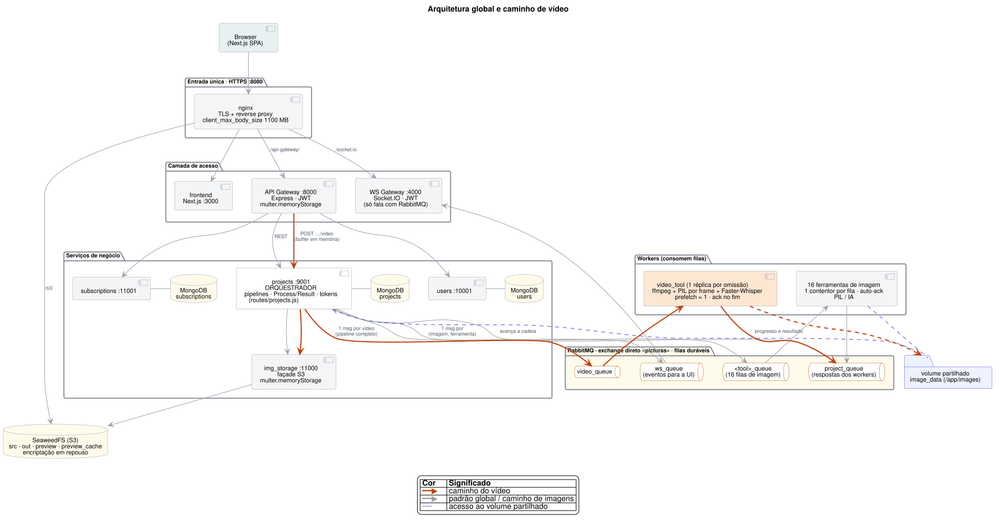
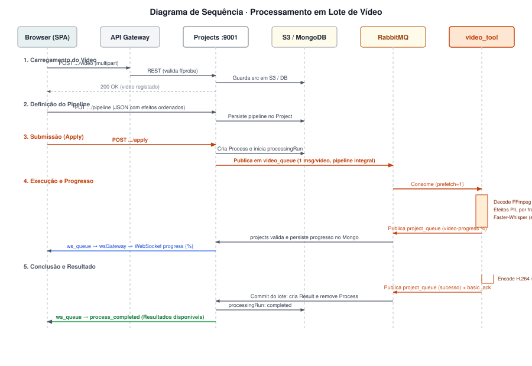

# 📝 Exercício 6 (Bloco 1) — Template de Identificação e Comparação de Padrões Arquiteturais
### Fase 2: Melhoria de Requisitos Não Funcionais do PictuRAS · Alimenta as secções de diagnóstico e de decisões arquiteturais do relatório da Fase 2

**Versão do template:** 1.1 · **Data:** 2026-11-04 · **Estado:** Em vigor · **Enunciado compatível:** 1.1

> **Como usar este template**
> - Segue o enunciado `RAS-exercicio_6_bloco1_SWdesign_PT.md`. As secções 1 a 3 deste template correspondem, por ordem, aos pontos 1 a 3 do **Resultado Esperado**; a secção 0 corresponde à tarefa de **Preparação**.
> - Este é o **Bloco 1**. O **Bloco 2** (`RAS-exercicio_6_bloco2_SWdesign_template_PT.md`) continua este documento: usa a matriz (secção 3.3), as alternativas (`ALT-n`) e o registo de evidências e hipóteses (secção 2.6). **Mantém os IDs.**
> - Existe uma **versão em inglês** deste template (`RAS-exercicio_6_bloco1_SWdesign_template_EN.md`), com as mesmas secções e os mesmos IDs.
> - Regista no relatório as **versões do enunciado e do template** que usaste (campo «Versões usadas» abaixo). O histórico de versões está no fim deste documento.
> - A estrutura final do relatório da Fase 2 será definida numa versão seguinte das diretrizes. Este template agrupa o conteúdo para o poderes copiar para o relatório sem retrabalho.
> - Substitui os textos entre chavetas `{...}`, apaga as linhas de ajuda (`>`) e os exemplos que não se aplicam.
> - **Distingue factos de hipóteses.** Um facto cita uma evidência (`EV-nn`); o que não tem evidência é uma hipótese (`H-nn`). Regista ambos na secção 2.6.
> - Convenções de IDs: `EV-nn` (evidência), `H-nn` (hipótese), `ALT-n` (alternativa). Nunca reutilizes um ID eliminado.
> - O foco é a **extensão de vídeo**, **enquadrada no padrão global da solução**. Não analises o vídeo isoladamente.
> - Esta fase é de *refactoring*: as alternativas têm de preservar o comportamento funcional.
> - Se fizeres medições exploratórias, guarda os cenários, *scripts*, dados e ambiente para que sejam reprodutíveis e reutilizáveis como *baseline*.

---

**Equipa:** Grupo PL3-G5  
**Elementos:** Alice Soares (pg63920), João Azevedo (pg63981), Francisco Barros (pg65409), Samuel Ferreira (pg65441)  
**Commit de partida:** `0523102` (tag `phase2-base`), checkout `afb84e5` em `picturas-um/picturas-27`  
**Data da análise:** 2026-11-21  
**Versão deste documento:** v1.0  
**Versões usadas:** enunciado 1.1 · template 1.1

---

## 0. Preparação e ambiente

> Regista como a solução foi lançada, para que outra pessoa consiga repetir. Se algum passo falhou, indica-o.

| **Item** | **Valor** |
|----------|-----------|
| Commit de partida | `052310226c51fa57a17101c7bd1ad795674aac95` (tag `phase2-base`), checkout `afb84e5c818820f807bb504a8ed9f0a3162cc9dd` |
| Comando(s) de arranque | `docker compose up -d --build` (e arranque de réplicas via `docker compose up -d --no-build --scale video_tool=2 video_tool`) |
| Ambiente da baseline (SO, CPU, RAM, versões de Docker e Compose) | Linux 7.0.0-43-generic x86_64, Intel Core i7-13650HX (20 CPUs lógicas), 33 357 824 000 bytes de RAM visíveis ao Docker, Docker Engine 29.9.3 e Compose v5.7.1. Dados do manifesto oficial em `evaluation/evidence/official-baseline-performance-2026-11-17/`. |
| Projeto de teste (nº de imagens e de vídeos, amostras usadas) | Capacidade: A com um vídeo de fala de 177 s e legendagem, B com dois MP4 de 10 s e um MOV de 6 s com brilho, sem imagens. Operabilidade: A com o excerto de fala de 10 s da baseline de usabilidade, B com um vídeo para usar a barra de ferramentas, sem aplicar o pipeline. |
| Problemas encontrados ao lançar | Conflitos com volumes legados da Fase 1 exigiram limpeza com `docker compose down -v --remove-orphans` devido a alterações de layout do SeaweedFS (S3); certificados TLS internos autoassinados expirados necessitando `rejectUnauthorized: false` |

**Como é orquestrado o processamento em lote de imagens e de vídeos** *(5 a 8 linhas)*:

O botão `Apply` envia um pedido a `POST /api-gateway/projects/:user/:project/process`. Para cada imagem, o orquestrador envia uma mensagem por ferramenta à fila respetiva e avança quando recebe a resposta na `project_queue`. Para cada vídeo, identificado por `media_type`, envia o pipeline completo numa mensagem à `video_queue`. Os efeitos de fotograma contíguos partilham uma passagem de descodificação e codificação. As legendas podem introduzir etapas adicionais e a extração de fotogramas produz imagens. O worker publica progresso e resultados em `project_queue`. O orquestrador guarda o progresso aceite e publica as atualizações em `ws_queue`.

---

## 1. Âmbito e vista da arquitetura

### 1.1 Fontes consultadas

| **Fonte** | **Versão / data** | **Usada para** |
|-----------|-------------------|----------------|
| `README.md` | Commit `0f6dbc5` / 2026-11 | Instruções de arranque, portas expostas, topologia de serviços e dependências de execução |
| `AGENTS.md` | Commit `0f6dbc5` / 2026-11 | Arquitetura detalhada, bifurcação imagem/vídeo, convenções e restrições de pipeline |
| `doc-ext-requisitos-2627.pdf` | PL1-G4 (2026) | Requisitos funcionais e não funcionais herdados da extensão de vídeo da Fase 1 |
| Diretrizes da Fase 2 (`fase-2-guidelines.md`) | Versão 1 (04/11/2026) | Requisitos de refactoring, metodologia baseline-medição, critérios de não funcionalidade |
| `specs/002-nfr-improvement/spec.md` | 2026-11-17 | Especificação dos dois requisitos não funcionais (capacidade e operabilidade), protocolos e métricas |
| `docs/fase-2-plano-decisoes.md` | 2026-11-21 | Matriz de decisão, definição de baselines oficiais, metas e testes de regressão |
| `docs/fase-2-auditoria.md` | 2026-11-21 | Auditoria arquitetural, matriz de rastreabilidade e identificação de riscos de concorrência |
| `RAS_support_doc_architectural_patterns_PT.html` | 2026-11-04 | Taxonomia de padrões arquiteturais (Camadas, Monolítico, Microserviços, Event-Driven, Pipeline) |
| Slides da aula 11 (*Arch. Styles*) | 2026 | Fundamentação teórica dos estilos arquiteturais e das táticas de desenho de software |

### 1.2 Vista da arquitetura global

> A vista mostra o **padrão global** da solução, com o **caminho do vídeo destacado**. Usa a notação e a ferramenta que preferires (e.g., C4 de contentores, componentes UML, PlantUML, Mermaid, draw.io) e indica uma legenda.

**Ferramenta / notação:** PlantUML / C4 Component View adaptada com codificação por cores e estereótipos de comunicação (`arquitetura_global.puml`).

| **Elemento (cor, forma ou estilo)** | **Significado** |
|-------------------------------------|-----------------|
| Retângulo Laranja (`#FDE7D3` / seta `#C2410C`) | Caminho e componentes dedicados ao processamento de vídeo (`video_queue`, `video_tool`) |
| Retângulo Cinza / Azul claro | Camada de acesso, gateway e frontend SPA |
| Retângulo Branco (`business`) | Serviços de negócio (`projects`, `users`, `subscriptions`, `imageStorageService`) |
| Fila Amarela / Castanho (`rmq`) | Filas duráveis do broker RabbitMQ (`<tool>_queue`, `project_queue`, `ws_queue`) |
| Linha Tracejada Roxa (`#4F46E5`) | Acesso ao volume de sistema de ficheiros partilhado (`image_data`) |
| Cilindro Amarelo | Bases de dados dedicadas por serviço (MongoDB) e Object Storage (SeaweedFS S3) |

### 1.3 Diagrama de sequência de um pedido completo

> Carregamento → definição do pipeline → *Apply* → progresso → resultado, para um projeto com vídeos.

| **Passo** | **Origem → Destino** | **Mensagem / endpoint / fila** | **Evidência** |
|-----------|----------------------|--------------------------------|---------------|
| Carregamento do vídeo | Browser → `apiGateway` → `projects` → `imageStorageService` → SeaweedFS | `POST /api-gateway/projects/:owner/:project/video` (multipart/form-data) | `EV-04`, `projects/routes/projects.js` |
| Definição do pipeline | Browser → `apiGateway` → `projects` | `POST /api-gateway/projects/:user/:project/tool` para adicionar e `POST …/reorder` para reordenar | `EV-04`, `projects/controllers/project.js` |
| *Apply* | Browser → `apiGateway` → `projects` → RabbitMQ | `POST /api-gateway/projects/:user/:project/process` → publicação na `video_queue` (1 msg/vídeo com pipeline integral) | `EV-01`, `EV-04`, `projects/utils/processBatch.js` |
| Progresso | `video_tool` → `project_queue` → `projects` → `ws_queue` → `wsGateway` → Browser | Eventos `video-progress` tipados com percentagem e token de execução | `EV-03`, `EV-06`, `Tools/video/video.py` |
| Resultado | `video_tool` → RabbitMQ (`project_queue`) → `projects` → MongoDB (`Result`) e `ws_queue` | Mensagem de sucesso na `project_queue`, ack manual, commit de lote e notificação `process_completed` | `EV-01`, `EV-06`, `projects/utils/processBatch.js` |

### 1.4 Onde e porquê o sistema bifurca entre imagem e vídeo

| **Ponto de bifurcação** | **Caminho de imagens** | **Caminho de vídeo** | **Evidência** | **Porquê** (facto ou hipótese) |
|-------------------------|------------------------|----------------------|---------------|--------------------------------|
| **Validação e Upload** | `POST /:user/:project/img` (validação de formato JPEG/PNG) | `POST /:user/:project/video` (validação de contentor, codec de vídeo, resolução, duração e limites free/premium via ffprobe) | `EV-04`, `projects/utils/video.js:14-80` | **Facto:** Conteúdos de vídeo têm restrições rígidas de compatibilidade e exigem validação de streams áudio/vídeo ausentes em imagens estáticas. |
| **Despacho no Orquestrador** | Despacho passo-a-passo: 1 mensagem por cada par (imagem, ferramenta) enviada para `<tool>_queue` | Despacho em bloco: 1 mensagem por vídeo contendo todo o pipeline enviada para a `video_queue` | `EV-04`, `projects/utils/processBatch.js:88-142` | **Facto:** Evitar re-codificações e descodificações repetidas de vídeo por ferramenta, que causariam sobrecarga incomportável de I/O e tempo de CPU. |
| **Execução dos Workers** | Microsserviços PIL/IA independentes e especializados (16 contentores dedicados) | Serviço `video_tool` que executa o pipeline completo, com uma réplica por omissão | `EV-01`, `EV-02`, `docker-compose.yaml:255-260` | **Facto:** Os efeitos de fotograma contíguos partilham uma passagem. A legendagem pode introduzir etapas adicionais. |
| **Confirmação AMQP (*Ack*)** | Confirmação automática imediata na receção (`auto_ack=True`) em `Tools/utils/rabbit_mq.py` | Confirmação manual explícita (`ack`) apenas no final do processamento com sucesso ou falha tratada | `EV-01`, `EV-07`, `Tools/video/video.py:169-176` | **Facto:** Vídeos são computacionalmente pesados; se o worker falhar a meio, a mensagem não pode ser confirmada antes de tempo. |
| **Interface / Frontend** | Filtros de IA (remoção de fundo, upgrade, etc.) e exportação PDF ativos | Ferramentas de IA desativadas; adição de ferramentas vídeo (trim, speed, legendas); sem exportação PDF | `EV-05`, `frontend/app/dashboard/[pid]/page.tsx` | **Facto:** Algoritmos de IA de imagem atuais não suportam vídeo no backend do sistema e vídeo não é convertível para formato PDF. |

---

## 2. Identificação e análise dos padrões atuais

### 2.1 Padrão global da solução

> Identifica o estilo, ou a combinação de estilos, que organiza o PictuRAS como um todo. Este padrão é o **ponto de partida** da análise: define o contexto e as restrições a que qualquer alternativa terá de responder.

| | |
|---|---|
| **Nome(s) do padrão / estilo** | **Microserviços Orientados a Eventos com API Gateway e Pipes and Filters Distribuído** |
| **Descrição** | A arquitetura decompõe o sistema em serviços autónomos por domínio de negócio e ferramentas de processamento especializadas. A comunicação síncrona com o exterior é centralizada pelo Nginx e `apiGateway` (REST) e `wsGateway` (WebSockets), enquanto o processamento interno de transformações é totalmente assíncrono, orquestrado através de filas de mensagens gerenciadas pelo broker RabbitMQ e persistência desacoplada em MongoDB e SeaweedFS (S3). |

**Decisões globais que condicionam o vídeo**

| **Decisão global** | **Evidência** | **Efeito no vídeo** |
|--------------------|---------------|---------------------|
| Orquestração centralizada baseada em estados (`projects`) | `EV-04`, `projects/routes/projects.js` | O orquestrador tem de manter o ciclo de vida completo do vídeo, controlar quotas e transições, forçando o tratamento diferenciado de vídeo face a imagens. |
| Intercâmbio de dados através de volume partilhado (`image_data`) | `EV-01`, `docker-compose.yaml:26-30` | Impõe que workers de vídeo corram no mesmo nó físico ou partilhem o sistema de ficheiros local montado, condicionando a escalabilidade distribuída multi-host. |
| Mensageria assíncrona desacoplada via RabbitMQ | `EV-01`, `EV-04`, `rabbitMQ/definitions.json` | Todo o progresso, cancelamento e confirmação dependem da robustez das filas `video_queue` e `project_queue`. |

**Benefícios e desafios do padrão global**

| **Tipo** | **Descrição** | **Característica / subcaracterística (ISO/IEC 25010)** | **Facto / hipótese** |
|----------|---------------|--------------------------------------------------------|----------------------|
| Benefício | Desacoplamento de responsabilidades e escalabilidade independente dos módulos de negócio | Manutenibilidade / Modularidade | Facto (`EV-04`) |
| Benefício | Tolerância a bloqueios no frontend através de processamento em segundo plano orientado a eventos | Eficiência de desempenho / Comportamento temporal | Facto (`EV-04`) |
| Desafio | Complexidade de coordenação de transações distribuídas e consistência de dados entre MongoDB, S3 e AMQP | Fiabilidade / Recuperabilidade | Facto (`EV-06`, `fase-2-auditoria.md`) |
| Desafio | Ponto único de falha e sobrecarga de I/O no volume de armazenamento partilhado | Eficiência de desempenho / Utilização de recursos | Hipótese (`H-04`) |

### 2.2 Padrão do processamento de vídeo

| | |
|---|---|
| **Nome do padrão** | **Pipeline Monolith sob Worker Assíncrono (*Single-Pass Processing*)** |
| **Descrição** | Em vez de decompor cada filtro de vídeo num serviço individual, todas as operações de vídeo (filtros de cor PIL, corte temporal, alteração de velocidade, transcrição Faster-Whisper e extração de fotogramas) estão integradas num único microsserviço monolítico (`video_tool`). O worker consome mensagens da fila, descodifica o stream uma só vez, aplica a sequência em memória e codifica o resultado final. |
| **Contraste com o caminho de imagens** | O caminho de imagens utiliza um *Pipes and Filters* distribuído puro, onde cada ferramenta é um microsserviço autónomo isolado com a sua própria fila e ciclo de vida; o caminho de vídeo agrupa todo o pipeline de filtros numa única execução síncrona dentro de um único worker. |

**Benefícios e desafios do padrão do vídeo**

| **Tipo** | **Descrição** | **Característica / subcaracterística (ISO/IEC 25010)** | **Facto / hipótese** |
|----------|---------------|--------------------------------------------------------|----------------------|
| Benefício | Elevada eficiência de processamento por evitar múltiplas descodificações e codificações sequenciais de ficheiros de vídeo pesados | Eficiência de desempenho / Utilização de recursos e Comportamento temporal | Facto (`EV-01`, `Tools/video/effects.py`) |
| Benefício | Preservação da fidelidade do stream de áudio e mitigação da degradação cumulativa de compressão por perda (lossy codecs) | Adequação funcional / Integridade | Facto (`EV-01`, `Tools/video/video_processor.py`) |
| Desafio | Efeito de bloqueio (*Head-of-Line Blocking*): uma tarefa longa e pesada (como transcrição de legendas em CPU) bloqueia o único consumidor de vídeo para todos os outros utilizadores | Eficiência de desempenho / Capacidade | Facto (`EV-01`, `EV-03`, baseline oficial `b_wait_seconds = 61,727 s`) |
| Desafio | Baixa modularidade: falhas em bibliotecas auxiliares (ex.: Faster-Whisper ou Pillow) podem deitar abaixo todo o worker de vídeo | Fiabilidade / Tolerância a falhas | Facto (`EV-01`, `EV-03`) |

### 2.3 Relação entre o padrão global e o padrão do vídeo

> Em que pontos o vídeo **segue** o padrão global, em que pontos se **afasta** dele e com que consequências.

| **Aspeto** | **O que o padrão global prescreve** | **O que o vídeo faz** | **Segue / afasta-se** | **Consequência** | **Evidência** |
|------------|-------------------------------------|-----------------------|-----------------------|------------------|---------------|
| **Decomposição Funcional** | Um microsserviço independente por ferramenta | Todas as ferramentas de vídeo concentradas no contentor `video_tool` | Afasta-se | Reduz I/O de rede e recodificações, mas cria um serviço monolítico pesado | `EV-01`, `EV-02` |
| **Granularidade de Despacho** | Uma mensagem por filtro/passo do pipeline | Uma mensagem única contendo todo o array de operações do pipeline | Afasta-se | O orquestrador perde visibilidade direta dos passos intermediários, dependendo de eventos de progresso | `EV-04`, `projects/utils/processBatch.js` |
| **Comunicação Assíncrona** | Mensageria assíncrona desacoplada via filas RabbitMQ | Consumo de fila assíncrono via `video_queue` | Segue | Mantém alinhamento com a arquitetura assíncrona orientada a eventos global | `EV-01`, `rabbitMQ/definitions.json` |
| **Armazenamento de Ficheiros** | Volume partilhado `image_data` e S3 | Utiliza `image_data` para I/O e leitura de ficheiros de entrada e saída | Segue | Mantém compatibilidade total com o modelo de persistência perimetral | `EV-01`, `docker-compose.yaml` |

**O que o vídeo herda do padrão global / que restrições este lhe impõe / que fragilidades resultam do desvio** *(3 a 6 linhas)*:

O processamento de vídeo herda do padrão global a infraestrutura de transporte assíncrono (RabbitMQ), o sistema de autorização por JWT e o mecanismo de reporte de eventos para o frontend (`wsGateway`). No entanto, o padrão global impõe restrições de concorrência e armazenamento, pois os limites de transação do orquestrador foram originalmente desenhados para imagens rápidas. A decisão de desviar o vídeo para um *Pipeline Monolith* foi fundamental para a viabilidade do desempenho temporal (evitando overheads de descodificação), mas introduziu uma fragilidade crítica de **capacidade e escalabilidade**: ao correr como réplica única com `prefetch_count=1`, cria filas de espera gigantescas quando surgem tarefas lentas de IA/legendagem.

### 2.4 Legendagem automática e extração de fotogramas

| **Funcionalidade** | **Como se integra no padrão do vídeo** | **Impacto nos atributos de qualidade** | **Evidência** |
|--------------------|----------------------------------------|-----------------------------------------|---------------|
| **Legendagem automática** (`subtitles`) | Integrada como etapa síncrona dentro de `video_tool`, executando Faster-Whisper CPU com quantização int8 para extrair texto e queimar legendas com `ffmpeg` | Degradação severa do comportamento temporal e capacidade: ocupa o worker a 100% de CPU durante dezenas de segundos, bloqueando toda a `video_queue` | `EV-03`, `Tools/video/subtitles.py` |
| **Extração de fotogramas** (`extract_frames`) | Integrada no `video_tool` como passo terminal obrigatório, gerando um conjunto de imagens PNG/JPEG ou folha de contacto | Aumenta a pressão no volume partilhado de ficheiros e no MongoDB, exigindo ao orquestrador converter um resultado de vídeo em múltiplos registos de imagem | `EV-01`, `Tools/video/frames.py`, `AGENTS.md` |

### 2.5 Suporte aos requisitos não funcionais existentes e regras sem requisito explícito

> Usa os documentos de requisitos anteriores e a extensão do PL1-G4. Inclui as regras que não têm requisito explícito (e.g., ordem obrigatória de passos do pipeline).

| **Requisito / regra** (ID, ou «sem requisito explícito») | **Padrão global suporta?** | **Padrão do vídeo suporta?** | **Porquê** | **Evidência** |
|----------------------------------------------------------|----------------------------|------------------------------|------------|---------------|
| `REQ-VID-EDIT-010` (Desempenho da edição de vídeo) | Parcial | Sim | O padrão do vídeo otimiza o tempo ao fazer decode/encode numa única passagem | `EV-01`, `Tools/video/video_processor.py` |
| `REQ-VID-EDIT-011` (Capacidade de processamento concorrente) | Sim | Não (na base) | A base corre apenas 1 réplica de `video_tool` com `prefetch_count=1`, serializando pedidos | `EV-01`, `EV-02`, baseline oficial |
| `REQ-VID-EDIT-002` (Sessão não bloqueante durante edição) | Sim | Não (na base) | A interface base bloqueava o dashboard com modal sobreposto durante o processamento ativo | `EV-05`, `frontend/app/dashboard/[pid]/page.tsx` |
| `REQ-VID-FAIL-004` (Não perder trabalho em falha) | Parcial | Sim | O worker de vídeo faz ack manual apenas no fim e gera ficheiro `.part` atómico | `EV-01`, `Tools/video/video.py:169` |
| `REQ-VID-STATUS-003` (Acompanhamento em tempo real) | Sim | Parcial | Envia percentagem para WebSocket, mas na base a página bloqueava com modal e perdia estado em reload | `EV-05`, `frontend/app/dashboard/[pid]/page.tsx` |
| Regra: Extração de fotogramas é terminal e única (sem req. explícito) | N/A | Sim | Validado no orquestrador e garantido pela lógica do pipeline do worker de vídeo | `EV-04`, `AGENTS.md`, `projects/utils/processBatch.js` |
| Regra: `trim` e `speed` aplicam-se a 1 vídeo e efeitos a todos (sem req. explícito) | Parcial | Sim | O orquestrador discrimina `params.imgId` nos filtros de vídeo | `EV-04`, `AGENTS.md` |

### 2.6 Registo de evidências e hipóteses

> Este registo é **partilhado com o Bloco 2**: novas evidências e hipóteses acrescentam-se aqui, continuando a numeração.

| **ID** | **Tipo** | **Localização** (ficheiro e linhas, commit, comando) | **O que mostra** |
|--------|----------|------------------------------------------------------|------------------|
| EV-01 | Código / Configuração | `Tools/video/video.py:53-54, 169-176` | Configura `prefetch_count=1`, consumidor síncrono bloqueante e confirmação manual explícita (`basic_ack`) apenas após processamento bem-sucedido ou erro tratado. |
| EV-02 | Configuração | `docker-compose.yaml:255-260` | Serviço `video_tool` configurado com uma única réplica por omissão, sem política de escalabilidade automática. |
| EV-03 | Código | `Tools/video/subtitles.py:15-21, 60-63` | Execução síncrona do Faster-Whisper em CPU (int8) para deteção de idioma e transcrição, bloqueando o worker durante a totalidade do processamento. |
| EV-04 | Código | `projects/utils/processBatch.js:88-142` e `projects/routes/projects.js` | Despacho bifurcado: imagens processadas passo-a-passo através de mensagens individuais para `<tool>_queue`; vídeos despachados com pipeline completo para `video_queue`. |
| EV-05 | Código | `frontend/app/dashboard/[pid]/page.tsx` na tag `phase2-base` | Estado de progresso mantido exclusivamente na memória volátil do componente React e sobreposição de modal (`overlay`) que bloqueia a interação durante o lote. |
| EV-06 | Código | `projects/models/project.js:35-65` e `projects/utils/processingRun.js` | Definição do subdocumento `processingRun` para persistir o snapshot autorizado de execução, token, estado e progresso monotónico no MongoDB. |
| EV-07 | Código | `Tools/utils/rabbit_mq.py:28-35` | Ferramentas de imagem ativam `auto_ack=True` na subscrição da fila, arriscando perda de trabalhos em caso de falha a meio da execução. |
| EV-08 | Código | `projects/utils/rabbit_mq.js:11-30` | Abertura e fecho de ligações e canais AMQP individuais por mensagem de despacho com encerramento forçado por `setTimeout(500)`. |
| EV-09 | Configuração / Código | `apiGateway/app.js` e `docker-compose.yaml` | Serviços internos utilizam certificados TLS autoassinados com bypass de validação (`rejectUnauthorized: false`). |
| EV-10 | Código | `apiGateway/routes/projects.js` e `projects/routes/projects.js` | Endpoint autenticado `GET /projects/:owner/:project/processing-status` expondo a projeção segura do snapshot de processamento. |

| **ID** | **Hipótese** | **Como confirmar ou refutar** | **Estado** |
|--------|--------------|-------------------------------|------------|
| H-01 | A execução de duas réplicas de `video_tool` sob a mesma fila `video_queue` reduzirá a média do tempo de espera de B (`b_wait_seconds`) para 15 segundos ou menos. | Executar o cenário automatizado A/B com uma e duas réplicas. | Confirmada no cenário medido: média de 0,113 s nos três ensaios finais. [M-02](../sessoes/2026-11-22-fecho-fase-2.md#final-capacity-and-same-instrument-baseline) |
| H-02 | A persistência do snapshot e a remoção do overlay permitirão 12/12 ações e recuperação após recarregamento e navegação no cenário A/B. | Executar três ensaios no Chromium com utilizador premium e projetos novos durante a legendagem de A. | Confirmada no cenário medido: 12/12 ações, 3/3 nos dois percursos e zero conclusões prematuras. [M-03](../sessoes/2026-11-22-fecho-fase-2.md#measurement-configuration-and-usability) |
| H-03 | Finalizações concorrentes de trabalhos do mesmo lote por réplicas distintas podem gerar condições de corrida e perda de resultados no orquestrador `projects`. | Executar testes de concorrência com finalizações simultâneas de vídeos. | Reproduzida antes da correção. A [P-02](../sessoes/2026-11-22-p02.md) confirmou dois resultados preservados após a correção. |
| H-04 | O volume partilhado pode tornar-se um gargalo de I/O ou ponto de falha. | Medir latência e utilização do volume sob carga e observar o efeito de uma indisponibilidade controlada. | por confirmar |

---

## 3. Alternativas e matriz de comparação

### 3.1 Alternativas consideradas

> 2 a 3 alternativas relevantes **para o processamento de vídeo**. O padrão global é o **contexto da comparação**: indica se cada alternativa o **mantém** ou o **altera**. Consulta os slides da aula 11 e o documento de apoio. Se for relevante, inclui uma alternativa ao próprio padrão global como termo de comparação.

| **ID** | **Nome / padrão** | **Descrição breve** | **Mantém ou altera o padrão global?** | **Fonte** |
|--------|-------------------|---------------------|---------------------------------------|-----------|
| ALT-1 | **Consumidores Concorrentes (*Competing Consumers*) com Réplicas do Worker Monolítico de Vídeo** | Escalar horizontalmente o serviço `video_tool` para múltiplas réplicas idênticas (e.g. 2 réplicas), mantendo uma única fila `video_queue` partilhada e `prefetch_count=1`. | **Mantém** o padrão global da solução e preserva integralmente o contrato de despacho. | `RAS_support_doc_architectural_patterns_PT.html` (Secção 7) |
| ALT-2 | **Decomposição em Microserviços Distribuídos de Vídeo (*Pipes and Filters* Distribuído)** | Decompor o processamento de vídeo em múltiplos microsserviços autónomos por ferramenta (um contentor para corte, outro para cor, outro para legendas), encadeados passo-a-passo como nas imagens. | **Altera** o padrão do vídeo para convergir com o padrão distribuído de imagens; mantém o estilo global. | `RAS_support_doc_architectural_patterns_PT.html` (Secção 3 e 6) |
| ALT-3 *(opcional)* | **Filas Separadas por Tipo de Carga (*Workload-Specific Queues*)** | Criar filas AMQP dedicadas consoante o perfil computacional: uma fila para filtros rápidos de fotogramas (`video_light_queue`) e outra para tarefas CPU-bound intensivas (`video_heavy_queue` para legendagem e extração de frames). | **Mantém** o padrão global assíncrono, mas afasta-se parcialmente ao alterar a topologia de mensageria e o contrato de despacho de `projects`. | Slides da aula 11 e `RAS_support_doc_architectural_patterns_PT.html` (Secção 4 e 7) |

### 3.2 Análise de cada alternativa

> Copia o bloco para cada alternativa.

**ALT-1 — Consumidores Concorrentes com Réplicas de Video Tool**

| | |
|---|---|
| **Coerência com o padrão global** | Totalmente coerente. Utiliza a semântica nativa de balanceamento de carga do RabbitMQ sobre a mesma fila `video_queue` e o mesmo volume partilhado. |
| **Efeito nos atributos de qualidade** | Permite trabalho concorrente com a mesma confirmação manual. O ganho temporal e o consumo agregado dependem da carga e do número de réplicas. |
| **Vantagens potenciais** | Mantém o contrato de mensagens. Enquanto houver uma réplica livre, outro trabalho pode avançar durante a legendagem. |
| **Desvantagens ou riscos** | Risco de condições de corrida no orquestrador `projects` quando múltiplos vídeos de um lote terminam em simultâneo (P-02 foi reaberta após a auditoria reproduzir perda de resultados); duplicação de modelos Whisper na memória sem partilha. |
| **Custo e risco de migração** (a funcionalidade existente tem de ser preservada) | **Baixo custo e risco muito reduzido**. Não altera código de clientes nem formatos de mensagem. |

**ALT-2 — Decomposição em Microserviços Distribuídos de Vídeo**

| | |
|---|---|
| **Coerência com o padrão global** | Alinha perfeitamente o processamento de vídeo com o modelo das ferramentas de imagem (*Pipes and Filters* distribuído com 1 fila por filtro). |
| **Efeito nos atributos de qualidade** | Aumenta a **modularidade** e **modificabilidade** isolada; no entanto, **destrói o desempenho temporal** e a utilização de recursos devido ao ciclo vicioso de decodificação/recodificação H.264 por cada filtro. |
| **Vantagens potenciais** | Isolamento total de falhas (falha nas legendas não afeta filtros de brilho); escalamento granular de ferramentas individuais. |
| **Desvantagens ou riscos** | Recodificações sucessivas podem degradar a qualidade, aumentar a duração e gerar mais I/O. A dimensão dos efeitos exigiria implementar e medir a alternativa. |
| **Custo e risco de migração** | **Custo e risco extremamente altos**. Reescreveria completamente o subsistema de vídeo, quebrando contratos e violando o princípio de *refactoring* sem novas funcionalidades. |

**ALT-3 — Filas separadas por tipo de carga**

| | |
|---|---|
| **Coerência com o padrão global** | Mantém os microsserviços assíncronos e o pipeline completo por vídeo. Altera o encaminhamento no orquestrador e a topologia RabbitMQ (`EV-01`, `EV-04`). |
| **Efeito nos atributos de qualidade** | Consumidores dedicados podem reduzir a interferência entre tipos de carga. O ganho depende da distribuição da procura e dos recursos disponíveis. |
| **Vantagens potenciais** | Capacidade reservada para efeitos rápidos e configuração de escala por tipo de carga. |
| **Desvantagens ou riscos** | Filas com procura desigual podem deixar capacidade ociosa. A classificação de pipelines mistos acrescenta caminhos a validar. |
| **Custo e risco de migração** | Médios. Exige alterar o encaminhamento, configurar consumidores e repetir testes de entrega e finalização de lotes. |

### 3.3 Matriz de comparação de padrões

> Escala à tua escolha (e.g., Alto / Médio / Baixo). **Justifica cada célula** com evidência da solução (`EV-nn` ou `H-nn`); as avaliações sem fundamento não são valorizadas. A justificação detalhada e a análise de trade-offs fazem-se no Bloco 2 (secção 4.1).

| **Atributo de qualidade (ISO/IEC 25010)** | **Padrão global atual (referência)** | **Padrão atual do vídeo** | **ALT-1** | **ALT-2 (projeção)** | **ALT-3 (projeção)** |
|-------------------------------------------|--------------------------------------|---------------------------|-----------|-----------|-----------|
| Relação com o padrão global | — | Afasta-se (Pipeline Monolith) | Mantém o padrão global e do vídeo | Aproxima o vídeo do padrão distribuído das imagens | Mantém o padrão global e altera o encaminhamento de vídeo |
| Eficiência de desempenho — comportamento temporal | Médio — depende do encadeamento passo a passo (`EV-04`) | Baixo — bloqueado por tarefas longas de legendagem (`EV-01`, `EV-03`) | Alto no cenário A/B — dois consumidores podem avançar em paralelo (`H-01`) | Baixo — recodificações adicionais | Alto para tarefas rápidas quando há capacidade reservada |
| Eficiência de desempenho — capacidade / elasticidade | Alto — ferramentas de imagem escalam individualmente (`EV-07`) | Baixo — réplica única, um vídeo de cada vez (`EV-02`) | Duas réplicas validadas em P-01. A relação com escalas superiores ficou por medir. | Médio — escala por ferramenta, com possível saturação de CPU e disco | Médio — escala por fila, com risco de capacidade ociosa |
| Fiabilidade — tolerância a falhas / recuperabilidade | Média — ferramentas de imagem usam auto-ack (`EV-07`) | Ack manual e limpeza de ficheiros `.part` (`EV-01`) | Preserva ack manual. A P-02 verificou a proteção do fecho simultâneo. | Isola falhas por ferramenta e acrescenta pontos de falha | Preserva ack manual se mantiver o protocolo. Acrescenta dependências de encaminhamento. |
| Manutenibilidade — modularidade / modificabilidade | Alta — serviços independentes (`EV-04`) | Média — o worker concentra as operações de vídeo (`EV-01`) | Média — mantém a estrutura do worker | Alta — isola operações em serviços separados | Média — reutiliza o worker e acrescenta regras de classificação |
| Segurança | Validação no gateway e dívida de TLS interno (`EV-09`) | Isolamento em contentores Docker | Mantém as mesmas interfaces | Requer controlo de acessos nos serviços e filas adicionais | Requer controlo de acessos às novas filas |
| Usabilidade — operabilidade | Operações desacopladas no backend | Bloqueio de UI na base (`EV-05`) | A recuperação na UI resulta do painel e do snapshot (`H-02`) | Depende do frontend. A maior demora prevista pode afetar a experiência. | Pode reduzir a espera das tarefas rápidas. A recuperação depende do frontend. |

### 3.4 Adequação do padrão atual

O padrão atual global (Microsserviços Orientados a Eventos) é altamente adequado para as operações de gestão de projetos, controlo de acessos e orquestração assíncrona do PictuRAS. No entanto, no subsistema de vídeo, a combinação de um **Pipeline Monolith** executado numa **única réplica com prefetch unitário** revelou-se inadequada para responder aos requisitos não funcionais de capacidade e elasticidade (`REQ-VID-EDIT-011`), gerando esperas inaceitáveis quando ocorrem tarefas CPU-bound (legendagem Faster-Whisper).

A alternativa **ALT-1** (*Competing Consumers* com duas réplicas de `video_tool`) permite que um pedido avance enquanto outro ocupa uma réplica. Mantém o contrato de despacho e a passagem partilhada de descodificação e codificação para efeitos de fotograma contíguos.

---

## ✅ Lista de verificação antes de entregar o Bloco 1

- [x] O *commit* de partida está identificado e o ambiente de lançamento está descrito (secção 0).
- [x] A vista da arquitetura mostra o **padrão global** com o caminho do vídeo destacado, e há um diagrama de sequência do processamento em lote (secção 1).
- [x] O **padrão global** e o **padrão do vídeo** estão identificados, com evidências, benefícios e desafios (secções 2.1 e 2.2).
- [x] A relação entre os dois padrões está analisada: o que segue, o que se afasta e com que consequências (secção 2.3).
- [x] Cada afirmação cita uma evidência (`EV-nn`) ou está marcada como hipótese (`H-nn`); factos e hipóteses estão separados (secção 2.6).
- [x] Há 2 a 3 alternativas e cada uma indica se **mantém ou altera** o padrão global, com custo e risco de migração (secção 3).
- [x] A matriz inclui o padrão global como referência e **todas as células estão justificadas** (secção 3.3).
- [x] Os IDs (`EV`, `H`, `ALT`) estão estáveis, porque o Bloco 2 os reutiliza.
- [x] As **versões do enunciado e do template** usadas estão indicadas no cabeçalho.

---

## Histórico de versões do template

> Esta secção documenta o template. **Não a copies para o relatório.** Esquema `major.minor`, igual ao do enunciado: a versão *major* muda quando mudam a estrutura ou os campos obrigatórios; a *minor* muda em clarificações e correções.

| Versão | Data | Alterações | Enunciado compatível |
|--------|------|------------|----------------------|
| 1.1 | 2026-11-04 | Adicionado o controlo de versões (linha de versão, campo «Versões usadas», item na lista de verificação e este histórico). Versão em inglês disponível: `RAS-exercicio_6_bloco1_SWdesign_template_EN.md`. | 1.1 |
| 1.0 | 2026-11-04 | Primeira versão: template do Bloco 1 (secções 0 a 3 e lista de verificação), criado a partir do template combinado do Exercício 6. | 1.0 |
