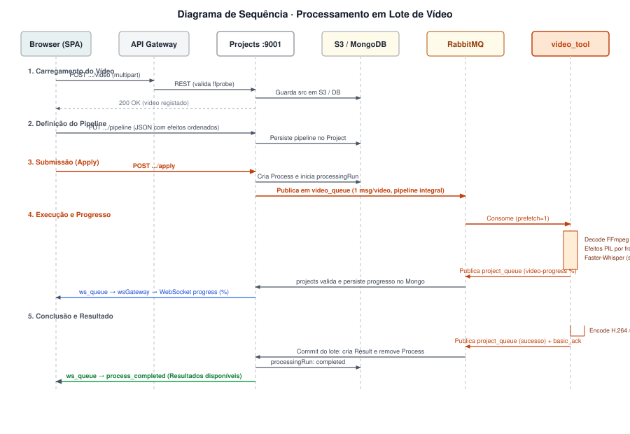

# 📝 Exercício 7 — Template de Táticas Arquiteturais para Melhorar RNF do PictuRAS
### Fase 2: Melhoria de Requisitos Não Funcionais do PictuRAS · Alimenta as secções de diagnóstico, quantificação e decisões arquiteturais do relatório da Fase 2

**Versão do template:** 3.0 · **Data:** 2026-11-17 · **Estado:** Em vigor · **Enunciado compatível:** 3.0

> **Como usar este template**
> - Segue o enunciado `RAS-exercicio_7_taticas_SWdesign_PT.md`. As secções 1 a 5 correspondem às tarefas 1 a 5; a secção 6 à tarefa 6.
> - Continua o registo de evidências e hipóteses do Bloco 1 do Exercício 6 (`EV-nn`, `H-nn`) e **usa os cenários do Bloco 2** (`QS-nn`, `CAND-n`) **sem os reescrever**. Convenções de IDs novos neste exercício: `TAT-nn` (tática candidata) e `DA-n` (decisão arquitetural). Nunca reutilizes um ID eliminado.
> - Regista no relatório as **versões do enunciado e do template** que usaste (campo «Versões usadas»).
> - Substitui os textos entre chavetas `{...}`, apaga as linhas de ajuda (`>`) e os exemplos que não se aplicam.
> - **Distingue factos de hipóteses.** Um facto cita uma evidência (`EV-nn`); o que não tem evidência é uma hipótese (`H-nn`).
> - Esta fase é de *refactoring*: rejeita as táticas que acrescentam funcionalidades (classe C).
> - **Não inventes valores** de *baseline*, alvo ou mínimo aceitável: fixam-se após a medição inicial.
> - Se fizeres medições exploratórias, guarda os cenários, *scripts*, dados e ambiente para os reutilizares como *baseline*.

---

**Equipa:** Grupo PL3-G5  
**Elementos:** Alice Soares (pg63920), João Azevedo (pg63981), Francisco Barros (pg65409), Samuel Ferreira (pg65441)  
**Commit de partida:** `0523102` (tag `phase2-base`), checkout `afb84e5` em `picturas-um/picturas-27`  
**Data da análise:** 2026-11-21  
**Versão deste documento:** v1.0  
**Versões usadas:** enunciado 3.0 · template 3.0  
**Versões do Bloco 1 e do Bloco 2 usadas como entrada:** Bloco 1 v1.0 · Bloco 2 v1.0

---

## 1. Cenários de entrada (do Bloco 2)

> Copia do Bloco 2 os dois candidatos e os respetivos cenários. **Não os reescrevas:** o Bloco 2 é o único sítio onde os cenários se caracterizam. Se tiveres de corrigir uma medida da resposta, corrige-a lá e regista a alteração abaixo. Nas tabelas seguintes, `QS-01` e `QS-02` designam os cenários de `CAND-1` e `CAND-2`: substitui-os pelos IDs reais do Bloco 2.

### 1.1 Candidatos e cenários

| **Candidato** | **Cenário** (`QS-nn` do Bloco 2) | **Característica / subcaracterística (ISO/IEC 25010)** | **Evidência** | **Origem** (padrão global / padrão do vídeo / interação) | **Estímulo a que a tática reage** | **Resposta e medida (resumo)** | **Escala e método (Bloco 2, secção 5.1)** |
|---------------|----------------------------------|--------------------------------------------------------|---------------|----------------------------------------------------------|-----------------------------------|--------------------------------|--------------------------------------------|
| **CAND-1** | **QS-01** | Eficiência de desempenho — capacidade | `EV-01`, `EV-02`, `EV-03` | Padrão do vídeo (processamento monolítico com consumidor único serializado) | Submissão de projeto B (3 vídeos com efeito `brightness`) logo após submissão de projeto A (vídeo com fala longa com `subtitles`) | Processamento de B arranca sem ter de aguardar pelo término da transcrição CPU-bound de A; tempo de espera `b_wait_seconds` ≤ 15 s | Escala: segundos de espera (`b_wait_seconds`). Método: harness automatizado A/B com recolha de logs e métricas Docker (`evaluation/run_scenario.py`). |
| **CAND-2** | **QS-02** | Usabilidade — operabilidade | `EV-05`, `EV-06`, `EV-10` | Interação (backend de orquestração ↔ frontend React SPA) | Utilizador navega para outro projeto, utiliza a toolbar, regressa ao projeto inicial e recarrega a página durante processamento ativo | Interface permanece responsiva sem modais bloqueantes, recuperando o progresso real sem regressão nem falsas conclusões | Escala: interações concluídas (0–4 por ensaio, total 12/12) e taxas de recuperação por navegação (3/3) e refresh (3/3). Método: ensaio instrumentado no Chromium. |

### 1.2 Alterações feitas ao Bloco 2 (se existirem)

| **Cenário** | **O que mudou e porquê** | **Onde foi atualizado no Bloco 2** |
|-------------|--------------------------|-------------------------------------|
| QS-01 / QS-02 | Foram mantidos os cenários e critérios definidos no Bloco 2. Os resultados das campanhas são registados na comparação final. | N/A |

---

## 2. Táticas candidatas

> Pelo menos três por cenário. Classe **A** = refactoring puro; **B** = alteração visível que é o objeto da melhoria; **C** = funcionalidade nova (rejeitar).

| **ID** | **Cenário** | **Atributo → categoria** | **Tática** | **Como produz a resposta** (estímulo → tática → resposta) | **Já existe na base?** (evidência) | **Classe (A/B/C)** |
|--------|-------------|--------------------------|------------|-----------------------------------------------------------|------------------------------------|--------------------|
| **TAT-01** | QS-01 | Desempenho → gerir recursos | **Replicar computação (*Replicate computation*)** | O broker RabbitMQ distribui as mensagens de vídeo pendentes por múltiplas réplicas ativas na mesma fila (`video_queue`), permitindo que a réplica livre processe o projeto B enquanto a outra transcreve o projeto A. | **Parcial** — O RabbitMQ suporta nativamente, mas o `docker-compose.yaml` instanciava apenas 1 réplica por omissão (`EV-02`). | **A** |
| **TAT-02** | QS-01 | Desempenho → controlar procura | **Priorizar eventos (*Prioritize events*) / Filas dedicadas** | Criar duas filas separadas (`video_light_queue` e `video_heavy_queue`), garantindo que tarefas rápidas têm trânsito prioritário e não são bloqueadas por tarefas de legendagem. | **Não** — Existe apenas uma fila `video_queue` partilhada para todas as operações de vídeo (`EV-04`). | **A** |
| **TAT-03** | QS-01 | Desempenho → controlar procura | **Reduzir a sobrecarga: partilha de recursos (*Reduce overhead*)** | Partilhar um modelo em memória entre processos para reduzir a duplicação de memória e o custo de inicialização por réplica. | **Parcial** — O volume `whisper_models` partilha os ficheiros. Cada processo reutiliza a sua própria instância através de `lru_cache` em `Tools/video/subtitles.py`. | **A** |
| **TAT-04** | QS-02 | Usabilidade / Fiabilidade → gerir recursos | **Manter cópias de dados: snapshot de estado (*Maintain data copies*)** | O serviço `projects` persiste no MongoDB um snapshot atómico (`processingRun`) contendo token, estado terminal e progresso monotónico por vídeo, exposto via endpoint autenticado de leitura. | **Não** — A base mantinha o progresso exclusivamente na memória volátil do componente React (`EV-05`). | **A** |
| **TAT-05** | QS-02 | Usabilidade → operabilidade | **Desacoplamento visual da interface (*Support concurrent user tasks*)** | Eliminar a janela modal de sobreposição bloqueante (*overlay*) e implementar um painel flutuante partilhado no layout global do dashboard, permitindo navegação concorrente entre projetos. | **Não** — A interface base bloqueava o ecrã com um modal obrigatório durante toda a duração do lote (`EV-05`). | **B** (alteração visual que é o objeto direto da melhoria) |
| **TAT-06** | QS-02 | Usabilidade / Fiabilidade → detetar e recuperar | **Reconciliação e sincronização de eventos (*Event synchronization*)** | O frontend reconcilia os eventos recebidos via WebSocket com polling na API REST de status, ordenando observações por data/hora e token para evitar regressões de progresso em caso de atrasos de rede. | **Não** — O cliente base não efetuava reconciliação nem persistia identificadores de execução (`EV-05`). | **A** |

---

## 3. Decisões arquiteturais

### DA-1 — Escala limitada dos workers de vídeo em fila única (*Competing Consumers*) (cenário QS-01)

| **Campo** | **Conteúdo** |
|-----------|--------------|
| **Contexto** | A solução base serializava o processamento de todos os vídeos num único contentor `video_tool` com `prefetch_count=1`. Tarefas pesadas de legendagem (CPU-bound) atrasavam a fila em mais de 60 segundos. A solução de refactoring tem de preservar os contratos de despacho e o comportamento funcional sem criar funcionalidades novas. |
| **Tática(s) escolhida(s)** | **TAT-01** (Replicar computação via instâncias concorrentes). |
| **Estrutura / padrão que a realiza** | Padrão **Competing Consumers** (consumidores concorrentes) implementado através de 2 réplicas do contentor `video_tool` consumindo da mesma fila durável `video_queue` do RabbitMQ, cada uma mantendo `prefetch_count=1` e confirmação manual (`ack`). |
| **Alternativas consideradas e razão de rejeição** | **TAT-02 (Filas dedicadas por carga):** Rejeitada porque exigiria reescrever o orquestrador `projects`, alterar o contrato de despacho de mensagens e modificar a infraestrutura de filas do RabbitMQ, introduzindo risco severo de regressão. <br>**TAT-03 (Partilha de modelo em memória):** Rejeitada como solução isolada, pois otimizaria apenas o carregamento do modelo mas não resolveria a serialização síncrona do processamento de vídeo. |
| **Consequências positivas** | A espera média de B foi 0,113 s com duas réplicas, face aos 61,727 s da baseline oficial. Atingiu o mínimo de ≤30 s e o alvo de ≤15 s. [M-02](../sessoes/2026-11-22-fecho-fase-2.md#final-capacity-and-same-instrument-baseline) |
| **Consequências negativas / riscos** | A média dos picos agregados de RAM passou de 2,86 GB para 4,29 GB face à baseline repetida. Os picos de CPU sobrepuseram-se nos dois conjuntos. A P-02 verificou a correção do fecho simultâneo e os três ensaios finais preservaram os resultados esperados. [M-04](../sessoes/2026-11-22-fecho-fase-2.md#final-capacity-and-same-instrument-baseline) |
| **Elementos arquiteturais afetados** | `docker-compose.yaml` (escalamento de réplicas de `video_tool`), broker RabbitMQ (`video_queue`), orquestrador `projects/utils/processBatch.js` (sincronização de commit de lote). |
| **Origem e âmbito do *refactoring*** | Padrão do vídeo e infraestrutura de implantação. A [P-02](../sessoes/2026-11-22-p02.md) verificou o fecho simultâneo com duas réplicas, persistência real e dois resultados recuperáveis. |
| **Classe (A/B/C)** | **Classe A**. Preserva o contrato de processamento e altera a capacidade de execução. |

### DA-2 — Persistência de snapshot de execução e interface de acompanhamento não bloqueante (cenário QS-02)

| **Campo** | **Conteúdo** |
|-----------|--------------|
| **Contexto** | Na base, o estado e progresso de processamento residiam apenas na memória volátil do componente React. Uma janela modal cobria a totalidade do ecrã durante o processamento, impedindo qualquer navegação, e o recarregamento de página (*refresh*) perdia irremediavelmente a visualização do progresso. |
| **Tática(s) escolhida(s)** | **TAT-04** (Manter cópias de dados: snapshot no MongoDB), **TAT-05** (Desacoplamento visual da interface) e **TAT-06** (Reconciliação de eventos). |
| **Estrutura / padrão que a realiza** | **Snapshot Pattern** no MongoDB (`processingRun` em `Project`), rota REST autenticada de projeção (`GET /projects/:owner/:project/processing-status`) e componente flutuante de progresso integrado no layout comum do Dashboard Next.js, sincronizado via WebSocket e polling periódico. |
| **Alternativas consideradas e razão de rejeição** | **Persistência exclusiva em LocalStorage/SessionStorage no browser:** Rejeitada porque não sincroniza entre múltiplos dispositivos/abas e perde o estado se o utilizador fechar a sessão ou limpar a cache. <br>**Comunicação exclusiva por WebSocket sem persistência:** Rejeitada porque o recarregamento de página corta a ligação Socket.IO e perde o progresso até chegar um novo evento do worker. |
| **Consequências positivas** | O alvo foi atingido em Chromium: 12/12 ações, recuperação em 3/3 após navegação, recarregamento e reconexão, e zero conclusões prematuras. A baseline tinha 6/12 ações e 0/3 após navegação e recarregamento. [M-03](../sessoes/2026-11-22-fecho-fase-2.md#measurement-configuration-and-usability) |
| **Consequências negativas / riscos** | O snapshot introduz escritas na base de dados e consultas durante a execução. O teste final observou 40 pedidos à API, incluindo 8 de estado, por ensaio. A baseline registou 28 e 6. As diferenças de instrumentação e reconexão limitam a atribuição do acréscimo ao polling. |
| **Elementos arquiteturais afetados** | `projects/models/project.js`, `projects/routes/projects.js`, `projects/utils/processingRun.js`, `apiGateway/routes/projects.js`, `frontend/app/dashboard/` e `frontend/components/`. |
| **Origem e âmbito do *refactoring*** | Interação entre o orquestrador backend e o frontend SPA. |
| **Classe (A/B/C)** | **Classe B** (Alteração visível na interface que constitui o objeto direto do requisito de usabilidade/operabilidade; devidamente justificada pois não introduz funcionalidades novas de edição). |

---

## 4. Vista arquitetural (antes / depois)

> Diagrama de componentes, implantação ou sequência. Destaca os elementos ou as interações introduzidos ou alterados pelas táticas (estereótipo `«tática: …»` ou cor) e inclui uma legenda.

**Antes**

```
[ Browser / Next.js ] ──(Bloqueado por Modal)──> (Estado volátil em React State)
        │
        │ POST …/process
        ▼
[ API Gateway ] ───────> [ Projects :9001 ] ──(Publica 1 msg/vídeo)──> [ RabbitMQ: video_queue ]
                                                                                │
                                                                                ▼
                                                                [ video_tool (1 Réplica Única) ]
                                                                (Execução sequencial bloqueante)
```

**Depois**



```
[ Browser / Next.js ] ──(Layout Não Bloqueante)──> [ GET /processing-status & WebSocket ]
        │                                                          │
        │ Navegação livre entre páginas / projetos                 │
        │                                                          ▼
        ▼                                               [ Projects: processingRun (Mongo) ]
[ API Gateway ] ───────> [ Projects :9001 ] ───────────> [ RabbitMQ: video_queue ]
                                                                 │              │
                                         ┌───────────────────────┴──────────────┴──────────────────────┐
                                         ▼                                                             ▼
                         «tática: TAT-01»                                              «tática: TAT-01»
                         [ video_tool - Réplica 1 ]                                    [ video_tool - Réplica 2 ]
                         (Processa Projeto A - legendas)                               (Processa Projeto B - brilho)
```

**Legenda e notas:**
- `«tática: TAT-01»` (Réplicas concorrentes sob Competing Consumers): permite processamento paralelo de múltiplos vídeos na mesma fila sem alteração do contrato de mensagens.
- `«tática: TAT-04/05»` (Snapshot persistente e UI não bloqueante): desacopla o ciclo de vida da interface da execução do backend, suportando navegação livre e recuperação após falhas de ligação.

---

## 5. Trade-offs e plano de medição

### 5.1 Matriz de efeitos

> Melhora (↑), degrada (↓) ou neutro (=). Mínimo de quatro atributos, incluindo a característica do outro cenário.

| **Decisão** | **Desempenho** | **Disponibilidade / Fiabilidade** | **Segurança** | **Usabilidade** | **Manutenibilidade / Testabilidade** | **Justificação** |
|-------------|----------------|-----------------------------------|---------------|-----------------|--------------------------------------|------------------|
| **DA-1** | **↑ Observado** na espera de B (0,113 s) | A P-02 e os três ensaios finais preservaram os resultados previstos. | **= Neutro** (mesmas interfaces) | B inicia mais cedo. A operabilidade do painel foi avaliada separadamente. | Há mais caminhos concorrentes a validar na orquestração. | O ganho aplica-se à carga testada, com duas réplicas e `prefetch_count=1`. |
| **DA-2** | Foram observados mais pedidos HTTP. O custo isolado do polling ficou por medir. | **↑ Observado** (recuperação em 3/3 após recarregamento e reconexão) | Os testes F5 confirmaram os controlos de cancelamento por permissão e após revogação. | **↑ Observado** (12/12 ações em Chromium) | O subdocumento e os componentes têm testes próprios de reconciliação. | A [campanha final de operabilidade](../sessoes/2026-11-22-fecho-fase-2.md#measurement-configuration-and-usability) atingiu o alvo. |

### 5.2 Interação entre DA-1 e DA-2

| **Decisão A** | **Decisão B** | **Efeito** (pré-requisito, sinergia ou conflito) | **Razão / evidência** |
|---------------|---------------|--------------------------------------------------|-----------------------|
| **DA-1** (Réplicas de Vídeo) | **DA-2** (Snapshot e UI) | **Sinergia** | A configuração final atingiu o alvo de espera e o de operabilidade em ensaios separados. Durante execuções longas, o utilizador pôde continuar a trabalhar no dashboard. A campanha não isolou a influência do polling sobre o processamento concorrente. |
| **DA-1** (Réplicas de Vídeo) | **DA-2** (Snapshot e UI) | **Pré-requisito técnico** | O envio de múltiplos eventos de progresso e conclusões fora de ordem provenientes de várias réplicas em DA-1 exige que o mecanismo de snapshot de DA-2 valide rigorosamente a monotonicidade e a precedência dos estados terminais (`EV-06`). |

### 5.3 Plano de medição (esboço)

> A mesma medição é feita antes e depois do *refactoring*, no mesmo ambiente.

| **Cenário** | **Cenário de teste e carga** | **Ambiente** (máquina, recursos, versões) | **O que se regista** | **Repetições e agregação** | **Onde ficam os *scripts* e os dados** |
|-------------|------------------------------|-------------------------------------------|----------------------|----------------------------|-----------------------------------------|
| **QS-01** (Capacidade) | Projeto A (fala de 177 s com `subtitles`) submetido 1,5s antes do Projeto B (2 MP4 de 10s e 1 MOV de 6s com `brightness`) | Docker Compose no host, 1 réplica (base) vs 2 réplicas (final), prefetch=1 | `b_wait_seconds`, duração A e B, makespan, profundidade de fila e picos de CPU/RAM | 1 aquecimento + 3 execuções válidas; cálculo de média, mínimo e máximo | `evaluation/run_scenario.py`, `evaluation/summarize.py` e `evaluation/evidence/` |
| **QS-02** (Operabilidade) | Projeto A (vídeo com fala de 10s com `subtitles`); utilizador abre Projeto B, interage com a toolbar, regressa a A, navega e faz refresh | Chromium 1280×720, conta premium, rede local HTTPS (:8080) | Sucesso de 4 interações em A/B, recuperação por navegação (pass/fail), recuperação por refresh (pass/fail) | 1 aquecimento + 3 ensaios válidos; cálculo de taxas percentuais e pontuações | `frontend/tests/processing-status.test.mjs`, `evaluation/evidence/` |

### 5.4 Preservação funcional

| **Zona alterada** | **Testes de regressão existentes** (`Tools/video/tests`, `projects/tests`, …) | **Lacunas de teste** | **Testes a acrescentar** |
|-------------------|--------------------------------------------------------------------------------|----------------------|--------------------------|
| **DA-1:** Orquestração de lotes concorrentes e finalização no RabbitMQ | `projects/tests/process-batch.test.js` e `Tools/video/tests/` | A auditoria reproduziu em memória a perda de resultados no fecho simultâneo. | Regressão local com barreira e validação com duas réplicas concluídas na [P-02](../sessoes/2026-11-22-p02.md). |
| **DA-2:** Snapshot de estado, API de status e interface React | Não existiam testes para a rota de status nem para lógica de reconciliação de estado no cliente | Ausência de cobertura para tokens antigos, eventos fora de ordem e hidratação de componentes | Criada suite de testes com 7 testes unitários em `frontend/tests/processing-status.test.mjs` cobrindo monotonicidade e precedência terminal |

---

## 6. Utilização de IA

| **Ferramenta / modelo** | **Tarefa apoiada** | **O que foi aceite** | **O que foi rejeitado e porquê** | **Como foi validado pela equipa** |
|-------------------------|--------------------|----------------------|----------------------------------|-----------------------------------|
| Gemini 3.8 Flash / Claude Code | Formulação das táticas arquiteturais e estruturação das tabelas de decisão DA-1 e DA-2 | Aceite a classificação das táticas (TAT-01 a TAT-06), matriz de trade-offs e identificação de classes A/B | Rejeitadas propostas de introdução de filas dedicadas ou alterações no formato de mensagens (classe C) por violarem a restrição de refactoring | Validação conceitual através dos slides da aula de Táticas e do livro de Bass, Clements & Kazman |
| Scripts de automação Python / Node | Geração de stubs de testes e automação do harness de medição | Aceites os cálculos temporais de derivação de `b_wait_seconds` e a monitorização de estatísticas Docker | Rejeitada a tentativa de considerar execuções com erros de amostragem como válidas | Auditoria manual dos registos de log gerados e inspeção do código em `evaluation/` |

---

## Lista de verificação antes de entregar

- [x] Os dois cenários vêm do Bloco 2 (`QS-nn`, `CAND-n`) e não foram reescritos; eventuais correções estão registadas e feitas no Bloco 2 (secção 1). **Sem valores de *baseline*, alvo ou mínimo inventados.**
- [x] Pelo menos três táticas candidatas por cenário, todas classificadas A/B/C (secção 2).
- [x] Duas decisões com alternativas, consequências e elementos afetados (secção 3).
- [x] Vista antes/depois com legenda (secção 4).
- [x] Matriz de efeitos, interação entre as decisões, plano de medição e plano de regressão (secção 5).
- [x] IA documentada (secção 6).
- [x] Factos com `EV-nn`; hipóteses marcadas como `H-nn`.

---

## Controlo de versões

| Versão | Data | Alterações | Enunciado compatível |
|--------|------|------------|----------------------|
| 3.0 | 2026-11-17 | Removida a secção de revisão cruzada; a utilização de IA passa a secção 6. Acompanha o enunciado 3.0. | 3.0 |
| 2.0 | 2026-11-05 | Secção 1 passa a «Cenários de entrada», vindos do Bloco 2 (v1.2); removidas a escrita de cenários e a secção de fragilidades (`FR-n`). Acompanha o enunciado 2.0. | 2.0 |
| 1.0 | 2026-11-05 | Primeira versão do template do Exercício 7 (táticas arquiteturais). | 1.0 |
